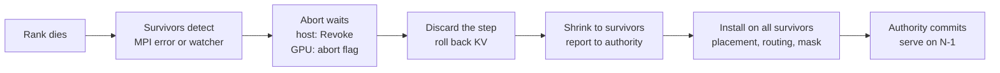

# WideEP fault tolerance: surviving a worker loss

## Summary

**Problem.** A wide expert-parallel (WideEP) deployment spreads one model over 16 to 64 GPUs. If
one worker process dies, the whole job dies today. Restarting takes about 3 minutes plus the
relaunch, and every in-flight request is lost.

**Result.** The surviving ranks keep serving on the CUDA graphs captured at startup. Nothing
reloads, recompiles or recaptures. Requests on surviving ranks continue with the same tokens. Only
the dead rank's own requests fail, with a retryable error.

| DeepSeek-R1 NVFP4, EP32 on 8×4 GB200 | With FT | Without FT |
|---|---|---|
| Kill to first token | 0.16 to 0.34 s | 166 to 213 s startup, plus relaunch |
| Kill to recovery committed | 0.14 s | — |
| Kill to survivors' requests done | 0.8 s idle, 1.4 s mid-decode, 2.6 s mid-MoE | all requests lost |
| Throughput, all ranks alive | −1.4% (14,488 vs 14,689 tok/s) | baseline |
| FT built in but off | 0% (kernels used are instruction-identical to main) | — |
| Throughput per surviving rank after the loss | 99.4% | 0 until restart |
| CUDA graphs recaptured | 0 | all |

**Tested.**
- DeepSeek-R1 and Kimi-K2 at EP32, and R1 at EP16.
- Victims on ranks 1, 2 and 30 (rank 30 on another node).
- Kills while idle, mid-decode, inside the MoE all-to-all (5 repeats), during eager prefill, and
  under full load (248 of 248 survivor requests completed).
- Tokens match a reference run that never used the lost rank. With block reuse on, answers stay
  correct.
- A loss that cannot be covered fails every request with an explicit error within 0.04 s.
- nsys shows every decode all-to-all running inside the original graphs.

**Scope.** One loss of any rank except rank 0, in aggregated serving with attention DP and static
EPLB with spare slots. Block reuse, chunked prefill, eager prefill and KV cache manager V1 and V2
all work. The overlap scheduler, MTP, online EPLB and disaggregated serving are rejected at
startup for now (section 6).

## 1. Background

**WideEP.** Attention runs data-parallel: each GPU serves its own requests. The MoE experts are
spread across GPUs; at EP32, R1's 256 experts sit 8 per GPU, plus a spare slot per GPU. Each MoE
layer runs two NVLinkOneSided kernels around the expert GEMMs. **Dispatch** pushes each token's
data into the buffers of the GPUs that own its experts. **Combine** pulls the expert outputs back
and sums them. The buffers live in symmetric memory that every GPU maps over NVLink. Kernels
signal each other with flags and spin until they see their peers' flags. A dead peer never
signals, so today the survivors spin until a device timeout kills their CUDA context.

**CUDA graphs.** Decode replays graphs captured at startup. A graph bakes in kernel arguments and
memory addresses, but not memory contents. So anything that changes after a loss must be data
that kernels read at run time.

**EPLB.** Expert placement maps each logical expert to physical slots. Static placement never
moves. A spare slot holding a copy of another rank's expert lets routing avoid a dead rank
without moving weights.

**ULFM.** User-Level Failure Mitigation is the fault-tolerance extension of MPI, in Open MPI 5
(`mpirun --with-ft ulfm`) and mpi4py 4. Without it, MPI aborts the job when one process dies.
With it:
- A call that involves a dead process returns `ERR_PROC_FAILED` instead of hanging or aborting.
- `Comm.Revoke()` makes a communicator unusable on every member. Ranks blocked in it, or calling
  it later, get `ERR_REVOKED`. We use it to wake all survivors at once.
- `Comm.Shrink()` runs an agreement among the live members and returns a new communicator without
  the dead ones. Every survivor gets the same membership, even if they noticed the failure at
  different times.
- `Comm.Get_failed()` lists the processes known to be dead.

MPI carries only host control traffic. All MoE data goes over NVLink.

## 2. Design

Rules:
- **Nothing a graph depends on changes.** EP size, rank ids, shapes, buffer layout and addresses
  stay fixed. After a loss we only rewrite small tensors in place: the routing tables, a mask of
  live ranks and an abort flag.
- **A dead rank's late writes cannot corrupt live data.** A process can die with NVLink writes
  still in flight to a peer's buffer.
- **No partial output reaches users.** The interrupted step is thrown away and run again.
- **All survivors switch together.** Only the external authority's Commit changes membership.
- **Every wait is bounded.** Any failure falls back to today's behavior: the job exits.
- **FT off changes nothing.**

**Recovery on each survivor:**
1. **Detect.** A host collective fails with a ULFM error, or the watcher thread fires. It waits on
   an MPI receive that only a process failure completes.
2. **Abort.** Mark the step aborted, set the GPU abort flag, and revoke the host communicators.
3. **Discard.** The commit gate stops the step before its results update any request. After the
   step's GPU work finishes, rollback undoes its KV cache reservations.
4. **Agree.** Call `Shrink` and report `Stopped` to the authority.
5. **Prepare.** On `Propose`, compute the expert placement without the dead rank, check that every
   expert still has a copy, and reply `Ready` with a digest. The authority requires all digests to
   match.
6. **Install.** On `Install`, switch to the survivor communicator, install the placement, check
   device routing, reset the buffers and abort flag, install the mask, and reply `Installed`.
7. **Commit.** On `Commit`, resend responses rank 0 missed, fail the dead rank's requests, restart
   the watcher and resume.

## 3. Components

### 3.1 MoE all-to-all kernels

- **Execution descriptor.** With FT on, dispatch and combine read one small descriptor at a fixed
  address: the live-rank mask and a pointer to the abort flag. Kernels skip masked ranks in every
  wait and load.
- **Abort flag in pinned host memory.** The host sets it with a plain CPU write, which needs no GPU
  work to land. So it reaches spinning kernels that occupy the whole GPU, eager or graph-launched.
  Spin loops exit when it is set, and a real timeout still traps. An aborted combine never marks
  its outputs ready, so no peer reads garbage.
- **Fixed per-source slots, against late writes.** Main lays out dispatch rows as
  `[payload][source][R rows]`, where R is this step's largest token count per rank. When R
  changes, every source's rows move, so a dead rank's late write could land on a live rank's
  rows. FT uses `[source][payload][C rows]` with the fixed C = `max_num_tokens`, so each source's
  region never moves and late writes only hit the dead rank's own rows. Same workspace size.
- **One extra copy.** The fixed slots are not contiguous per payload, so an FT-only gather kernel
  packs the valid rows into the dense layout the expert GEMMs expect. It overlaps with dispatch
  (PDL) and uses 16-byte stores. Invalid rows get expert id −1 and zero data. Combine needs no
  copy, because it pulls.

`MoeExecutionState` owns the descriptor: `request_abort`, `rearm` and `install_mask`.

### 3.2 Host communication and launch

- `MPIDist` runs host collectives on a private copy of `COMM_WORLD`, so revoking it leaves the MPI
  session usable. It adds `revoke`, `shrink`, `install_survivors` and the peer-failure watcher.
- After a loss, gathers keep each result at its original rank index and fill the dead rank's entry
  with a neutral value.
- It requires mpi4py 4, `MPI_THREAD_MULTIPLE` and ULFM enabled at launch.
- Launch with `mpirun --with-ft ulfm --mca pml ob1 --mca btl self,tcp --mca coll ^hcoll,ucc`.
  Under Slurm, run `mpirun` inside the allocation, because Slurm's PMIx launcher kills the whole
  job step when one task dies.
- After a loss, new MPI tasks fail fast, and shutdown ends with a bounded `MPI_Abort`. On multiple
  nodes `mpirun` can outlive the ranks, so the launcher must stop it.

### 3.3 Recovery authority

A small CPU process outside the workers decides. Survivors agreeing over MPI alone does not prove
they can all make progress.
- ZeroMQ messages signed with HMAC, for a trusted network.
- At startup, each worker registers the ranks it can recover from. The authority admits the ranks
  every worker can cover, never rank 0.
- A recovery runs `Stopped` → `Propose` → `Ready` → `Install` → `Installed` → `Commit`. Any
  violation, an uncovered loss, or the 60 s deadline sends `Abort`, and the job exits. Workers
  wait at most 120 s, so losing the authority also fails closed.

### 3.4 Experts and routing

- Static EPLB with spare slots holds copies of other ranks' experts. After a loss, a mask-only
  update points routing at those copies. No weights move.
- `covers_loss_of(rank)` decides which losses are recoverable, at startup and at loss time.
- Attention-DP routing skips absent ranks, so new requests go only to survivors. Requests caught
  mid-broadcast by the loss are re-admitted by rank 0.

### 3.5 Executor

`PeerLossRecovery` (`peer_loss_recovery.py`) with hooks in `py_executor.py`.
- **Commit gate.** Before a step updates any request, the executor syncs the step and checks the
  abort flag. A set flag discards the step, so no partial tokens reach users.
- **Rollback.** KV cache manager V1 frees the step's new sequences without storing their blocks
  for reuse and rewinds generation tokens. V2 reserves blocks during scheduling, so the executor
  records the step there and rollback reverts it. The attention-DP padding request is retired, and
  unscheduled requests stay queued.
- **Prefix caching.** A discarded step's blocks are never offered for reuse. Blocks completed
  before the loss stay valid. The dead rank's cache disappears with it, because each
  attention-DP rank has its own cache.
- **Responses.** Response gathers are numbered, and one interrupted by the loss is resent, along
  with error responses that were waiting for the next flush. Terminations wait for delivery. No
  response is lost or duplicated.
- **Dead rank's requests.** Rank 0 knows which rank owns each request and fails the dead rank's
  requests with a retryable error.
- **Own crash.** If a serving rank's own event loop crashes while the others could recover without
  it, that rank kills only itself, and the others recover.
- **Bounds and checks.** Recovery runs under the hang detector. `create()` rejects unsupported
  configurations at startup.

Enable with `TLLM_FAULT_TOLERANCE_MODE=1` plus the authority address and key.

## 4. Decisions and rejected alternatives

- **Process loss only.** Link or device failures can leave sticky CUDA errors, and an alive but
  unreachable rank must first be fenced. Both come later.
- **Discard and rerun the step.** Correct for paged KV caches. State carried across steps
  (recurrent state, speculative decoding) is rejected for now. Penalties and seeded sampling are
  not rolled back.
- **Fixed slots plus a gather.** A pull-based dispatch would add a round trip per MoE layer and
  rewrite main's hot kernel. Strided expert inputs would change every MoE backend. The gather is
  one on-GPU copy per layer, only with FT on.
- **Run-time descriptor instead of recapture.** Graphs stay valid by construction.
- **Host-memory abort flag.** A host-to-device copy on a side stream never completed while an
  eager kernel spun on every SM. A CPU write to mapped memory always lands.
- **External authority.** A party outside the failure domain commits membership. `Shrink` only
  rebuilds the communicator.
- **Environment variables, not `LlmArgs`,** while the feature is experimental.
- **mpi4py 4.1.2.** It has the ULFM bindings and matches the security-scanning lock file. Its
  executor cannot shut down with a dead member, hence the bounded `MPI_Abort`.

## 5. Results and cost

All times are from the kill. "Done" means every surviving request finished its remaining tokens,
so it also depends on how many tokens were left.

| Run | First token | Committed | Survivors' requests done |
|---|---|---|---|
| R1 EP32, idle kill | 0.16 to 0.34 s | 0.14 s | 0.7 to 1.1 s |
| R1 EP32, mid-decode kill | — | — | 1.4 to 3.1 s |
| R1 EP32, kill inside the MoE all-to-all (7 runs) | — | — | 2.6 to 3.2 s |
| R1 EP32, kill at eager prefill under full load | — | — | 4.2 to 4.6 s (248 of 248) |
| R1 EP32, kill under load with block reuse | — | — | 1.7 s (496 of 496) |
| Kimi-K2 EP32, idle kill | 0.31 to 0.83 s | — | 1.0 to 1.5 s |
| Kimi-K2 EP32, kill inside the MoE all-to-all | — | — | 2.4 to 3.0 s |
| R1 EP16, idle kill / kill inside the MoE all-to-all | 0.29 s | — | 0.9 s / 3.0 s |
| Without FT: fresh job startup to serving | R1 81 to 173 s, Kimi-K2 162 to 231 s | | |

An idle loss is noticed when rank 0 next polls, at most 1 s, which explains the spread in first
token times. Startup without FT varies with the file cache, and it excludes failure detection,
teardown and rescheduling.

| Throughput (R1 EP32, decode, 8 requests per rank) | tok/s |
|---|---|
| FT off, 32 ranks | 14,689 |
| FT on, 32 ranks | 14,488 (−1.4%) |
| FT on, 31 ranks after a loss | 13,960 (99.4% per rank) |

**Cost.** FT off costs nothing: the kernels it uses compile to the same instructions as main. FT
on adds one gather per MoE layer, one sync per step at the commit gate, a watcher thread polling
every 10 ms, and MPI over TCP for host control.

## 6. Limits and next phases

**Rejected at startup:** the overlap scheduler (production WideEP uses it, so it comes first), MTP
and guided decoding, online EPLB, disaggregated serving and KV connectors, LM-head TP in attention
DP, beam search, PEFT, pipeline or context parallelism, encoder-decoder, hybrid and Mamba models,
the CFT all-to-all mode, and the Ray and RPC executors.

**Other limits:** one loss per job; rank 0 must survive; every expert needs a copy on another
rank; the dead rank's requests fail instead of moving; the server keeps reporting "healthy"
during and after a recovery.

**Next:** lift the scheduler, MTP and online-EPLB restrictions. A later phase restores the job to N
ranks by admitting a replacement into the same slot. Later: CFT, Ray, disaggregated serving,
repeated failures, and removing the gather.

## 7. PRs

One commit per PR, in merge order. The first four are standalone fixes.

| # | Commit | PR | Tests and evidence |
|---|---|---|---|
| 1 | [bf3791cb9c](https://github.com/arusli-nv/TensorRT-LLM/commit/bf3791cb9c) | `[fix]` propagate fatal RPC worker errors | unit tests |
| 2 | [b0bb2786ad](https://github.com/arusli-nv/TensorRT-LLM/commit/b0bb2786ad) | `[fix]` bound RPC socket teardown with unreachable peers | unit tests |
| 3 | [6f7331dc5e](https://github.com/arusli-nv/TensorRT-LLM/commit/6f7331dc5e) | `[fix]` skip request updates without a sampling result | unit tests |
| 4 | [82e568a236](https://github.com/arusli-nv/TensorRT-LLM/commit/82e568a236) | `[fix]` keep EPGroupHealth identity across ConfigurableMoE deepcopy | unit test |
| 5 | [200602863d](https://github.com/arusli-nv/TensorRT-LLM/commit/200602863d) | `[infra]` upgrade mpi4py to 4.1.2 | ULFM bindings test; image build |
| 6 | [c989b2bc8a](https://github.com/arusli-nv/TensorRT-LLM/commit/c989b2bc8a) | `[feat]` WideEP recovery authority | fault injection at every protocol step; end-to-end over ZeroMQ |
| 7 | [7de2a38e53](https://github.com/arusli-nv/TensorRT-LLM/commit/7de2a38e53) | `[feat]` ULFM survivor communicators for host collectives | real 4-rank ULFM run; victims on ranks 1, 2 and 30 |
| 8 | [bf6ff93509](https://github.com/arusli-nv/TensorRT-LLM/commit/bf6ff93509) | `[feat]` fault-tolerant execution descriptor for the NVLinkOneSided all-to-all | abort inside graphs; timeout still traps; FT-off kernels instruction-identical |
| 9 | [948efcc0e9](https://github.com/arusli-nv/TensorRT-LLM/commit/948efcc0e9) | `[feat]` MoE execution state for WideEP recovery | eager and graph abort; 2-process SIGKILL late-write test |
| 10 | [c4354a62f5](https://github.com/arusli-nv/TensorRT-LLM/commit/c4354a62f5) | `[feat]` resident-replica EPLB placement after a rank loss | coverage tests; uncovered loss fails closed |
| 11 | [7abbf48a36](https://github.com/arusli-nv/TensorRT-LLM/commit/7abbf48a36) | `[feat]` let attention-DP routing skip absent ranks | unit tests; kill under full load |
| 12 | [68524ed0c1](https://github.com/arusli-nv/TensorRT-LLM/commit/68524ed0c1) | `[feat]` keep the MPI session serving after a peer loss | bounded teardown tests |
| 13 | [80f188e1c7](https://github.com/arusli-nv/TensorRT-LLM/commit/80f188e1c7) | `[feat]` recover the executor from a WideEP peer loss, with the docs page | rollback tests (V1, V2, reuse); 4-GPU CI test; multi-node runs |

The multi-node runs compare tokens with a reference run whose EPLB excludes the victim from the
start, because greedy tokens depend on which rank serves each expert.

## Appendix: mapping to the internal design document (v7)

Each row is one work item of the internal design "WideEP Fault Tolerance in TensorRT-LLM" (v7),
with the commit that implements it and the main code.

### Implemented

| v7 item | Title | Commit | Code | Status |
|---|---|---|---|---|
| 1a.8 | Recoverable execution abort | [8][c8], [4][c4] | [kernels], [op] | done |
| 1a.8a | Backend-mode safety qualification (late writes) | [8][c8], [9][c9] | [kernels], [nvlink] | done, non-CFT |
| 1a.8b | Backend-mode abort/quiescence integration | [9][c9] | [state], [nvlink] | done, non-CFT |
| 1a.11 | Fixed-capacity graph execution | [8][c8] | [kernels], [op] | done |
| 1b.2a | Replica/capacity admission | [10][c10], [6][c6] | [eplb], [authority] | done |
| 1b.4a | Logical/physical mapping foundation | [10][c10] | [eplb] | done for static EPLB |
| 1c.3 | MPI evidence transport | [5][c5], [7][c7] | [communicator] | done (ULFM) |
| 1c.3a | Runtime adapter and survivor-authority contract | [7][c7], [6][c6] | [communicator], [authority] | done |
| 1c.4 | Engine hook | [13][c13], [3][c3] | [recovery], [executor] | done |
| 1c.4a | Survivor-aware management collectives | [7][c7], [11][c11] | [communicator], [adp] | done |
| 1c.4b | Sole recovery coordinator and backend interface | [6][c6] | [authority] | done |
| 1c.4c | Request disposition | [13][c13], [3][c3] | [recovery], [kv] | done |
| 1d.1 | Poisoned lifecycle and public admission policy | [12][c12], [1][c1], [2][c2], [13][c13] | [session], [recovery] | done; env-var gate, not `LlmArgs` |
| 1d.4a | Physical acceptance | [13][c13] | [ci] | done: EP32 R1/Kimi-K2, EP16, EP64 pending |
| 1d.5 | Performance gate | [8][c8], [13][c13] | [docs] | done: −1.4% all-active, 99.4% degraded |

Supporting commits without their own item: [1][c1] and [2][c2] (RPC fatal errors and teardown,
under 1d.1), [3][c3] (absent sample state, under 1c.4c), [4][c4] (shared EPGroupHealth, under 1a.8).

### Not implemented yet
| v7 item | Title | Why |
|---|---|---|
| 1a.6 | TwoSided kernel/binding coverage | MVP uses NVLinkOneSided |
| 1a.7 | NCCL recovery primitives | MVP uses MPI/ULFM |
| 1b.3 | Quiesced EPLB integration | online EPLB rejected at startup |
| 1b.7 | N−K placement and missing experts | uncovered losses fail closed |
| 1c.2 | Per-rank evidence budgets | later |
| 1c.6 | Multi-failure agreement | one loss per job |
| 1d.3 | Health and passive metrics | server keeps reporting healthy |
| 1d.7 | v1 qualification | later |

Merged upstream before this work: 1a.1, 1a.2, 1a.4, 1b.2, 1c.1, 1d.0.

[c1]: https://github.com/arusli-nv/TensorRT-LLM/commit/bf3791cb9c
[c2]: https://github.com/arusli-nv/TensorRT-LLM/commit/b0bb2786ad
[c3]: https://github.com/arusli-nv/TensorRT-LLM/commit/6f7331dc5e
[c4]: https://github.com/arusli-nv/TensorRT-LLM/commit/82e568a236
[c5]: https://github.com/arusli-nv/TensorRT-LLM/commit/200602863d
[c6]: https://github.com/arusli-nv/TensorRT-LLM/commit/c989b2bc8a
[c7]: https://github.com/arusli-nv/TensorRT-LLM/commit/7de2a38e53
[c8]: https://github.com/arusli-nv/TensorRT-LLM/commit/bf6ff93509
[c9]: https://github.com/arusli-nv/TensorRT-LLM/commit/948efcc0e9
[c10]: https://github.com/arusli-nv/TensorRT-LLM/commit/c4354a62f5
[c11]: https://github.com/arusli-nv/TensorRT-LLM/commit/7abbf48a36
[c12]: https://github.com/arusli-nv/TensorRT-LLM/commit/68524ed0c1
[c13]: https://github.com/arusli-nv/TensorRT-LLM/commit/80f188e1c7

[authority]: https://github.com/arusli-nv/TensorRT-LLM/blob/80f188e1c7/tensorrt_llm/executor/recovery/authority.py
[communicator]: https://github.com/arusli-nv/TensorRT-LLM/blob/80f188e1c7/tensorrt_llm/_torch/distributed/communicator.py
[kernels]: https://github.com/arusli-nv/TensorRT-LLM/blob/80f188e1c7/cpp/tensorrt_llm/kernels/moe/communication/moeAlltoAllKernels.cu
[op]: https://github.com/arusli-nv/TensorRT-LLM/blob/80f188e1c7/cpp/tensorrt_llm/thop/moe/communication/moeAlltoAllOp.cpp
[state]: https://github.com/arusli-nv/TensorRT-LLM/blob/80f188e1c7/tensorrt_llm/_torch/moe/fused_moe/communication/execution_state.py
[nvlink]: https://github.com/arusli-nv/TensorRT-LLM/blob/80f188e1c7/tensorrt_llm/_torch/moe/fused_moe/communication/nvlink_one_sided.py
[eplb]: https://github.com/arusli-nv/TensorRT-LLM/blob/80f188e1c7/tensorrt_llm/_torch/moe/fused_moe/moe_load_balancer.py
[adp]: https://github.com/arusli-nv/TensorRT-LLM/blob/80f188e1c7/tensorrt_llm/_torch/pyexecutor/scheduler/adp_router.py
[session]: https://github.com/arusli-nv/TensorRT-LLM/blob/80f188e1c7/tensorrt_llm/llmapi/mpi_session.py
[recovery]: https://github.com/arusli-nv/TensorRT-LLM/blob/80f188e1c7/tensorrt_llm/_torch/pyexecutor/peer_loss_recovery.py
[executor]: https://github.com/arusli-nv/TensorRT-LLM/blob/80f188e1c7/tensorrt_llm/_torch/pyexecutor/py_executor.py
[kv]: https://github.com/arusli-nv/TensorRT-LLM/blob/80f188e1c7/tensorrt_llm/_torch/pyexecutor/resource_manager.py
[docs]: https://github.com/arusli-nv/TensorRT-LLM/blob/80f188e1c7/docs/source/features/wide-ep-fault-tolerance.md
[ci]: https://github.com/arusli-nv/TensorRT-LLM/blob/80f188e1c7/tests/integration/defs/wide_ep_ft/test_peer_loss_recovery.py
