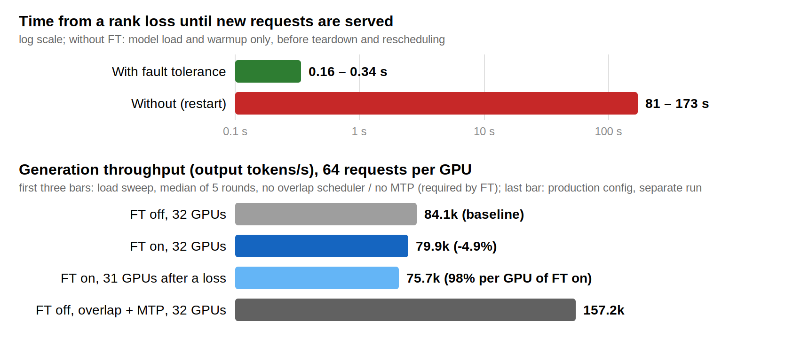
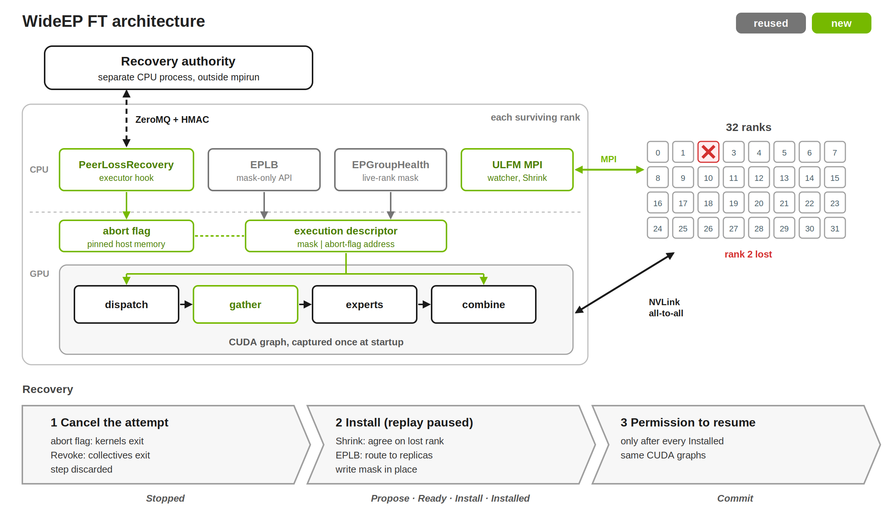
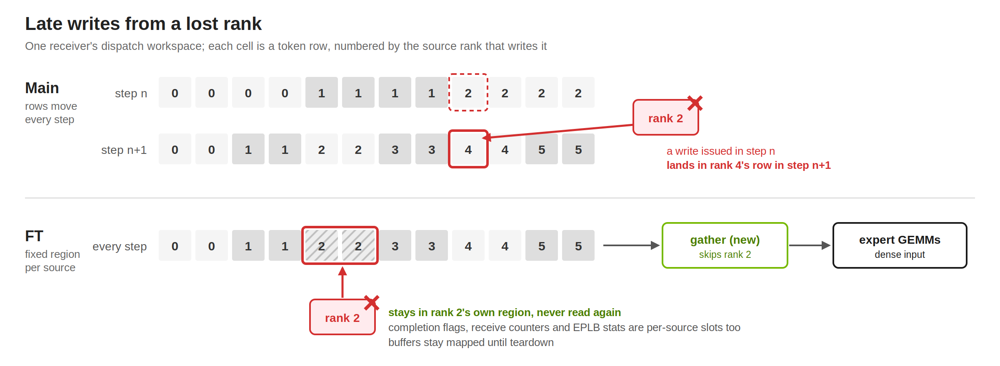

# [WIP] WideEP Fault Tolerance Design Doc

Andrew Rusli | Created: Oct 12, 2026 | Updated: Oct 13, 2026 | Status: Prototyping

## Overview

Today, losing one worker process (rank) of a WideEP job kills the whole job, and a restart takes
minutes. This WideEP Fault Tolerance (FT) MVP is an initial PoC which recovers from the loss of one
rank (except rank 0), provided that rank's experts have replicas on other GPUs, and keeps the
healthy ranks serving.

The surviving ranks use the same CUDA graphs captured at startup and route the lost rank's experts
to their replicas. Survivors' in-flight requests continue from their last token (only the
interrupted step is redone), with correct output. Only the lost rank's own requests fail, because
their KV cache was lost; they end with an explicit error asking the client to retry.

## Background

The WideEP MVP uses Open MPI User Level Failure Mitigation (ULFM), MPI's fault tolerance, which
provides:

- **Error returns:** MPI calls involving a dead process return an error instead of hanging or
  aborting the job.
- **`Comm.Revoke`:** when called by any rank, it makes every pending and future operation on the
  communicator fail with `ERR_REVOKED` on every rank, waking survivors blocked in a collective.
- **`Comm.Shrink`:** builds a new communicator without the dead ranks (identified automatically),
  identical on every survivor. This is a form of survivor agreement.
- **`Comm.Get_failed`:** names the processes that died. Used to tell whether a `BrokenExecutor`
  failure is a peer loss, so the job is not terminated and recovery can run.

## Reused merged foundations

**1a.1 (#13302):** `EPGroupHealth`: process-local rank-health mask and generation.
Used directly as our live-rank mask.

**1a.2 (#13404):** rank masking in the all-to-all kernels, at launch time.
We extend this to run-time masking inside CUDA graphs. The kernel argument is the address of the
execution descriptor in GPU memory, which holds the live-rank mask and the address of an abort flag
in pinned host memory. This lets us reuse captured graphs and rewrite the mask in place between
graph replays.

**1a.3, 1a.4 (#15524):** Python binding for the all-to-all kernels, detection-only
`AlltoAllWatchdog`, and `EPGroupHealth` generation checks in the NVLinkOneSided dispatch/combine
ops.
We reuse the Python bindings, extended with an execution descriptor. The watchdog is not used with
FT (ULFM detects the loss and the abort flag releases kernels). The generation check is redundant,
because the mask only changes while no collective runs (at startup and in recovery's install
phase).

**1b.1, 1b.2 (#15525):** `reconfigure_mask_only` EPLB API (C++ with Python binding); rejects
updates that would leave an expert with no replica, or that arrive during an active or queued
forward iteration.
We use it in recovery's install phase, while serving is paused. Each survivor calls it with the
lost rank, changing routing before the new live-rank mask is written and kernels start ignoring
the dead rank.

**1c.1 (#15677):** adds EP error patterns (GPU fallen off the bus, CUDA context destroyed, MPI rank
terminated, all-to-all timeouts, etc.) to main's fatal-error classifier from #12718. A message
containing one of those strings is classified as fatal/severe instead of transient.
Kept. We use it for a rank's own fatal errors, and with FT that rank ends alone. Peer losses bypass
it and go straight to recovery. This is a local per-rank decision; agreeing on which rank was lost
is done separately by ULFM Shrink and the recovery authority.

**1d.0 (#14160):** with FT on, a crashing rank's signal handler ends only that rank (`_exit`),
instead of aborting every rank and killing the launcher (`mpirun`).
Used. It is why other ranks survive a rank crash; we add launcher survival (the job is not torn
down) by running under `mpirun --with-ft ulfm`, confirmed in multi-node kill runs.

## New contributions

Branch: [main...wideep-ft](https://github.com/NVIDIA/TensorRT-LLM/compare/main...arusli-nv:TensorRT-LLM:wideep-ft).
One commit per PR, in merge order.

#### 1. prerequisite (1a.8): [fix] keep EPGroupHealth identity across ConfigurableMoE deepcopy ([84fc6524bd](https://github.com/arusli-nv/TensorRT-LLM/commit/84fc6524bd))

When a layer passes `override_quant_config`, `ConfigurableMoE` deepcopies `model_config`, which
contains `EPGroupHealth` (shared by all layers). We override `__deepcopy__` to return `self`.
Without this, layers with a quant override hold their own copy, so a rank-health update never
reaches them. The same fix is in draft #15788 (1d.3, EP health metrics).

#### 2. 1c.3: [infra] upgrade mpi4py to 4.1.2 for ULFM fault tolerance ([efc083e9d3](https://github.com/arusli-nv/TensorRT-LLM/commit/efc083e9d3))

Moves the `TRTLLM_USE_MPI_KVCACHE` patch to mpi4py 4's file layout (behavior unchanged) and removes
two 3.1.5-only build workarounds. 4.1.2 is already the version declared and scanned in
`security_scanning`.
Takes effect after the CI image is rebuilt; until `current_image_tags.properties` is updated, CI
stays on 3.1.5 and the ULFM tests skip.

#### 3. 1c.4b, 1c.3a, 1b.2a: [feat] add an external recovery authority for WideEP peer loss ([7954af7253](https://github.com/arusli-nv/TensorRT-LLM/commit/7954af7253))

A separate CPU process, outside the workers' launch and termination groups so it survives any
worker's death. It decides whether and how survivors continue after a worker dies. It uses ZeroMQ
messages because MPI is broken mid-recovery, signed with HMAC-SHA256 using a key shared by the
authority and workers, so only the deployment's own processes can affect recovery.

- **Startup admission:** each worker sends `Register` (its rank and the ranks whose loss the expert
  placement can cover). All workers must report the same ranks, otherwise registration aborts. The
  authority admits them (never rank 0) and replies with `Registered`.
- **Recovery:**
  - `Stopped`: each survivor has paused and names the dead rank.
  - `Propose`: the authority assigns a new generation and lists the survivors.
  - `Ready`: survivors send a digest of their new expert routing; all must match.
  - `Install`: the authority tells survivors to switch to the survivor communicator and write the
    new rank mask and routing.
  - `Installed`: each survivor confirms.
  - `Commit`: everyone resumes together, so nobody runs with the old state.
- **Fails closed:** any violation, disagreement, timeout (60 s) or unreachable authority sends
  `Abort` to every worker, and the job ends as it does today.
- **Limits:** one recovery per deployment (repeated failures are 1c.6, beyond the MVP).

#### 4. 1c.3, 1c.3a, 1c.4a: [feat] ULFM survivor communicators for host collectives ([1fd4629c5c](https://github.com/arusli-nv/TensorRT-LLM/commit/1fd4629c5c))

Makes the executor's CPU-side MPI collectives survive a peer loss using ULFM. Uses a private copy of
`COMM_WORLD`, so revoking it doesn't break other users of `COMM_WORLD`, such as the MPI session.

- **Detect (1c.3):** a background watch thread notices a peer death even while the rank is busy on
  the GPU.
- **Unblock and agree (1c.3a):** Revoke wakes survivors stuck in a collective. Shrink makes them
  agree on the dead rank and builds a survivor communicator, which is switched to only at the
  authority's `Install`.
- **Survivor-aware collectives (1c.4a):** rank numbers stay the same after a loss and gathers return
  an empty entry for the dead rank, so survivors are never renumbered (same CUDA graphs).
- **Limits:** pure attention DP only; requires launching with `mpirun --with-ft ulfm`; a second loss
  is not recoverable.

#### 5. 1a.8, 1a.8a, 1a.11: [feat] add a run-time rank mask and abort to the NVLinkOneSided all-to-all ([d6f44ab1d7](https://github.com/arusli-nv/TensorRT-LLM/commit/d6f44ab1d7))

Kernels take the address of a fixed execution descriptor in GPU memory: a live-rank mask plus a
pointer to an abort record in pinned host memory. Captured CUDA graphs therefore see mask changes
made in place, and a CPU write releases kernels spinning on a dead peer instead of trapping.
Each sender writes to a fixed per-source slot, so a dead or late sender can only corrupt its own
slot. A new gather kernel compacts the slots and blanks inactive or aborted rows. Without a
descriptor the kernels run unchanged (FT-off SASS is identical to main). Details and benchmarks in
[Late writes](#late-writes-symmetric-memory-and-kernel-design-commits-5-and-6).

#### 6. 1a.8a, 1a.8b: [feat] bind MoE layers to the all-to-all execution descriptor for recovery ([300b5218ef](https://github.com/arusli-nv/TensorRT-LLM/commit/300b5218ef))

Adds `MoeExecutionState`: one execution descriptor per model, bound to the NVLinkOneSided object of
every MoE layer before CUDA-graph capture (requires one shared `EPGroupHealth`, see commit 1).
Recovery controls it with:

- `request_abort()`: sets a flag in pinned host memory that every waiting kernel polls, so kernels
  stuck on the dead peer return early, the rest of the step runs without waiting, and its invalid
  output is discarded and redone after recovery.
- `rearm()`: once all survivors are quiet, resets each workspace's round counter and flags and
  clears the abort record, so the redone step starts in sync.
- `install_mask()`: writes the new mask in place.

All-to-all buffers stay mapped for the model's lifetime, so the addresses captured in CUDA graphs
stay valid. Since kernels now read the mask from the descriptor, rank-mask mode allows CUDA graphs
when FT is on (previously rejected).

#### 7. 1b.2a, 1b.4a: [feat] route a lost rank's experts to their replicas after a peer loss ([f6c4a211da](https://github.com/arusli-nv/TensorRT-LLM/commit/f6c4a211da))

Uses main's mask-only EPLB API (#15525) to route a lost rank's experts to replicas already resident
on other GPUs: no weights move, and graphs are untouched.

- **Admission (1b.2a):** `covers_loss_of(rank)` checks whether every expert in every MoE layer keeps
  a copy if that rank is lost. Each worker asks this for every rank (except 0) to build the
  `recoverable_ranks` list it sends in `Register`.
- **Agreement:** `masked_placement_digest()` hashes every layer's placement with the dead rank
  cleared. This is the digest in `Ready`, so all survivors route identically.
- **Install (1b.4a):** at `Install`, `install_resident_placement()` reroutes first, then marks the
  rank failed, rearms, and writes the mask. Routing must exclude the rank before the mask hides it,
  or kernels would silently drop its tokens.

#### 8. 1b.4a, 1c.4a: [feat] let attention-DP routing skip absent ranks ([e78147290b](https://github.com/arusli-nv/TensorRT-LLM/commit/e78147290b))

Every iteration, the attention-DP scheduler runs a host allgather of each rank's state (its active
requests and tokens) to decide where new requests go. After a loss, that list has an empty entry
for the dead rank. ADP routing now drops it and stores per-rank counts by rank number (a dict
instead of a list), so no live rank's count shifts to another rank's position.

- New requests go only to live ranks. One strictly pinned to the dead rank gets an explicit error
  instead of waiting forever.
- Admission capacity counts only live ranks, so it never admits more requests than they can hold.
- Each step, ranks vote on whether to use CUDA graphs and which batch size to pad to; only live
  ranks vote, so the dead rank's empty entry can't force survivors out of their graphs.
- With all ranks present, behavior is unchanged.

#### 9. 1d.1: [feat] keep the MPI session serving after a peer loss ([d98a04e25e](https://github.com/arusli-nv/TensorRT-LLM/commit/d98a04e25e))

With FT on, the MPI session server on rank 0 treats a dead rank's task failure (a ULFM peer-failure
error, or `BrokenExecutor` once ULFM reports a failed rank) as a departed peer, not a job failure,
so the session doesn't tear down the survivors.

- The CPU-side MPI barriers at task end and at the load balancer's shutdown (between ranks of one
  node, around shared host memory) tolerate the dead rank. Previously they could hang or error when
  the recovered job shuts down.
- After a loss, new requests are served normally. Only the MPI session's task mechanism (running a
  function on every rank, used at startup and teardown) can't be used, so new task commands fail
  fast and only shutdown is honored.
- Shutdown ends the world with `MPI_Abort(0)`, because mpi4py.futures can't release a world that
  lost a rank.
- Without FT, nothing changes.

#### 10. 1c.4c: [feat] roll back KV Cache Manager V2 allocations of a discarded step ([f1bb11d9dd](https://github.com/arusli-nv/TensorRT-LLM/commit/f1bb11d9dd))

Adds `revert_prepare_resources()`, which undoes the KV-cache space the scheduler reserved for a step
whose forward is discarded (the step interrupted by a peer loss), so its redo after recovery starts
from the same state:

- new requests free their blocks (never committed for reuse);
- later prompt chunks shrink back to their previous capacity;
- generating requests give back the step's tokens.

The discarded step's KV writes are overwritten by the redo. KV Cache Manager V2 only.
Recurrent-state (linear attention) and sparse-attention managers are rejected at startup; a
discarded step can't be undone for them by freeing blocks.

#### 11. 1c.4, 1c.4c, 1d.1, 1d.4a: [feat] recover the executor from a WideEP peer loss ([a4efd09919](https://github.com/arusli-nv/TensorRT-LLM/commit/a4efd09919))

Adds `PeerLossRecovery`, which hooks into `PyExecutor` and runs the recovery using commits 3–10. At
startup it validates the configuration and registers with the authority.

- **Detect and stop:** the watcher sets a flag, aborts MoE collectives and revokes host
  communicators; the step in flight is discarded, not committed.
- **Recover:**
  - Shrink to agree on the dead rank.
  - Wait for the GPU and roll back the step's KV allocations.
  - Authority handshake: `Stopped` → `Propose` → `Ready` (digest) → `Install` (survivor
    communicator, resident placement, rearm, mask) → `Installed` → `Commit`.
- **Requests (1c.4c):** responses lost in an interrupted gather are redelivered. The dead rank's
  requests fail with an explicit retry error. Requests cut off mid-broadcast are re-admitted.
- **Resume** on the CUDA graphs captured at startup. If the recovery itself can't complete
  (`Abort`, a timeout, more than one dead rank), survivors shut down as they would without FT; the
  hang detector bounds a stuck recovery.
- Adds a 4-GPU integration test (1d.4a). The user doc lands as a separate docs PR (draft:
  [wide-ep-fault-tolerance.md](wide-ep-fault-tolerance.md)).

## Related draft PRs

**1c.3 (#15785):** MPI failure-evidence transport. Spreads "rank R looks dead" across ranks on its
own communicator.
Not used yet; our ULFM watch thread plays this role. It can plug in later as the detector: it
reports the dead rank, and the recovery authority still makes the only decision. The two never
share a communicator.

**1a.8 (#15895):** cooperative all-to-all abort. Lets kernels waiting on a dead peer return instead
of trapping.
Same goal as commit 5, but the abort epoch is a kernel argument, which CUDA graphs freeze, so it
can't run under graphs. We keep our descriptor and can port its failure diagnostics (phase, reason,
waiting peer).

**1a.7 (#15789):** NCCL abort and survivor rebuild.
Not needed: the MVP uses MPI and the NVLink all-to-all, not NCCL.

**1d.3 (#15788):** EP rank-health metrics.
Not needed for the MVP; it contains the same `EPGroupHealth` deepcopy fix as commit 1.

## Validated configurations

- **Configurations:** DeepSeek-R1 NVFP4 on 16, 32 and 64 GB200 GPUs; Kimi-K2 NVFP4 on 32.
  Attention DP, static EPLB with redundant experts, NVLinkOneSided fence path, CUTEDSL MoE, decode
  CUDA graphs, non-overlap scheduler, KV Cache Manager V2.
- **Failures:** SIGKILL of one rank (1, 2, 30 or 62, including ranks on other nodes), killed while
  idle, generating, inside the MoE all-to-all, during prefill and under full load. A rank without
  expert coverage fails closed.
- **Tests:** CPU and GPU unit tests; a 4-GPU integration test (DeepSeek-V3-Lite, kill idle and
  mid-step).

**Results (DeepSeek-R1 NVFP4, 32 GB200 GPUs):**

| Rank killed while… | Result |
|---|---|
| no requests run (idle) | serving again after 0.16–0.34 s (restart without FT: 81–173 s) |
| requests generate tokens | all finish within 1.4–3.1 s |
| GPUs run the MoE all-to-all | all finish within 2.6–3.2 s |
| prefill, full load | 248 of 248 finish within 4.6 s |
| its experts have no copy elsewhere | every request fails with an explicit error within 0.04 s |

- Survivors' tokens match a reference run that never used the lost rank, and all decode steps stay
  in the original CUDA graphs (Nsight Systems: no graph captures after the kill).
- FT overhead vs FT off with the same config: −2.4% (8 requests per GPU), −3.7% (64 per GPU),
  mostly the new gather kernel (about half of the added MoE-layer time at 8 requests per GPU,
  about 80% at 64; see [Benchmarks](#benchmarks)).
- After a loss, the 31 remaining GPUs serve 75.8k tok/s, 98% of their per-GPU throughput before
  the loss.
- With the overlap scheduler and MTP (production config, not yet supported with FT), the same 32
  GPUs reach 157k tok/s.

## Remaining qualifications

- **Production config:** the overlap scheduler and MTP aren't supported with FT. This is the
  largest gap: 157k tok/s without FT versus 80k with FT on the same 32 GPUs. Online EPLB (1b.3)
  isn't supported either.
- **1c.3a live-rank fencing:** only process death is recovered. A hung or unreachable rank ends the
  job after the hang detector's 300 s timeout (needs live-rank fencing, plus 1c.2 and 1c.3 for
  suspicion).
- **Model coverage:** KV Cache Manager V2 only. Recurrent-state (e.g. Kimi K3) and sparse-attention
  models are rejected at startup; sliding-window attention is unvalidated. Greedy sampling is
  expected: penalties, seeded sampling and multi-token stop words aren't rolled back with a
  discarded step.
- **Kernel cost:** the gather kernel adds 4–14 µs per MoE layer; fusing or removing it is open.
- **CI:** needs an image with mpi4py 4.1.2; until then the ULFM tests skip. x86 is unverified (only
  aarch64 was available).
- **Follow-ups:** CFT (needs the R615 driver), Ray, disaggregated serving, repeated failures (1c.6),
  restore to N ranks, health reporting (1d.3).

## MVP Architecture

Top: the components of each surviving rank and how they connect (ZeroMQ to the authority, MPI and
NVLink to the other ranks). Bottom: the three recovery phases (attempt cancellation, routing/mask
installation, permission to resume) and the authority messages of each. Survivors install while
graph replay is paused, and resume only after `Commit`, which the authority sends after every
survivor has sent `Installed`. #15785 can later
replace the watcher as the detector; the authority stays the only decision-maker.

### Safety features

- **Resume only on permission:** survivors resume only after `Commit` for their generation, and
  only after every survivor reported `Installed` with the same placement digest.
- **Cancellation reaches spinning kernels:** a CPU write to pinned host memory needs no GPU work, so
  it reaches kernels that occupy the whole GPU.
- **No garbage data:** rows from masked ranks or an aborted step reach the expert GEMMs as expert
  id −1 with zero data. An aborted combine never marks its output ready.
- **No partial output:** the interrupted step is discarded before it updates any request. Its KV
  reservations are rolled back and its blocks are never offered for reuse.
- **No lost or duplicated responses:** responses from an interrupted gather are resent.
- **Own crash:** an admitted rank whose own loop crashes exits alone, so the survivors recover.
- **Bounded and fail-closed:** every wait has a deadline. An uncovered loss, a second loss, rank 0's
  loss or any recovery failure ends the job with an explicit error.

### Late writes: symmetric memory and kernel design (commits 5 and 6)

A rank can die with writes still in flight into peers' workspaces. The hazard is main's
runtime-dependent layout, not rank renumbering: main sizes each source's rows by the step's
`runtime_max_tokens_per_rank`, so rows move between steps, and a late write can land in a
survivor's rows. With FT, each source writes into a fixed region sized by `max_num_tokens_per_rank`.
Only the payload layout changes: the receive counters, completion flags and EPLB stats are separate
arrays that already have one fixed slot per source on main. So everything a dead rank writes
(payloads, flags, counters, EPLB stats) stays in storage indexed by that rank, which later
execution neither reads nor reassigns. Workspaces stay mapped until
teardown, so the backing memory stays valid.

- **Kernels (commit 5):** dispatch and combine read the descriptor, skip masked ranks in every wait
  and load, and exit spin loops on abort. A new gather kernel packs valid rows into the dense GEMM
  input. With FT off, the kernels are instruction-identical to main.
- **Model binding (commit 6):** the workspace is sized for the fixed regions and kept mapped for the
  model's lifetime.
- **Verified:** a 2-process test kills a rank mid-dispatch at three timings. Every byte outside the
  dead rank's regions is unchanged, and masked execution continues correctly.
- **Alternatives rejected:** a pull-based dispatch (a round trip per MoE layer, plus a rewrite of
  main's hot kernel); strided expert inputs (would change every MoE backend).

#### Benchmarks

R1 NVFP4, 32 GB200 GPUs; Nsight Systems on one rank (job `kbench-7900025`); medians per MoE layer
over about 142k layer executions from CUDA graphs. Sanitize and gather launch with PDL and start
while dispatch is still running, so their column is the time they add after dispatch ends.

| | Dispatch | Combine | Sanitize (off) / Gather (on), after dispatch | MoE-layer span |
|---|---|---|---|---|
| FT off, 8 req/GPU | 13.4 µs | 34.1 µs | 1.7 µs | 82.0 µs |
| FT on, 8 req/GPU | 14.6 µs | 35.8 µs | 5.1 µs | 88.6 µs (+8%) |
| FT off, 64 req/GPU | 15.2 µs | 41.3 µs | 1.7 µs | 126.0 µs |
| FT on, 64 req/GPU | 16.4 µs | 42.7 µs | 16.6 µs | 144.8 µs (+15%) |

- Dispatch and combine changes cost 1–2 µs each (descriptor read, mask checks).
- The gather is the main cost and grows with batch: +3.4 µs at 8 requests per GPU and +14.9 µs at
  64, because it copies every row where main's sanitize only marks invalid expert ids in place.
- End to end, that is −2.4% / −3.7% throughput. A cheaper gather (copy only received rows) or
  fusing it into dispatch is the main optimization left.
