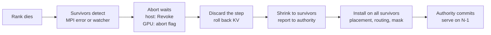

# WideEP fault tolerance: surviving a worker loss

## Summary

A wide expert-parallel (WideEP) deployment spreads one model over 16 to 64 GPUs, one worker
process (rank) per GPU. Today, if one rank dies, the whole job dies: a restart takes minutes and
every in-flight request is lost.

With fault tolerance (FT) on, the surviving ranks keep serving on the CUDA graphs they captured at
startup. Nothing reloads, recompiles or recaptures. Requests on surviving ranks continue with the
same tokens; only the requests the lost rank was serving fail, with a retryable error.

| DeepSeek-R1 NVFP4 on 32 GB200 GPUs | With FT | Without FT |
|---|---|---|
| Kill until new requests are served | 0.16 to 0.34 s | restart: 81 to 173 s of load and warmup, plus teardown and rescheduling |
| Kill until in-flight requests finish | 0.8 to 3.2 s | never: they are lost |
| Throughput with all 32 GPUs | −1.4% (14,488 vs 14,689 tokens/s) | baseline |
| Throughput per GPU after losing one | 99.4% | 0 until the restart finishes |
| FT built in but turned off | no change | — |

Tested on DeepSeek-R1 and Kimi-K2 at 32 GPUs and R1 at 16, killing different ranks at every stage
of a step (section 4). The current scope is one loss, of any rank but rank 0, with attention data
parallelism and static expert placement; section 5 lists what is not supported yet.

## 1. Background

**WideEP.** Attention runs data-parallel: each GPU serves its own requests. MoE experts are spread
across GPUs. Each MoE layer runs two NVLinkOneSided all-to-all kernels: **dispatch** pushes each
token into the buffers of the GPUs that own its experts, and **combine** pulls the expert outputs
back. Kernels signal each other with flags over NVLink and spin until they see their peers'
flags, so a dead peer leaves the survivors spinning until a device timeout kills their CUDA
context.

**CUDA graphs** bake in kernel arguments and memory addresses, not memory contents. Anything that
changes after a loss must therefore be data the kernels read at run time.

**Expert placement (EPLB)** maps each expert to physical slots. With static placement and spare
slots, other ranks can hold copies of a rank's experts, so routing can avoid a dead rank without
moving weights.

**ULFM** (User-Level Failure Mitigation) is MPI's fault-tolerance extension, in Open MPI 5 and
mpi4py 4. Without it, MPI aborts the whole job when one process dies. With it:
- a call that involves a dead process returns an error instead of hanging or aborting;
- `Comm.Revoke()` makes a communicator fail on every member, which wakes ranks blocked in it;
- `Comm.Shrink()` agrees on the live members and returns a communicator without the dead ones,
  identical on every survivor;
- `Comm.Get_failed()` names the dead processes.

MPI carries only host control traffic; MoE data goes over NVLink.

## 2. Design

Principles: nothing a captured graph depends on changes; a dead rank's in-flight writes cannot
corrupt live data; no partial output reaches users; all survivors switch together; every wait is
bounded, and any failure falls back to today's behavior, ending the job.

### 2.1 MoE all-to-all kernels

- **Execution descriptor.** With FT on, dispatch and combine read one small tensor at a fixed
  address: a mask of live ranks and a pointer to an abort flag. Kernels skip masked ranks. After a
  loss only this tensor and the routing tables are rewritten, in place, so the graphs keep
  running.
- **Abort flag in pinned host memory.** The host sets it with a plain CPU write, which reaches
  spinning kernels even when they occupy the whole GPU. Spin loops then exit, and an aborted
  combine never marks its outputs ready. A real timeout still traps.
- **Fixed slots against late writes.** A process can die with NVLink writes still in flight. Main
  places each source rank's rows by this step's largest token count, so the rows move from step to
  step and a late write could land on a live rank's rows. FT gives each source a fixed slot sized
  by `max_num_tokens`, so late writes only hit the dead rank's own slot. The workspace size is the
  same.
- **One extra copy.** Fixed slots are not contiguous, so an FT-only gather kernel packs the valid
  rows into the dense layout the expert GEMMs expect, overlapped with dispatch. Combine needs no
  copy because it pulls.

### 2.2 Membership and coordination

- **Host collectives** run on a private copy of `COMM_WORLD`. After a loss, survivors revoke it,
  shrink to a survivor communicator, and keep each gather result at its original rank index.
- **A watcher thread** detects a loss even while no collective is running.
- **The recovery authority** is a small CPU process outside the workers, because survivors
  agreeing over MPI does not prove they can all make progress. Over HMAC-signed ZeroMQ it admits
  the recoverable ranks at startup and runs each recovery as Stopped → Propose → Ready (placement
  digests must match) → Install → Installed → Commit. Anything unexpected, or its 60 s deadline,
  aborts the job; if the authority itself dies, workers time out and the job ends.
- **Routing.** A mask-only EPLB update points the dead rank's experts at their copies, and
  attention-DP routing sends new requests only to survivors.

Launch and configuration are in the user docs, `docs/source/features/wide-ep-fault-tolerance.md`.

### 2.3 Requests and KV cache

- **Commit gate.** Before a step updates any request, the executor checks the abort flag. An
  aborted step is discarded and run again, so no partial tokens reach users.
- **Rollback.** After the step's GPU work finishes, its KV cache reservations are undone (KV cache
  managers V1 and V2).
- **Prefix caching.** Blocks of a discarded step are never offered for reuse. Blocks finished
  before the loss stay valid, and the dead rank's cache disappears with it.
- **Responses.** A response gather interrupted by the loss is resent, so nothing is lost or
  duplicated. The dead rank's requests fail with a retryable error.
- **Own crash.** A rank whose own event loop crashes while the others can recover exits alone.

## 3. Decisions and rejected alternatives

- **Process loss only.** Link or device failures can leave sticky CUDA errors, and an alive but
  unreachable rank must first be fenced.
- **Discard and rerun the step**, rather than salvaging it. Penalties and seeded sampling are not
  rolled back.
- **Fixed slots plus a gather**, rather than a pull-based dispatch (a round trip per MoE layer and
  a rewrite of main's hot kernel) or strided expert inputs (a change to every MoE backend).
- **A run-time descriptor rather than recapturing graphs**, so graphs stay valid by construction.
- **A host-memory abort flag**, because a host-to-device copy never completed while a kernel
  launched outside a graph occupied the whole GPU.
- **Environment variables, not `LlmArgs`**, while the feature is experimental.

FT off costs nothing: the kernels it uses compile to the same instructions as main. FT on adds the
gather per MoE layer, one sync per step at the commit gate, and a watcher thread.

## 4. Results

Each run kills one rank at the moment in the first column. "New requests served" is the first
token of a request sent after the kill; "in-flight requests finished" is when every request on a
surviving rank completed its remaining tokens.

| Model, GPUs, when the rank is killed | New requests served | In-flight requests finished |
|---|---|---|
| R1, 32, no requests running | 0.16 to 0.34 s | 0.7 to 1.1 s |
| R1, 32, while requests generate tokens | — | 1.4 to 3.1 s |
| R1, 32, during the MoE all-to-all (7 runs) | — | 2.6 to 3.2 s |
| R1, 32, while new prompts are processed, full load | — | 4.2 to 4.6 s (248 of 248) |
| R1, 32, full load with prefix caching | — | 1.7 s (496 of 496) |
| Kimi-K2, 32, no requests running | 0.31 to 0.83 s | 1.0 to 1.5 s |
| Kimi-K2, 32, during the MoE all-to-all | — | 2.4 to 3.0 s |
| R1, 16, no requests running / during the MoE all-to-all | 0.29 s | 0.9 s / 3.0 s |

Tokens match a reference run that never used the lost rank (with prefix caching on, answers are
checked instead). Ranks 1, 2 and 30 were killed, including one on another node. A loss that no
copy covers fails every request with an explicit error within 0.04 s. An nsys trace shows every
decode all-to-all running inside the original graphs. Recovery itself, from the kill until every
survivor resumed, took 0.14 s; when no requests run, the loss is noticed at rank 0's next poll,
within 1 s.

## 5. Limits and next steps

**Not supported yet** (rejected at startup): the overlap scheduler, MTP and guided decoding,
online EPLB, disaggregated serving and KV connectors, LM-head TP in attention DP, beam search,
PEFT, pipeline or context parallelism, encoder-decoder, hybrid and Mamba models, the CFT
all-to-all mode, and the Ray and RPC executors. Production WideEP uses the overlap scheduler and
MTP, so those come first.

**Other limits:** one loss per job; rank 0 must survive; every expert needs a copy on another
rank; the dead rank's requests fail rather than move; the server keeps reporting "healthy".

**Next:** lift the scheduler, MTP and online-EPLB restrictions, then restore the job to full size
by admitting a replacement rank into the same slot.

## 6. PRs

One commit per PR, in merge order. The first four are standalone fixes.

| # | Commit | PR | Tests and evidence |
|---|---|---|---|
| 1 | [bf3791cb9c](https://github.com/arusli-nv/TensorRT-LLM/commit/bf3791cb9c) | `[fix]` propagate fatal RPC worker errors | unit tests |
| 2 | [b0bb2786ad](https://github.com/arusli-nv/TensorRT-LLM/commit/b0bb2786ad) | `[fix]` bound RPC socket teardown with unreachable peers | unit tests |
| 3 | [6f7331dc5e](https://github.com/arusli-nv/TensorRT-LLM/commit/6f7331dc5e) | `[fix]` skip request updates without a sampling result | unit tests |
| 4 | [82e568a236](https://github.com/arusli-nv/TensorRT-LLM/commit/82e568a236) | `[fix]` keep EPGroupHealth identity across ConfigurableMoE deepcopy | unit test |
| 5 | [200602863d](https://github.com/arusli-nv/TensorRT-LLM/commit/200602863d) | `[infra]` upgrade mpi4py to 4.1.2 | ULFM bindings test; image build |
| 6 | [c989b2bc8a](https://github.com/arusli-nv/TensorRT-LLM/commit/c989b2bc8a) | `[feat]` WideEP recovery authority | fault injection at every protocol step; end-to-end over ZeroMQ |
| 7 | [7de2a38e53](https://github.com/arusli-nv/TensorRT-LLM/commit/7de2a38e53) | `[feat]` ULFM survivor communicators for host collectives | real 4-rank ULFM run; losing rank 1, 2 or 30 |
| 8 | [bf6ff93509](https://github.com/arusli-nv/TensorRT-LLM/commit/bf6ff93509) | `[feat]` fault-tolerant execution descriptor for the NVLinkOneSided all-to-all | abort inside graphs; timeout still traps; FT-off kernels instruction-identical |
| 9 | [948efcc0e9](https://github.com/arusli-nv/TensorRT-LLM/commit/948efcc0e9) | `[feat]` MoE execution state for WideEP recovery | abort with and without CUDA graphs; 2-process SIGKILL late-write test |
| 10 | [c4354a62f5](https://github.com/arusli-nv/TensorRT-LLM/commit/c4354a62f5) | `[feat]` resident-replica EPLB placement after a rank loss | coverage tests; uncovered loss fails closed |
| 11 | [7abbf48a36](https://github.com/arusli-nv/TensorRT-LLM/commit/7abbf48a36) | `[feat]` let attention-DP routing skip absent ranks | unit tests; kill under full load |
| 12 | [68524ed0c1](https://github.com/arusli-nv/TensorRT-LLM/commit/68524ed0c1) | `[feat]` keep the MPI session serving after a peer loss | bounded teardown tests |
| 13 | [80f188e1c7](https://github.com/arusli-nv/TensorRT-LLM/commit/80f188e1c7) | `[feat]` recover the executor from a WideEP peer loss, with the docs page | rollback tests (V1, V2, reuse); 4-GPU CI test; multi-node runs |

The multi-node runs compare tokens with a reference run whose EPLB excludes the killed rank from the
start, because greedy tokens depend on which rank serves each expert.

## Appendix: mapping to the internal design document (v7)

Each row is one work item of the internal design "WideEP Fault Tolerance in TensorRT-LLM" (v7),
with the commit that implements it and the main code.

### Implemented

| v7 item | Title | Commit | Code | Status |
|---|---|---|---|---|
| 1a.8 | Recoverable execution abort | [8][c8], [4][c4] | [kernels], [op] | done |
| 1a.8a | Backend-mode safety qualification (late writes) | [8][c8], [9][c9] | [kernels], [nvlink] | done, non-CFT |
| 1a.8b | Backend-mode abort/quiescence integration | [9][c9] | [state], [nvlink] | done, non-CFT |
| 1a.11 | Fixed-capacity graph execution | [8][c8] | [kernels], [op] | done |
| 1b.2a | Replica/capacity admission | [10][c10], [6][c6] | [eplb], [authority] | done |
| 1b.4a | Logical/physical mapping foundation | [10][c10] | [eplb] | done for static EPLB |
| 1c.3 | MPI evidence transport | [5][c5], [7][c7] | [communicator] | done (ULFM) |
| 1c.3a | Runtime adapter and survivor-authority contract | [7][c7], [6][c6] | [communicator], [authority] | done |
| 1c.4 | Engine hook | [13][c13], [3][c3] | [recovery], [executor] | done |
| 1c.4a | Survivor-aware management collectives | [7][c7], [11][c11] | [communicator], [adp] | done |
| 1c.4b | Sole recovery coordinator and backend interface | [6][c6] | [authority] | done |
| 1c.4c | Request disposition | [13][c13], [3][c3] | [recovery], [kv] | done |
| 1d.1 | Poisoned lifecycle and public admission policy | [12][c12], [1][c1], [2][c2], [13][c13] | [session], [recovery] | done; env-var gate, not `LlmArgs` |
| 1d.4a | Physical acceptance | [13][c13] | [ci] | done: EP32 R1/Kimi-K2, EP16, EP64 pending |
| 1d.5 | Performance gate | [8][c8], [13][c13] | [docs] | done: −1.4% all-active, 99.4% degraded |

Supporting commits without their own item: [1][c1] and [2][c2] (RPC fatal errors and teardown,
under 1d.1), [3][c3] (absent sample state, under 1c.4c), [4][c4] (shared EPGroupHealth, under 1a.8).

### Not implemented yet
| v7 item | Title | Why |
|---|---|---|
| 1a.6 | TwoSided kernel/binding coverage | MVP uses NVLinkOneSided |
| 1a.7 | NCCL recovery primitives | MVP uses MPI/ULFM |
| 1b.3 | Quiesced EPLB integration | online EPLB rejected at startup |
| 1b.7 | N−K placement and missing experts | uncovered losses fail closed |
| 1c.2 | Per-rank evidence budgets | later |
| 1c.6 | Multi-failure agreement | one loss per job |
| 1d.3 | Health and passive metrics | server keeps reporting healthy |
| 1d.7 | v1 qualification | later |

Merged upstream before this work: 1a.1, 1a.2, 1a.4, 1b.2, 1c.1, 1d.0.

[c1]: https://github.com/arusli-nv/TensorRT-LLM/commit/bf3791cb9c
[c2]: https://github.com/arusli-nv/TensorRT-LLM/commit/b0bb2786ad
[c3]: https://github.com/arusli-nv/TensorRT-LLM/commit/6f7331dc5e
[c4]: https://github.com/arusli-nv/TensorRT-LLM/commit/82e568a236
[c5]: https://github.com/arusli-nv/TensorRT-LLM/commit/200602863d
[c6]: https://github.com/arusli-nv/TensorRT-LLM/commit/c989b2bc8a
[c7]: https://github.com/arusli-nv/TensorRT-LLM/commit/7de2a38e53
[c8]: https://github.com/arusli-nv/TensorRT-LLM/commit/bf6ff93509
[c9]: https://github.com/arusli-nv/TensorRT-LLM/commit/948efcc0e9
[c10]: https://github.com/arusli-nv/TensorRT-LLM/commit/c4354a62f5
[c11]: https://github.com/arusli-nv/TensorRT-LLM/commit/7abbf48a36
[c12]: https://github.com/arusli-nv/TensorRT-LLM/commit/68524ed0c1
[c13]: https://github.com/arusli-nv/TensorRT-LLM/commit/80f188e1c7

[authority]: https://github.com/arusli-nv/TensorRT-LLM/blob/80f188e1c7/tensorrt_llm/executor/recovery/authority.py
[communicator]: https://github.com/arusli-nv/TensorRT-LLM/blob/80f188e1c7/tensorrt_llm/_torch/distributed/communicator.py
[kernels]: https://github.com/arusli-nv/TensorRT-LLM/blob/80f188e1c7/cpp/tensorrt_llm/kernels/moe/communication/moeAlltoAllKernels.cu
[op]: https://github.com/arusli-nv/TensorRT-LLM/blob/80f188e1c7/cpp/tensorrt_llm/thop/moe/communication/moeAlltoAllOp.cpp
[state]: https://github.com/arusli-nv/TensorRT-LLM/blob/80f188e1c7/tensorrt_llm/_torch/moe/fused_moe/communication/execution_state.py
[nvlink]: https://github.com/arusli-nv/TensorRT-LLM/blob/80f188e1c7/tensorrt_llm/_torch/moe/fused_moe/communication/nvlink_one_sided.py
[eplb]: https://github.com/arusli-nv/TensorRT-LLM/blob/80f188e1c7/tensorrt_llm/_torch/moe/fused_moe/moe_load_balancer.py
[adp]: https://github.com/arusli-nv/TensorRT-LLM/blob/80f188e1c7/tensorrt_llm/_torch/pyexecutor/scheduler/adp_router.py
[session]: https://github.com/arusli-nv/TensorRT-LLM/blob/80f188e1c7/tensorrt_llm/llmapi/mpi_session.py
[recovery]: https://github.com/arusli-nv/TensorRT-LLM/blob/80f188e1c7/tensorrt_llm/_torch/pyexecutor/peer_loss_recovery.py
[executor]: https://github.com/arusli-nv/TensorRT-LLM/blob/80f188e1c7/tensorrt_llm/_torch/pyexecutor/py_executor.py
[kv]: https://github.com/arusli-nv/TensorRT-LLM/blob/80f188e1c7/tensorrt_llm/_torch/pyexecutor/resource_manager.py
[docs]: https://github.com/arusli-nv/TensorRT-LLM/blob/80f188e1c7/docs/source/features/wide-ep-fault-tolerance.md
[ci]: https://github.com/arusli-nv/TensorRT-LLM/blob/80f188e1c7/tests/integration/defs/wide_ep_ft/test_peer_loss_recovery.py
