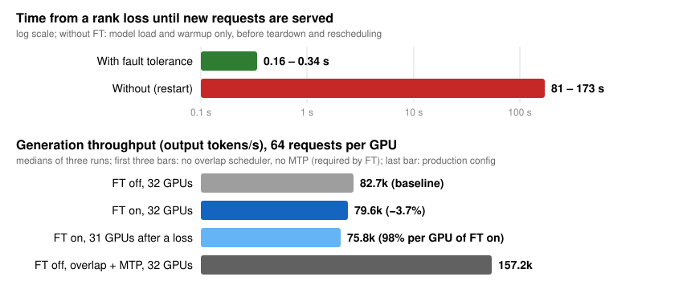

# WideEP fault tolerance: surviving a worker loss

## Summary

- Today, losing one worker process (rank) of a WideEP job kills the whole job.
- With fault tolerance (FT), the surviving ranks keep serving **on the CUDA graphs captured at
  startup**: no reload, recompile or recapture.
- Survivors' requests continue with the same tokens. Only the lost rank's requests fail, with a
  retryable error.



DeepSeek-R1 NVFP4, 32 GB200 GPUs (EP32, attention DP). Kimi-K2 and 16 and 64 GPUs show similar
results.

## 1. Today's failover (without FT)

- A rank dies → its peers' MoE all-to-all kernels spin on flags it never sets, until a device
  timeout traps and kills their CUDA contexts. Host collectives that include it hang or abort.
- The whole job exits. All in-flight requests are lost.
- The job must be torn down, rescheduled and started again: model load and warmup alone take
  81–173 s for R1 on 32 GPUs.

## 2. Failover with FT

```text
rank dies
  → detect      a host collective fails with a ULFM error, or a watcher thread sees it
  → unblock     revoke host communicators; set the abort flag that spinning MoE kernels poll
  → discard     the interrupted step reaches no request; its KV reservations are undone
  → agree       ULFM Shrink gives every survivor the same membership; each reports to the
                external recovery authority
  → install     route the lost rank's experts to their copies; mask the rank in the kernels
  → commit      the authority commits once every survivor has installed; serving resumes
```

**ULFM** (MPI fault tolerance, Open MPI 5 + mpi4py 4):
- calls involving a dead process return an error instead of hanging or aborting the job;
- `Revoke` makes a communicator fail on every member, which wakes blocked ranks;
- `Shrink` returns a communicator without the dead ranks, identical on every survivor.

## 3. How long until serving resumes

- **New requests:** served 0.16–0.34 s after the kill (vs. a restart of minutes), per the chart.
- **Recovery itself:** kill → all survivors resumed in 0.14 s.
- **Requests already running when the rank is killed:**

| Killed while… | Result |
|---|---|
| requests generate tokens | all finish within 1.4–3.1 s |
| GPUs run the MoE all-to-all (7 runs) | all finish within 2.6–3.2 s |
| new prompts are processed, full load | 248 of 248 finish within 4.6 s |

- Times include generating each request's remaining tokens.
- Tokens match a reference run that never used the lost rank (also with prefix caching on).
- Throughput: −1.4% with FT on; after a loss, 99.4% per remaining GPU. FT built in but off: no
  change (the kernels used are instruction-identical to main).

## 4. When we keep the captured CUDA graphs, and how

**When:**
- a process is lost (not a GPU, link or driver failure);
- every expert of the lost rank has a copy on another rank (static EPLB with spare slots; at
  EP32, R1 has 8 experts + 1 spare slot per GPU);
- it is the first loss, and not rank 0;
- the configuration is supported (section 7).

Otherwise the job ends as today, with an explicit error on every request.

**How:** a graph bakes in kernel arguments and addresses, not memory contents.
- **Fixed:** EP size, rank ids, graph shapes, buffer layout, all addresses. The lost rank keeps its
  seat; its slots just stay empty.
- **Rewritten in place, between steps:**
  - EPLB routing tables → the lost rank's experts point at their copies;
  - the live-rank mask, read by dispatch and combine;
  - the abort flag and each rank's workspace counters, reset.
- **Host side** (outside graphs): collectives move to the survivor communicator; the lost rank's
  entry in each gather is filled with a neutral value.
- nsys confirms every decode all-to-all still runs inside the original graphs.

## 5. What makes it safe

- **Late writes.** A rank can die with NVLink writes still in flight into peers' buffers. Main's
  buffer layout moves every step, so such a write could land on a live rank's rows. FT gives each
  source rank a fixed slot (section 6).
- **Spinning kernels.** The abort flag lives in pinned host memory and is set by a plain CPU
  write, so it reaches kernels that occupy the whole GPU, graph-launched or not. A real timeout
  still traps.
- **Garbage data.** An aborted combine never marks its output ready. Rows from masked ranks, or of
  an aborted step, reach the expert GEMMs as expert id −1 with zero data.
- **No partial output.** A commit gate checks the abort flag before a step updates any request;
  an aborted step is discarded and run again.
- **KV cache and prefix caching.** The discarded step's KV reservations are undone after its GPU
  work finishes (KV cache managers V1 and V2). Its blocks are never offered for reuse.
- **No lost or duplicated responses.** An interrupted response gather is resent.
- **All-or-nothing switch.** Only the authority's Commit changes membership, after every survivor
  reports the same expert placement.
- **Bounded.** Every wait has a deadline; any failure ends the job as today. A rank whose own loop
  crashes while the others can recover exits alone.

## 6. Symmetric memory and kernel changes

The all-to-all workspace is symmetric memory: each GPU allocates a buffer that every peer maps
over NVLink. **Dispatch** pushes tokens into the receiving GPU's buffer; **combine** pulls expert
outputs from peers' buffers. Completion flags live in the same buffers.

**Who owns which rows of one GPU's dispatch buffer** (one payload shown; each digit is the
source rank that writes that row). Main sizes each source's rows by
`runtime_max_tokens_per_rank`, the largest local batch across ranks this step; FT sizes them by
the fixed `max_num_tokens_per_rank`.

```text
row                0 1 2 3 4 5 6 7 8 9 10 11

Main, step n       0 0 0 0 1 1 1 1 2 2 2  2     runtime_max_tokens_per_rank = 4
Main, step n+1     0 0 1 1 2 2 3 3 4 4 5  5     runtime_max_tokens_per_rank = 2
                                   ^
                                   late write from dead rank 2, aimed at row 8 in step n,
                                   lands in rank 4's rows in step n+1

FT, every step     0 0 0 0 1 1 1 1 2 2 2  2     max_num_tokens_per_rank = 4 (fixed):
                                                rank 2's late writes stay in rank 2's rows
```

- FT also stores each source's payloads together: `[source][payload][max_num_tokens_per_rank]`
  versus main's `[payload][source][runtime_max_tokens_per_rank]`.
- Same workspace size, plus a small alignment pad per source slot: main already reserves room for
  the largest possible `runtime_max_tokens_per_rank`.
- **New gather kernel (FT only):** the fixed slots are not contiguous per payload, so it packs the
  valid rows into the dense `[source][runtime_max_tokens_per_rank]` input the expert GEMMs
  expect. It overlaps with dispatch (programmatic dependent launch). Combine needs no copy
  because it pulls.
- **Dispatch and combine (FT path):** read the descriptor (live-rank mask + abort-flag pointer)
  at a fixed address; skip masked ranks in every wait and load; exit spin loops on abort.
- **FT off:** the same kernels without the descriptor, instruction-identical to main.

**Alternatives considered:**
- pull-based dispatch: a round trip per MoE layer and a rewrite of main's hot kernel;
- strided expert inputs: would change every MoE backend;
- recapturing graphs after a loss: slow, and graphs captured with fewer ranks would not match.

## 7. Limits and next steps

- **Not supported yet** (rejected at startup): overlap scheduler, MTP and guided decoding, online
  EPLB, disaggregated serving, LM-head TP in ADP, beam search, PEFT, PP/CP, encoder-decoder,
  hybrid/Mamba, the CFT all-to-all mode, Ray and RPC executors.
- **Other limits:** one loss per job; rank 0 must survive; the lost rank's requests fail rather than
  move; the server keeps reporting "healthy".
- **Open item:** in one 64-GPU run, one test request drifted from the reference at its third
  token (coherent text); likely floating-point rounding from changed expert batch sizes.
- **Next:** overlap scheduler and MTP (production WideEP uses both), online EPLB, then restoring the
  job to full size with a replacement rank.

Launch and configuration: `docs/source/features/wide-ep-fault-tolerance.md`.

## 8. PRs

One commit per PR, in merge order. The first four are standalone fixes.

| # | Commit | PR | Tests and evidence |
|---|---|---|---|
| 1 | [bf3791cb9c](https://github.com/arusli-nv/TensorRT-LLM/commit/bf3791cb9c) | `[fix]` propagate fatal RPC worker errors | unit tests |
| 2 | [b0bb2786ad](https://github.com/arusli-nv/TensorRT-LLM/commit/b0bb2786ad) | `[fix]` bound RPC socket teardown with unreachable peers | unit tests |
| 3 | [6f7331dc5e](https://github.com/arusli-nv/TensorRT-LLM/commit/6f7331dc5e) | `[fix]` skip request updates without a sampling result | unit tests |
| 4 | [82e568a236](https://github.com/arusli-nv/TensorRT-LLM/commit/82e568a236) | `[fix]` keep EPGroupHealth identity across ConfigurableMoE deepcopy | unit test |
| 5 | [200602863d](https://github.com/arusli-nv/TensorRT-LLM/commit/200602863d) | `[infra]` upgrade mpi4py to 4.1.2 | ULFM bindings test; image build |
| 6 | [c989b2bc8a](https://github.com/arusli-nv/TensorRT-LLM/commit/c989b2bc8a) | `[feat]` WideEP recovery authority | fault injection at every protocol step; end-to-end over ZeroMQ |
| 7 | [7de2a38e53](https://github.com/arusli-nv/TensorRT-LLM/commit/7de2a38e53) | `[feat]` ULFM survivor communicators for host collectives | real 4-rank ULFM run; losing rank 1, 2 or 30 |
| 8 | [bf6ff93509](https://github.com/arusli-nv/TensorRT-LLM/commit/bf6ff93509) | `[feat]` fault-tolerant execution descriptor for the NVLinkOneSided all-to-all | abort inside graphs; timeout still traps; FT-off kernels instruction-identical |
| 9 | [948efcc0e9](https://github.com/arusli-nv/TensorRT-LLM/commit/948efcc0e9) | `[feat]` MoE execution state for WideEP recovery | abort with and without CUDA graphs; 2-process SIGKILL late-write test |
| 10 | [c4354a62f5](https://github.com/arusli-nv/TensorRT-LLM/commit/c4354a62f5) | `[feat]` resident-replica EPLB placement after a rank loss | coverage tests; uncovered loss fails closed |
| 11 | [7abbf48a36](https://github.com/arusli-nv/TensorRT-LLM/commit/7abbf48a36) | `[feat]` let attention-DP routing skip absent ranks | unit tests; kill under full load |
| 12 | [68524ed0c1](https://github.com/arusli-nv/TensorRT-LLM/commit/68524ed0c1) | `[feat]` keep the MPI session serving after a peer loss | bounded teardown tests |
| 13 | [80f188e1c7](https://github.com/arusli-nv/TensorRT-LLM/commit/80f188e1c7) | `[feat]` recover the executor from a WideEP peer loss, with the docs page | rollback tests (V1, V2, reuse); 4-GPU CI test; multi-node runs |

The multi-node runs compare tokens with a reference run whose EPLB excludes the killed rank from the
start, because greedy tokens depend on which rank serves each expert.

## Appendix: mapping to the internal design document (v7)

Each row is one work item of the internal design "WideEP Fault Tolerance in TensorRT-LLM" (v7),
with the commit that implements it and the main code.

### Implemented


| v7 item | Title | Commit | Code | Status |
|---|---|---|---|---|
| 1a.8 | Recoverable execution abort | [8][c8], [4][c4] | [kernels], [op] | done |
| 1a.8a | Backend-mode safety qualification (late writes) | [8][c8], [9][c9] | [kernels], [nvlink] | done, non-CFT |
| 1a.8b | Backend-mode abort/quiescence integration | [9][c9] | [state], [nvlink] | done, non-CFT |
| 1a.11 | Fixed-capacity graph execution | [8][c8] | [kernels], [op] | done |
| 1b.2a | Replica/capacity admission | [10][c10], [6][c6] | [eplb], [authority] | done |
| 1b.4a | Logical/physical mapping foundation | [10][c10] | [eplb] | done for static EPLB |
| 1c.3 | MPI evidence transport | [5][c5], [7][c7] | [communicator] | done (ULFM) |
| 1c.3a | Runtime adapter and survivor-authority contract | [7][c7], [6][c6] | [communicator], [authority] | done |
| 1c.4 | Engine hook | [13][c13], [3][c3] | [recovery], [executor] | done |
| 1c.4a | Survivor-aware management collectives | [7][c7], [11][c11] | [communicator], [adp] | done |
| 1c.4b | Sole recovery coordinator and backend interface | [6][c6] | [authority] | done |
| 1c.4c | Request disposition | [13][c13], [3][c3] | [recovery], [kv] | done |
| 1d.1 | Poisoned lifecycle and public admission policy | [12][c12], [1][c1], [2][c2], [13][c13] | [session], [recovery] | done; env-var gate, not `LlmArgs` |
| 1d.4a | Physical acceptance | [13][c13] | [ci] | done: EP32 R1/Kimi-K2, EP16, EP64 |
| 1d.5 | Performance gate | [8][c8], [13][c13] | [docs] | done: −1.4% all-active, 99.4% degraded |

Supporting commits without their own item: [1][c1] and [2][c2] (RPC fatal errors and teardown,
under 1d.1), [3][c3] (absent sample state, under 1c.4c), [4][c4] (shared EPGroupHealth, under 1a.8).

### Not implemented yet
| v7 item | Title | Why |
|---|---|---|
| 1a.6 | TwoSided kernel/binding coverage | MVP uses NVLinkOneSided |
| 1a.7 | NCCL recovery primitives | MVP uses MPI/ULFM |
| 1b.3 | Quiesced EPLB integration | online EPLB rejected at startup |
| 1b.7 | N−K placement and missing experts | uncovered losses fail closed |
| 1c.2 | Per-rank evidence budgets | later |
| 1c.6 | Multi-failure agreement | one loss per job |
| 1d.3 | Health and passive metrics | server keeps reporting healthy |
| 1d.7 | v1 qualification | later |

Merged upstream before this work: 1a.1, 1a.2, 1a.4, 1b.2, 1c.1, 1d.0.

[c1]: https://github.com/arusli-nv/TensorRT-LLM/commit/bf3791cb9c
[c2]: https://github.com/arusli-nv/TensorRT-LLM/commit/b0bb2786ad
[c3]: https://github.com/arusli-nv/TensorRT-LLM/commit/6f7331dc5e
[c4]: https://github.com/arusli-nv/TensorRT-LLM/commit/82e568a236
[c5]: https://github.com/arusli-nv/TensorRT-LLM/commit/200602863d
[c6]: https://github.com/arusli-nv/TensorRT-LLM/commit/c989b2bc8a
[c7]: https://github.com/arusli-nv/TensorRT-LLM/commit/7de2a38e53
[c8]: https://github.com/arusli-nv/TensorRT-LLM/commit/bf6ff93509
[c9]: https://github.com/arusli-nv/TensorRT-LLM/commit/948efcc0e9
[c10]: https://github.com/arusli-nv/TensorRT-LLM/commit/c4354a62f5
[c11]: https://github.com/arusli-nv/TensorRT-LLM/commit/7abbf48a36
[c12]: https://github.com/arusli-nv/TensorRT-LLM/commit/68524ed0c1
[c13]: https://github.com/arusli-nv/TensorRT-LLM/commit/80f188e1c7

[authority]: https://github.com/arusli-nv/TensorRT-LLM/blob/80f188e1c7/tensorrt_llm/executor/recovery/authority.py
[communicator]: https://github.com/arusli-nv/TensorRT-LLM/blob/80f188e1c7/tensorrt_llm/_torch/distributed/communicator.py
[kernels]: https://github.com/arusli-nv/TensorRT-LLM/blob/80f188e1c7/cpp/tensorrt_llm/kernels/moe/communication/moeAlltoAllKernels.cu
[op]: https://github.com/arusli-nv/TensorRT-LLM/blob/80f188e1c7/cpp/tensorrt_llm/thop/moe/communication/moeAlltoAllOp.cpp
[state]: https://github.com/arusli-nv/TensorRT-LLM/blob/80f188e1c7/tensorrt_llm/_torch/moe/fused_moe/communication/execution_state.py
[nvlink]: https://github.com/arusli-nv/TensorRT-LLM/blob/80f188e1c7/tensorrt_llm/_torch/moe/fused_moe/communication/nvlink_one_sided.py
[eplb]: https://github.com/arusli-nv/TensorRT-LLM/blob/80f188e1c7/tensorrt_llm/_torch/moe/fused_moe/moe_load_balancer.py
[adp]: https://github.com/arusli-nv/TensorRT-LLM/blob/80f188e1c7/tensorrt_llm/_torch/pyexecutor/scheduler/adp_router.py
[session]: https://github.com/arusli-nv/TensorRT-LLM/blob/80f188e1c7/tensorrt_llm/llmapi/mpi_session.py
[recovery]: https://github.com/arusli-nv/TensorRT-LLM/blob/80f188e1c7/tensorrt_llm/_torch/pyexecutor/peer_loss_recovery.py
[executor]: https://github.com/arusli-nv/TensorRT-LLM/blob/80f188e1c7/tensorrt_llm/_torch/pyexecutor/py_executor.py
[kv]: https://github.com/arusli-nv/TensorRT-LLM/blob/80f188e1c7/tensorrt_llm/_torch/pyexecutor/resource_manager.py
[docs]: https://github.com/arusli-nv/TensorRT-LLM/blob/80f188e1c7/docs/source/features/wide-ep-fault-tolerance.md
[ci]: https://github.com/arusli-nv/TensorRT-LLM/blob/80f188e1c7/tests/integration/defs/wide_ep_ft/test_peer_loss_recovery.py
