# WideEP FT: Mid-point Slides (draft)

Draft 2026-10-27 08:00 PDT (overnight changes: OVERNIGHT_LOG.md). ~22 min talk + ~5 min Q&A.

How to read:
- **Slide text** = what goes on the slide.
- The image under it is the diagram for that slide (`figures/slides/` = slide-sized versions).
- *Notes* = speaker notes and sources. Not on the slide.

Code: v5-final 27442bd91d (measured). The PR stack v5-pr a23efa7228 behaves the same. Design: `DESIGN_DOC_final.md` (10-27). Data: DeepSeek-R1 NVFP4 on 32 GB200. "CLAIMS N" = row N of `mvp/CLAIMS.md`. Code line refs are at v5-final.

| Section | Time | Slides |
|---|---|---|
| Background | ~2 min | 0b, 1-3 |
| Proposed solution | ~9-10 min | 4, 4b, 5, 5b, 6-9, 9b |
| Benchmark results | ~9 min | 10-13, 13b, 15, 16, 16b, 18, 19 (14 and 17 moved to backup B15, B16) |
| Closing | ~3 min | 20-22 |
| Backup | Q&A | B1-B16 |

---

## 0. Title

**Slide text**

WideEP Fault Tolerance in TensorRT-LLM
Mid-point Review
Andrew Rusli, Oct 2026

---

## 0b. Outline (new)

**Slide text**

1. Why: one failure today means a 6–10 min restart
2. Design: the parts, then one slide per recovery step
   Detect ▸ Agree ▸ Plan ▸ Install ▸ Resume
3. Results: recovery (speed, throughput), then the cost while healthy
4. Status and next steps

*Notes:*
- **Key message:** The audience knows the path; the step bar returns on each design slide (5–9b) and a section bar on each result slide (11–18).

---

# Background

## 1. Current Status & Motivation

**Slide text**

Today
- 1 rank fails → whole WideEP job ends
- All in-flight requests fail
- To recover, we tear down and restart: 6–10 min on average

Restart Parts (mean over 20 restarts)
- Tear down: old job exits, ~10 s
- Start + load weights: processes start, weights copied to 32 GPUs, ~1.6–1.9 min (online EPLB ~6.0 min)
- Compile + tune kernels: attention-kernel JIT + autotuner, ~1.2–1.3 min
- Capture CUDA graphs: twice (memory dry run, then final), ~2.6–3.1 min

Why It Matters
- A live 918-GPU serving fleet (18 weeks): 46 restarts/day, median 3.5 min each [1]
- 77%: GPU still usable after the failure [1]
- WideEP spans 32–64+ GPUs: one failure idles all of them for the restart

[1] NVIDIA Dynamo fault-tolerance study, arXiv 2609.25451

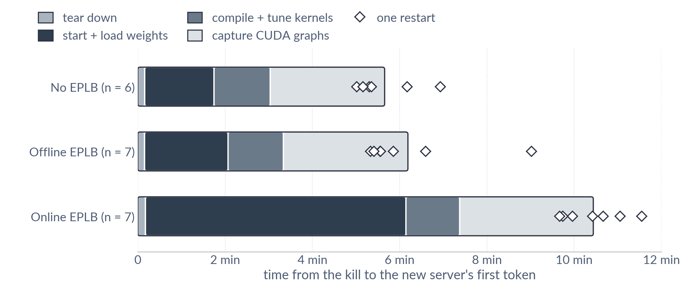

Caption (small, under the graph): DeepSeek-R1 NVFP4, DEP32 on 32 GB200, FT off, warm restart (checkpoint in page cache, autotuner results kept), 1 rank killed at 128 requests/GPU

*Notes:*
- **Key message:** Today one lost rank ends the whole 32-GPU job for 6–10 minutes on average, and such failures are common at scale.
- The figure pools all logged FT-off warm restarts on the standard recipe, from 3 FT-off builds: 15 of 20 on the 58caa0fde6 wheel, whose FT-off code is v5-final's; 5 on the older v3 / 7e8dfb37df builds, in a similar range (300.9–597.5 s vs 309.8–693.0 s) (CLAIMS 224, 228; 10 added overnight in RESTART2 8353534):
  - FT off, one rank killed during decode at 128/GPU;
  - abort and relaunch on the same nodes, page and autotuner caches kept (warm);
  - n = 6 / 7 / 7; mean 5.7 / 6.2 / 10.4 min; single runs 5.0–11.6 min.
  - A lower bound: no scheduler wait, no relaunch gap.
- Part means per mode (no / offline / online EPLB): tear down 9.5 / 9.3 / 10.5 s; start + load 95 / 115 / 358 s; compile + tune 77 / 76 / 74 s; graphs 157 / 171 / 184 s (graphs includes the ~4-6 s to the first token; CLAIMS 228).
  - Two slow loads: offline 300 s start + load (277 s model load, a mid-load page-cache eviction; the lone diamond near 9 min) and no EPLB 186 s (165 s model load, cause not checked).
  - 3 of the 10 new restarts spent ~60 s more in compile + tune (122–130 s vs 63–66 s): flashinfer's sampling kernels were JIT-built again on some ranks (~60 s nvcc); why the cache missed is not identified (CLAIMS 228).
- Why weights load again: the checkpoint is still in host RAM, but the GPUs are empty once the job dies.
  - ~20 s to start the processes, then ~60 s to copy the weights onto the 32 GPUs.
  - Online EPLB also rebuilds main's host copies of all experts (model load ~340 s).
- Compile + tune kernels: attention-kernel JIT ~51 s (every launch) + autotuner ~10 s (its cache is kept).
- CUDA graphs are captured twice: a memory dry run, then the real pass (64–84 s + 61–90 s on rank 0 over all 20; CLAIMS 228).
- Our first runs (10-16) restarted in ~4 min (CLAIMS 44): no MTP, overlap off, 12 graph sizes, so graph capture took 27 s vs 125–144 s now (rank-0 capture lines, no EPLB, both passes).
- [1], checked 10-26 against the paper (arXiv HTML):
  - 18 weeks, 918 GPUs, ~150 replicas, mostly ≤ 8 GPUs;
  - 5,762 restarts = 46/day, median 3.5 min;
  - 77% = 4,443 of 5,762 classed device-preserving (1,319 ambiguous; the paper says "most").
- Each failure idles all 32–64+ GPUs for the whole restart. Whether failures per job grow with GPU count is not measured. If asked, a rough estimate assuming independent per-GPU failures at [1]'s rate (46 restarts/day over 918 GPUs): ~1.6 restarts/day for a 32-GPU job; [1] is a different fleet (mostly ≤ 8-GPU replicas) and some causes (software bugs) need not scale with GPUs.

---

## 2. Existing Solutions

**Slide text**

| | On a rank loss | Back in | In-flight requests |
|---|---|---|---|
| vLLM | Restart today; open PR: mask rank, reload experts from disk | ~1 s after trigger (+~30 s detect) | Aborted |
| SGLang Elastic EP | Rank mask + redundant experts; copy lost ones from peer GPU or host; same graphs | 6–11 s | Fail, client retries |
| Huawei ReviveMoE | Redo step; recompile graphs from a precompiled cache | ~10 s | Re-run on survivors |
| Dynamo | Swap in a warm standby engine (weights, graphs kept); whole replica | < 7 s | Re-run; migration opt-in |
| Tarragon (research) | Shadow experts in GPU memory; KV checkpoints | 0.3–0.4 s stall | Restored from checkpoints |
| TRT-LLM today | Job ends | 6–10 min | All fail |
| **This work** | **Rank mask + spare slots, same graphs** | **0.8–2.8 s** | **Kept; lost rank's: re-run if nothing sent, else retryable error** |

*Notes* (each row checked 10-26 against its source):
- **vLLM**
  - PR #46370 ("fault tolerant ep using scale-down") is open (last push 10-23):
    - masks dead EP ranks in the DeepEP-LL / NIXL-EP all-to-all;
    - reloads only reassigned experts from disk; no graph recapture;
    - an orchestrator triggers it with `POST /v1/fault_tolerance/apply`;
    - recovery ~1 s after the trigger; detection ~30 s (kernel timeout); in-flight requests aborted ("we abort today to keep the first PR small").
    - Uses EPLB redundant slots; if every expert already has a surviving copy, nothing is reloaded. Rechecked 10-27 (last push 10-27).
  - PR #28296 (closed): its "2 s vs 32 s restart" is a retry after a transient error on the same ranks. In its kill test the instance exited.
- **SGLang Elastic EP, on Mooncake over RDMA (InfiniBand / RoCE)**
  - LMSYS blog 2026-03-25: 6.2–6.8 s for 1–16 failed ranks (DeepSeek-V3.2, 32 GPUs, 256 redundant experts).
  - EEP paper (arXiv 2605.10670):
    - 11 s pause + 8 s reintegration vs 348 s restart (DeepSeek-V3, 48 GPUs);
    - 1 s kernel timeout; graphs unchanged;
    - in-flight requests "reported as failed and must be retried by the client";
    - within 4.4% of DeepEP while healthy.
    - Lost experts (rechecked 10-27): reuse a copy the rank already holds; else copy from a surviving replica on another GPU; only if all GPU copies are lost, reload from a pinned host-DRAM backup (`--enable-elastic-expert-backup`). Redundant experts are resident in GPU memory (`--ep-num-redundant-experts`; the blog uses 256 for up to 16 failed ranks).
    - Detection: 1 s timeout inside the all-to-all kernel. Paper setup: DeepSeek-V3, 48 GPUs, prefill/decode disaggregated.
- **ReviveMoE** (arXiv 2602.21140; Huawei)
  - 10.2 s vs 83.1 s restart; DeepSeek-V3 on 80 Ascend NPUs.
  - Graph caches compiled ahead of time for "common failure scenarios" (the paper does not list which) and saved to disk; at a failure a cached compile takes ~6 s (disaggregated) / 8 s (collocated) vs 12.9 min for a full compile. Graphs are recompiled from the cache, not kept.
  - Lost experts: dropped from the mapping if redundant copies exist; else masked (small accuracy loss up to 1/32 of experts); or an attention NPU switches to MoE and loads weights from disk (worst case).
  - The failed rank's sequences move to healthy ranks with prompt + tokens, and prefill is recomputed.
  - Single-NPU failures only.
- **Dynamo** (arXiv 2609.25451; docs), rechecked 10-27
  - Shadow engine: a parked standby keeps its CUDA context, communicators and graphs on the same GPUs, weights shared read-only; a failed replica recovers in < 7 s (13–29× faster than a warm restart). KV is not kept.
  - In-flight requests: the paper's shadow path replays them ("replays interrupted requests rather than preserving request state"); the frontend's separate request migration (off by default, `--migration-limit`) continues them on another worker with the tokens so far.
  - Replica level: "a failure in one rank can stall the entire replica, requiring all ranks to restart"; evaluated on single-node replicas only.
- **Tarragon** (arXiv 2601.01310; UC Riverside, Cisco), research prototype, code not released
  - Disaggregated attention workers (vLLM) and expert workers (C++); Mixtral-8x7B on 16 H200.
  - Expert worker loss: pre-loaded inactive shadow experts in GPU memory take over; attention worker loss: per-request KV checkpoints (async, to a separate store) restored on healthy workers.
  - Token-stream stall 0.3–0.4 s vs ~64 s for MegaScale-Infer; failure probing every 10 ms; within 2.8% of MegaScale-Infer while healthy. Tested with SIGINT to one worker.
- **TRT-LLM:** merged rank mask and a detection-only watchdog. Draft PR #14198 (closed) had no expert restore and no graphs.

*Notes:*
- **Key message:** Engines today restart or pause ~6–30 s (vLLM's PR, SGLang, ReviveMoE, Dynamo); a research prototype (Tarragon) pauses 0.3–0.4 s on a small disaggregated setup; we resume in ~1–3 s inside one WideEP job, on the same CUDA graphs, with no spare GPU memory held, and keep survivors' requests. ReviveMoE re-runs the lost rank's requests and Tarragon restores them; we do not yet.

---

## 3. Scope: RISE Phase 1 (MVP)

**Slide text**

RISE Phases
- Phase 1: survive a loss, keep serving on N−k ← this talk
- Phase 2: restore back to N
- Phase 3: planned scaling

MVP Scope
- DeepSeek-R1, aggregated serving, DEP32 on GB200
- Rank or node process loss (not rank 0)
- Restore lost experts, repeated losses

Goals
- Healthy cost < 1% per decode step (target)
- Resume in seconds, same CUDA graphs
- Survivors' requests continue, no restart

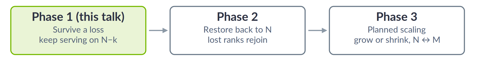

*Notes:*
- **Key message:** This talk is Phase 1: survive a loss and keep serving on fewer GPUs (DeepSeek-R1, aggregated serving).
- Phases are from the v7 design doc: "Phase 1 — Survive and continue at N−K"; "Phase 2 restores physical capacity to N; Phase 3 generalizes planned scaling".
- v7 MVP = one failure with resident replicas. v7 "v1" = repeated failures and missing-expert restore. Both are done here.
- Fail closed (job ends as today): rank 0, rank 0's node. Host death and NVLink fabric faults are untested.
- Not yet supported: disaggregated serving.
- "Continue": survivors keep their state and replay any discarded step from their committed tokens (B9). On v5-final with a config whose healthy runs are token-deterministic (small batch, MTP + overlap), survivors' and the re-run request's 400-token outputs equal the no-failure run exactly in 6 of 6 kills; with the harness's control-placement check fixed (it read a running count), the pre-set rule passes in 2 of 2 runs (CLAIMS 231, 233, 237). This shows recovery itself does not change survivors' tokens; production outputs are not bit-reproducible even without failures. On the standard config two healthy runs already differ, so exactness is undefined there (CLAIMS 230).

---

# Proposed Solution

## 4. Overall Design

**Slide text** (provided, unchanged)

Core Features
- Failure detection (process-level)
- Continue serving with survivors
- No CUDA graph recapture
- Restore lost experts
- Dead rank late write safety

Core Approaches
- Recovery Authority
- Rank mask and abort flag
- Unbacked spare expert slots
- Remap all-to-all workspace

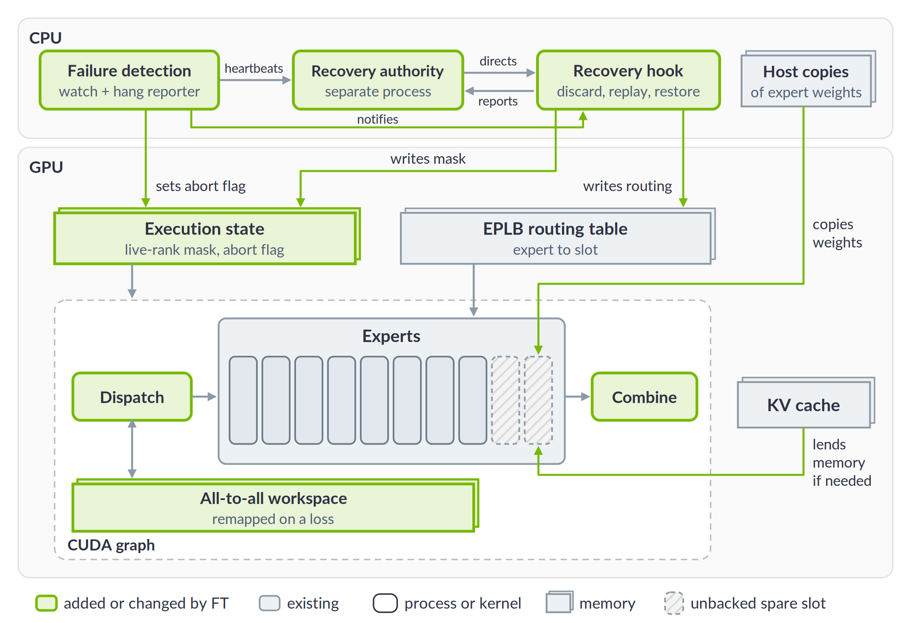

*Notes:*
- **Key message:** Recovery changes only data the CUDA graphs read (mask, abort flag, routing, expert slots), so the graphs never change.
- Green = added or changed by FT.
- The graph never changes. A recovery only edits what the graph reads: the rank mask, the abort flag, the expert→slot table and the slot contents.
- The abort flag is pinned host memory the kernels poll; it is drawn with the GPU state it controls (slide 5).
- Transition: "That is where the parts live. Next: what happens when a rank dies, in five steps, then one slide per step."

---

## 4b. Recovery in 5 Steps (roadmap for slides 5–9b)

**Slide text**

- Detect: notice a rank died, stop waiting on it
- Agree: survivors agree who failed, undo the unfinished step
- Plan: decide where the lost experts go, prepare memory
- Install: everyone has the same plan → load lost experts, switch over
- Resume: re-run the undone step, same CUDA graphs

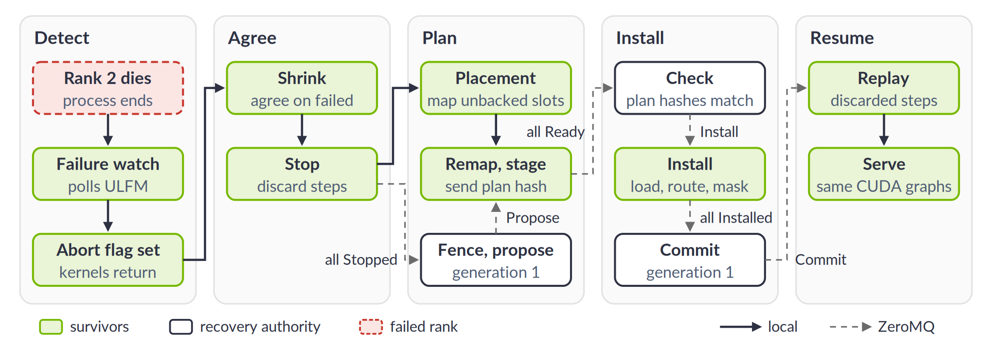

*Notes:*
- **Key message:** When a rank dies, survivors go through five steps and resume on the same CUDA graphs; every survivor applies the same plan or none.
- Roadmap: slide 4 = where the parts live; this slide = the order. Slides 5–9b take the steps in turn, each with the step bar on top: 5 Detect, 5b Agree, 6–7 Plan + Install (expert memory and placement), 8–9 Plan (all-to-all workspace remap), 9b Resume.
- Every survivor applies the same plan, or none (the plan-hash check is the gate).
- Detect: the failure watch is a native thread (no GIL) polling ULFM every 20 ms; it writes the abort flag (pinned host memory the all-to-all kernels poll). A frozen rank is first killed by hang detection after 30 s, then takes this path.
- Agree: survivors revoke and shrink the MPI communicator (ULFM's agreement, so all report the same failed set), discard steps not yet committed, revert KV and requests to the last committed step, and send `Stopped` to the recovery authority.
- Plan: every survivor runs the same placement rule (which survivor's spare slot gets each lost expert) and maps GPU memory behind the chosen spare slots (free GPU memory first, then KV cache). The authority fences (kills) the failed ranks and proposes the next generation. Survivors move the all-to-all workspace to fresh memory at the same addresses (a dead rank's late writes land in old memory), stage ring copies (no EPLB), and reply `Ready` with their plan hash.
- Plan hash = SHA-256 of the failed ranks, the new expert→slot placement of every layer, and the copy plan (`placement_digest`). If any survivor's hash differs, nobody installs.
- Install: experts come from host copies in `/dev/shm` (every node holds every expert with EPLB; without EPLB a ring: each node holds the next node's experts, staged in Plan). Then the routing table and rank mask switch, and the authority commits.

---

## 5. Failure Detection

Step bar (top of slide): 

**Slide text**

Crash (process or node lost)
- Open MPI with ULFM (fault-tolerant MPI) marks the rank failed
- Failure watch (thread on each rank) polls ULFM every 20 ms, then
  - sets the abort flag → GPU kernels waiting on the dead rank return
  - revokes MPI communicators → blocked host collectives return → recovery starts

Hang (opt-in)
- Ranks report to the recovery authority over ZeroMQ: heartbeat every 1 s, "waiting on rank r" after 2 s
- Every peer waits on rank r, no progress for 30 s → authority has it killed → crash path

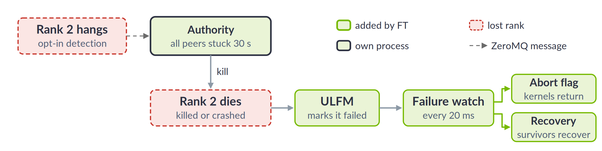

*Notes:*
- **Key message:** A crash is detected in ~20 ms; a hang is confirmed after 30 s and turned into a crash.
- Detect ≈ 0.02 s (median) after a kill (CLAIMS 193).
- A frozen rank is fenced 29.5–34.1 s after the freeze; the harness reads whole-second log stamps, so up to 1 s early (CLAIMS 193, 213, 227).
- Abort flag = pinned host memory. Rank mask = GPU memory.
- Suspect = a peer has waited > 2 s, or no heartbeat for 5 s.
- Why 30 s: at 5 s, a healthy rank holding the GIL was falsely fenced (CLAIMS 77, 97, 103).
- Code: `communicator.py` (`PeerFailureWatch`), `hang_monitor.py` (`check`), `recovery/config.py`.
- Three channels: ULFM (inside Open MPI: process failure, later the shrink/agreement); the abort flag (pinned host memory: written by the watch thread, polled by the all-to-all kernels); ZeroMQ over TCP (each rank ↔ authority, DEALER/ROUTER sockets, authenticated with a per-job key: heartbeats, wait reports and the recovery messages of slide 5b).
- The watch is a native thread that holds no GIL, so a busy Python executor does not delay detection. Rank 0's request queue is also woken so it does not wait for new requests.
- Diagram fix to consider: the hang evidence comes from the peers' "waiting on rank 2" reports and rank 2's missing heartbeats; the arrow now starts at rank 2.

---

## 5b. Agree: Recovery Authority (new)

Step bar (top of slide): 

**Slide text**

Why
- All survivors must apply the same plan, or none
- One small process outside MPI; talks to every rank over ZeroMQ

Survivors
- Shrink the MPI communicator (ULFM agreement) → same failed set on every rank
- Roll back unfinished steps (KV, requests), then tell the authority

Authority
- Kills the failed ranks for good, then drives the messages below
- Any hash differs, rank 0 lost, or deadline passed → job ends, as today

- Plan = the new expert placement (which GPU slot holds each expert); plan hash = its fingerprint, so survivors check they agree without sending the whole plan

Messages (ZeroMQ):

| Message | From → to | Contains | Means |
|---|---|---|---|
| Stopped | survivor → authority | failed ranks it saw | stopped, rolled back |
| Propose | authority → survivors | round number, failed ranks, survivors | plan without the failed ranks |
| Ready | survivor → authority | round number, plan hash | plan prepared |
| Install | authority → survivors | round number | all hashes match: switch |
| Commit | authority → survivors | round number | all switched: resume |

Diagram option: the authority lane of Figure R (`figures/fig_recovery_sequence_final.png`) instead of the table.

*Notes:*
- **Key message:** The authority makes recovery all-or-nothing; anything the survivors cannot agree on ends the job as a failure does today.
- Messages: `recovery/protocol.py`. Also `Installed` (survivor → authority, after switching; rank 0 reports how many requests the recovery failed), `Fence` (kill a hung rank) and `Abort` (authority → all: end the job). Round number = the generation (`RecoveryAuthority.generation`): it goes up by one per recovery; a Ready, Installed, Install or Commit with the wrong round number is a protocol error that ends the job (`authority.py` `_expect`, `peer_loss_recovery.py` `_expect_generation`).
- Plan hash = SHA-256 of the failed ranks, every layer's new expert→slot placement and the copy plan (`placement_digest`); a differing hash aborts every survivor before any installs (`authority.py`).
- Fencing a hung rank: a worker asks the MPI runtime to kill it 1 s after the Fence message; ULFM then sees it within ~2 s (`config.py`).
- Rank 0 holds the request queue; losing it ends the job (fail closed). Recoveries past their deadline ended the job 4/4 (pre-fix build, CLAIMS 177).

---

## 6. Unbacked Spare Expert Slots

Step bar (top of slide): 

**Slide text**

Healthy
- Extra slots at fixed addresses, no memory of their own (CUDA VMM)
- Never routed to → no extra compute

On a Loss
- Map real memory behind the slot
- Free GPU memory first, then borrow from KV cache
- Copy expert from a host copy, never from the dead GPU

Host Copies (CPU memory)
- With EPLB: every node holds all experts (~390 GB)
- No EPLB: ring, each node holds the next node's (~49 GB)

Which Spare Slots
- Default: unbacked, in every EPLB mode
- Exception: online EPLB writes experts from the CPU via GDRCopy; if it cannot map VMM memory here → backed spare slots (memory held from startup)
- Tested GB200: unbacked in all modes

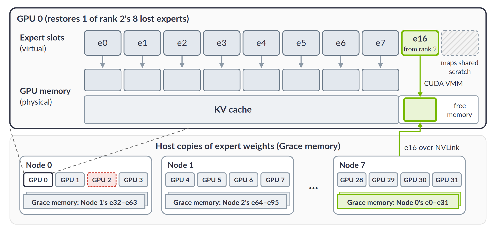

*Notes:*
- **Key message:** Spare expert slots cost no GPU memory while healthy; memory is mapped only when a lost expert is restored, from a host copy.
- While healthy, unbacked slots map one shared scratch per process (15 VMM chunks).
- Memory after a loss, per survivor, kept until restart: up to 0.44 GB (rank loss), 1.75 GB (node loss) (8269102 `restored_mb`).
- Online EPLB on the tested GB200 used unbacked slots (CLAIMS 182).
- GDRCopy = NVIDIA library that maps GPU memory into the CPU's address space (via GPUDirect RDMA), so a CPU thread can write GPU memory with a plain memcpy. Online EPLB (main's design) loads experts from the host copies this way at every rebalance, including into a restored spare slot.
- Unbacked slots are CUDA VMM allocations; GDRCopy can map those only where the platform supports GPUDirect RDMA on VMM memory, and never where GPU memory is a NUMA node. Startup checks every rank (`_ghost_slot_memory_host_accessible`); if any rank cannot, online EPLB uses backed slots (`extra_slots: empty`). No and offline EPLB do not use GDRCopy, so they always use unbacked slots.
- Code: `ghostSlotMemory.h`; `peer_loss_recovery.py` (`_make_room`); `config.py` (`extra_slots`).

---

## 7. Where Lost Experts Go

Step bar (top of slide): 

**Slide text**

Placement Rule
- Same plan on every survivor
- Empty spare slot first
- Else replace a replica (expert with ≥ 2 copies)
- Ties: fewest restored so far, then lowest rank

Sizing
- Enough spares to survive a node loss
- R1, 32 GPUs: 8 + 2 slots/GPU (no EPLB), 9 + 1 (EPLB)

Result
- Rank loss: 8 lost experts → 1 each on 8 survivors
- Node loss: 32 lost experts → 28 survivors
- Online EPLB rebalances at its next update

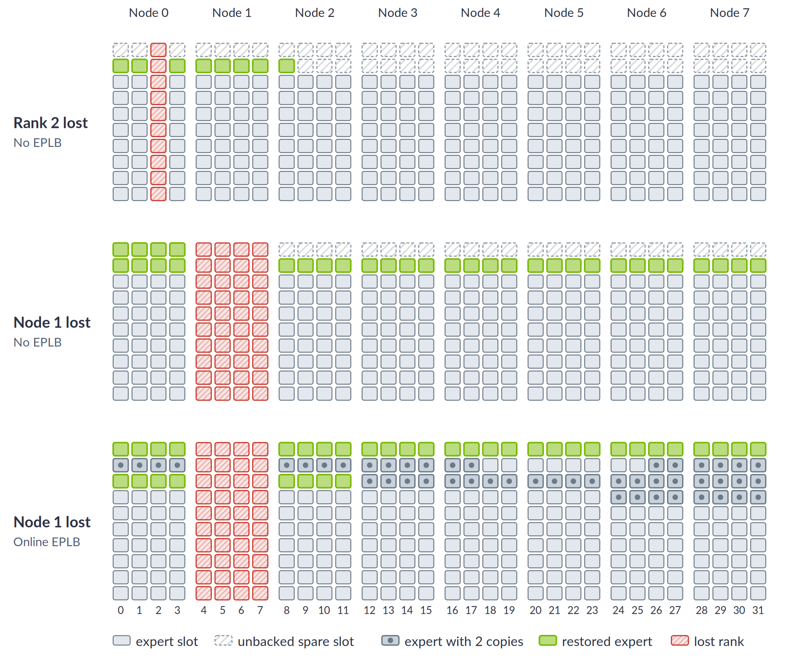

*Notes:*
- **Key message:** Every survivor computes the same placement, and lost experts spread evenly over the survivors.
- Spares per rank = ceil(256 / 28 survivors) − resident slots: 10 − 8 = 2 (no EPLB), 10 − 9 = 1 (EPLB) (`moe_load_balancer.py:1197-1201`).
- Rule: `restore_lost_experts` (`moe_load_balancer.py:986-1032`).
- No-EPLB panels come from the code's rule. The online panel is illustrative.
- The spread is even per layer, not across layers: the busiest survivor holds 1.18–1.27× the median restored memory (rank kills).
- An expert with no copy left → fail closed.

---

## 8. Late Writes (1): Quarantine (Fixed Mailboxes)

Step bar (top of slide): 

**Slide text**

Problem
- A dead GPU can still have NVLink writes in flight
- A late write can corrupt survivors' next step

Fixed Mailboxes
- Each sender owns fixed rows in every receiver's all-to-all workspace
- Dead sender's rows masked (quarantined)

Pros
- No timing or driver assumptions (with one row size)

Cons
- Changes main's all-to-all layout and kernels
- R1 mixes row sizes (NVFP4 ~4 KB, MTP ~14 KB) → rows shift → unsafe as is
- Fix: +7.5 GB/GPU, or risky kernel changes
- Healthy cost: +160–220 µs per ~14 ms decode step (~1.2–1.6%; inferred across runs)

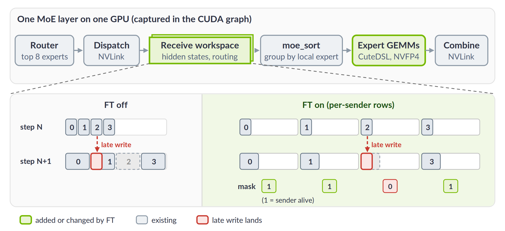

*Notes:*
- **Key message:** A dead GPU's late writes can corrupt survivors; fixed mailboxes stop them, but change main's all-to-all and break with R1's mixed row sizes.
- The figure shows the design as intended, with one row size.
- All-to-all workspace = a buffer in each GPU's memory that every other GPU writes into directly over NVLink (TRT-LLM's `MnnvlMemory`; the same idea as symmetric memory: same size on every rank, mapped into every peer). Receiver = the GPU whose workspace a token is written into; one row = one token's data.
- Main packs received rows, so a sender's rows can land anywhere in the receiver's region; fixed mailboxes reserve a region per sender, so a dead sender can only write its own region.
- R1's BF16 MTP layer and its 58 NVFP4 layers share one workspace with different row layouts (DECISIONS.md 10-21 19:05).
- Fix review 10-21 19:20: fixed regions per role are not structural; a workspace per layout costs +7.53 GB/rank.
- Healthy cost: CLAIMS 167, 171. Measured without EPLB at 32 requests/GPU, where a decode step takes ~13.8 ms (FT off, figA1 CSV, CLAIMS 206): 160–220 µs ≈ 1.2–1.6%. The final design costs 120 µs (+0.87%) in that cell.
- Reusing a mailbox at rejoin (Phase 2) would still need a "writes stopped" guarantee.
- Transition: "so we moved the cost from every step to the recovery".

---

## 9. Late Writes (2): Same-Address Remap (Final)

Step bar (top of slide): 

**Slide text**

Idea
- Keep main's all-to-all; pay at recovery, not every step

At Recovery
- Unmap old workspace memory, keep the addresses
- Map fresh memory at the same addresses (survivors only)
- Same CUDA graphs replay on fresh memory
- Late writes land in old pages no survivor reads

Pros
- Keeps main's all-to-all layout
- Any row layout; no bound on when writes stop

Cons
- Remap 7.5 GB/GPU per recovery: 0.4–1.0 s
- Assumes CUDA frees the old pages only after the dead process is gone; if they were reused sooner, a late write could silently corrupt (tested on 2–4 GPUs, not proven)

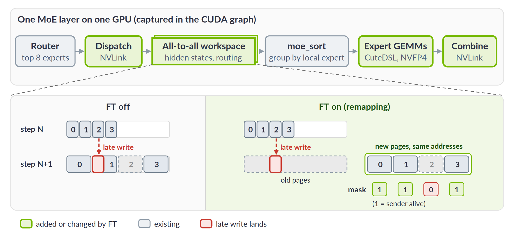

*Notes:*
- **Key message:** We keep main's all-to-all and remap its memory at recovery, so late writes land where no survivor reads; the cost moves from every step to recovery.
- Code: `PeerLossRecovery._remap_workspaces` → `MnnvlMemory.release_backing` / `remap`.
- Remap takes 0.41–0.97 s per survivor in the timed V5F-REC rows (up to 1.04 s in later runs). 0 bytes came from the KV cache in every logged case (CLAIMS 193).
- End to end it is not slower than Oct 20: online rank kill 0.76–1.00 s (v5-final, n=8) vs 0.92–1.31 s (Oct 20 build, n=1–3) (CLAIMS 121, 193, 203, 227, 235).
- Tests pass on v5-final (CLAIMS 221):
  - the victim keeps writing;
  - survivor rows stay byte-exact;
  - a no-remap control shows corruption.
- Not proven for unbounded time. No at-scale run observed a late write being absorbed.
- The assumption: the dead process still maps the old physical pages, so CUDA keeps them allocated and cannot hand them to anything new (not even our fresh remap) until that process is gone. Writes still in the NVLink fabric land within microseconds; in the kill test the old pages were freed before the test's 60 s limit (it polls every 0.1 s; the exact time is not logged). We rely on that gap and on CUDA's reference counting; the code does not prove the driver waits (design doc, Late Writes; CLAIMS 221).
- If the assumption failed: pages freed but not reused → the late write hits nothing (a fault on the dead GPU, or dropped; an error reported on the survivor's GPU is possible but untested). Pages freed and reused (fresh remap, KV cache) while a write is in flight → silent corruption of a survivor's data. Only the second is harmful.
- It is listed as a con because fixed mailboxes need no such assumption.

---

## 9b. Resume: Requests Continue (new)

Step bar (top of slide): 

**Slide text**

- Same CUDA graphs; only the rank mask, routing table and slot contents changed
- Survivors replay rolled-back steps from their committed tokens
- Lost rank's requests: nothing sent yet → re-run on a survivor; tokens already streamed → retryable error
- New requests go only to the ranks left

Optional: the request table of B9.

*Notes:*
- **Key message:** Everything the survivors held continues; only the lost rank's requests that already streamed see an error, which a client can retry.
- Decode kills at 128 requests/GPU: every request on the lost rank had already streamed, so 128 retryable errors per rank kill and 512 per node kill (3.1% / 12.5% of 4096 in flight); every other request completed (design doc, Recovery results, Requests). A restart drops all 4096.
- Token-exact vs a no-failure run in 6 of 6 kills on a deterministic small config (CLAIMS 231, 233, 237).
- A new request pinned to a lost rank gets HTTP 400 (B9).

---

# Benchmark Results

## 10. Setup

**Slide text**

Model & Hardware
- DeepSeek-R1 NVFP4
- 32 GB200 (8 nodes × 4), DEP32
- Aggregated; MTP (1 draft token); overlap scheduler
- TRT-LLM perf recipe settings

EPLB Modes
- No EPLB: 256 experts, 8 per GPU, fixed
- Offline EPLB: 288 slots (9 per GPU, 32 extra copies), placement set at start
- Online EPLB: 288 slots, rebalanced while serving, one layer per step

Workload
- 1k in / 1k out, 32 or 128 requests/GPU
- Failures injected during decode at 128 requests/GPU (4096 in flight); frozen rank at 64/GPU

Method
- FT on vs off, same nodes, back to back
- 8 pairs per EPLB mode and load (pair = one FT-off + one FT-on run); autotuner kernel choices pinned (same in both)
- Step time: rank 0's decode steps; stall steps (> 1.5× the median) excluded and checked separately
  - Stalls: ~1 in 300–400 steps takes over 2× the median, up to 300–400 ms (a normal step is 14–26 ms); mostly another rank running a prefill, which every rank waits for
  - Same rate with FT on and off; with every step included the cost is similar or lower in 5 of 6 cells, only noisier

No diagram.

*Notes:*
- **Key message:** One production-style config (DeepSeek-R1 on 32 GB200), FT on vs off on the same nodes.
- Configs: `mvp/harness/configs/std-*.yaml`. This is the perf-sanity aggregated R1 FP4 v2 recipe at DEP32:
  - max batch 512, max tokens 8192;
  - CuteDSL MoE, FP8 KV;
  - attention-DP balance;
  - online EPLB: 288 slots, one layer updated per iteration; offline: a fixed 288-slot placement.
- Benchmark settings, the same in every arm:
  - MTP acceptance forced to 1 (as in the recipe);
  - all requests released at once;
  - `stream_interval` 10;
  - 16 GiB host KV offload.
- Launch: FT on uses ULFM ob1/TCP; FT off uses the default launcher.
- Injected failures: rank kill = SIGKILL of one rank; node kill = SIGKILL of the node's 4 ranks with the host left up (a power or network loss of the host is untested); frozen rank = SIGSTOP. Frozen-rank cases run at 64/GPU, the load of the hang-detection tests they come from (`job.sh` HANG-POS / stop-c30).
- No EPLB with FT on: the same fixed placement, routed through EPLB's slot table (the static load balancer), plus 2 spare slots per GPU so a node's experts fit on the survivors (28 × 8 = 224 < 256). Part of no EPLB's higher healthy cost is this table lookup (design doc, Appendix I.7).
- Absolute tok/s are not comparable to published numbers.

---

## 11. Time to Serve Again

Section bar (top of slide): 

**Slide text**

- Lose 1 rank: 0.8–1.6 s (all runs)
- Lose 1 node (4 GPUs): 1.4–2.8 s
- Frozen rank: 33–37 s (30 s to confirm the hang; 64/GPU)
- Every run recovered (rank 0 is out of scope)
- For context: a restart takes 6–10 min on average (slide 1)

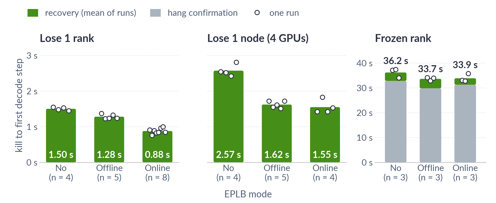

Caption (small, under the graph): DeepSeek-R1 NVFP4, DEP32 on 32 GB200, FT on, kills at 128 requests/GPU (frozen rank at 64), kill to rank 0's first decode step

*Notes:*
- **Key message:** Serving resumes in 0.8–1.6 s after losing a rank and 1.4–2.8 s after losing a node.
- Time = kill → rank 0's first decode step (server timestamps). n=4–8 per bar; frozen rank n=3 per mode (CLAIMS 193, 202, 203, 213, 227, 235, 238).
- A kill during prefill takes 1.7–2.7 s (n=2–3 per mode, CLAIMS 227, 235).
- Frozen rank: after the fence, serving resumes in 2.3–4.0 s (vs ~1 s after a kill): the rank is killed 1 s after the fence, the kill can take up to 2 s to show, then the ~1 s recovery runs (doc, Recovery flow; CLAIMS 213, 227, 238).
- All 52 recovery runs on v5-final pass: 15 + 8 replication + 8 THIN-CELLS + 2 offline (8283311) + 7 RECOV2 (8353506) + 5 RECOV3 (8361282) + 7 RECOV4 (8363511) = 52.

---

## 12. Where Recovery Time Goes

Section bar (top of slide): 

**Slide text**

- Detect + agree on who failed: 0.06–0.11 s
- Map spare-slot memory: 0.16–0.20 s (rank), 0.62–0.77 s (node)
- Remap all-to-all workspace: 0.50–0.96 s
- Stage expert copies (no EPLB only): 0.24 s (rank), 0.97 s (node)
- Install + first step: 0.08–0.25 s

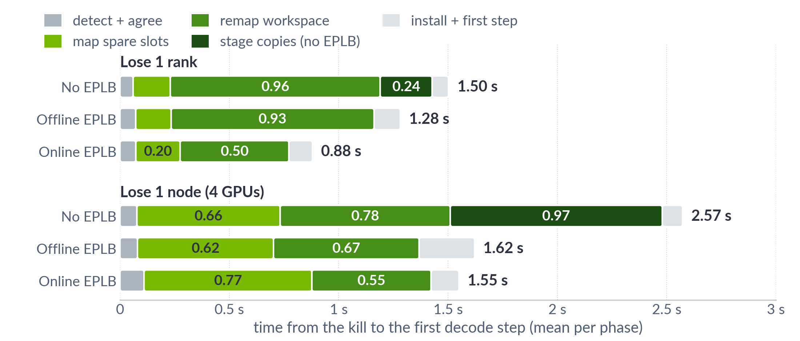

Caption (small, under the graph): DeepSeek-R1 NVFP4, DEP32 on 32 GB200, FT on, kills at 128 requests/GPU, mean per step

*Notes:*
- **Key message:** Two steps dominate: remapping the all-to-all workspace (every loss) and mapping spare-slot memory (~4× longer after a node loss); without EPLB, copying experts in from another node adds 0.24–0.97 s.
- Steps are spans between rank 0's server timestamps, split with the survivors' own logged durations (CLAIMS 241): detect = kill → detected (~0.02 s); agree = detected → stopped (revoke, shrink, roll back; 0.05–0.09 s); map spare slots = stopped → proposed; remap + stage = proposed → ready, split by the slowest survivor's staging time; install = ready → committed; first step = committed → first decode step. Means per mode over the kills of slide 11 (CLAIMS 193, 202, 203, 213, 227, 235, 238).
- Map spare slots is rank 0 mapping memory behind its spare slots, then answering the authority's request to fence the failed ranks (~15–50 ms); the authority proposes only after that. Rank 0's own mapping is 145–718 ms of the 161–768 ms span (cell means). It grows ~4× after a node loss: 4 ranks' experts need memory (1.75 vs 0.44 GB per survivor without EPLB).
- What could shrink (none built or measured):
  - Remap: the all-to-all workspace is 7.5 GB/GPU, sized for the max batch; sizing it to the real max batch cuts the bytes remapped. Pre-mapping a spare backing makes recovery a swap, but costs a second workspace of memory, so only after resizing.
  - No and offline EPLB remap ~2× online's: one ~0.5 s stall importing the dead GPU's node-mate's fresh memory (CLAIMS 214, 215; backup B2). Cause open.
  - Map spare slots: rank 0 answers the fence only after its own mapping; answering it during the mapping would let the proposal go out earlier, but each survivor still maps before its remap.
  - Stage copies (no EPLB): a ring copy crosses nodes; 0.97 s after a node loss.
  - Detect, agree and install are already small. A frozen rank's time is the 30 s hang confirmation (5 s falsely fenced a healthy rank; values in between untested).
---

## 13. Throughput After a Loss

Section bar (top of slide): 

**Slide text**

- 31 of 32 GPUs left: 92.5–95.1% of before (proportional 96.9%)
- 28 of 32 GPUs left: 85.6–86.9% of before (proportional 87.5%)
- Medians 0.6–4.4 percentage points below proportional

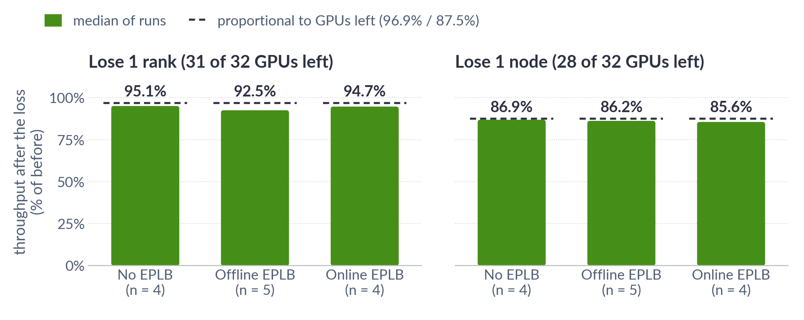

Caption (small, under the graph): DeepSeek-R1 NVFP4, DEP32 on 32 GB200, FT on, 128 requests/GPU closed loop, client throughput in the first full wave after the loss

*Notes:*
- **Key message:** After a loss, throughput is close to proportional to the GPUs left (medians 0.6–4.4 percentage points below).
- Method: client tok/s, first full decode wave after the resume / waves before the kill; 128/GPU fixed concurrency; n=4 / 5 / 4 per mode, 13 per loss type (CLAIMS 209, 220, 239).
- Proportional is a reference, not an upper bound: each survivor then serves more requests.
- Pooled over modes (n=13 each): 94.5% and 86.0%. Offline's rank-kill median fell from 95.4% to 92.5% with RECOV4's two new kills (0.900, 0.916); single runs span 90.0–96.7%.
- Why below proportional (diagnostic, CLAIMS 226): survivors do take more requests (rank 0's own median batch: 128 → ~130 after a rank kill, → ~147 after a node kill; 4,096 / 31 ≈ 132 on average), but steps get ~4–5% longer than the bigger batch explains (median step +5% vs ~+1% expected; node +14% vs ~+9%). 0.969 × 0.979 ≈ 0.95 matches the measured 0.954 (the n=11 set). Causes not separated: survivors holding a restored expert set the synchronous step, CUDA-graph padding (132 → 136), the 31-rank all-to-all.
- The closed-loop client keeps 4,096 requests in flight, so the lost rank's slots refill on survivors.
- Survivors stay at N−k until a restart: Phase 2 (rejoin) is not built.
- n differs from slide 11 (online rank n=8 there): this chart uses decode kills only; the four EPLB-update kills are another kill type (one measured: 0.911×, CLAIMS 229).

---

## 13b. Throughput Around a Kill (from B15)

Section bar (top of slide): 

**Slide text**

- Online EPLB; random request arrivals at ~80% load; a rank killed mid-run
- First 10 s: −10% (mean of 7 rank kills), then back at the offered load
- Only the lost rank's in-flight requests fail (18–23 per kill)

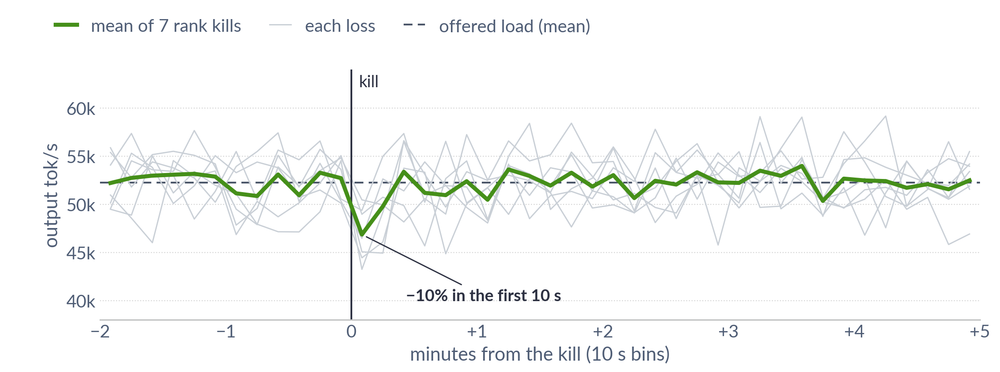

Caption (small, under the graph): DeepSeek-R1 NVFP4, DEP32 on 32 GB200, online EPLB, FT on, random arrivals at ~80% load, 7 rank kills

*Notes:*
- **Key message:** Seen from the clients, a kill is a ~10% dip for about 10 s; serving then keeps up with the traffic.
- Traffic, if asked: requests arrive at random (Poisson) at 51 req/s, about 80% of what the deployment sustains with a fixed 32 requests/GPU; input 128–4k and output 64–2k tokens. Details and the node kill (−30% in its first 10 s): backup B15 (CLAIMS 216, 218, 219, 236).
- Range over the 7 kills: −3 to −16% in the first 10 s. The offered load stays below the capacity left, so served throughput returns to ~1.0× of offered.
- Other modes, not run under this traffic (expectation from the closed-loop runs, not measured): no and offline EPLB recover a bit slower (rank kill 1.50 / 1.28 s vs 0.88 s, slide 11), so a somewhat deeper first-10 s dip (~−15%); their capacity after the loss is still ~95% (slide 13), above an ~80% load, so served throughput returns to the offered load the same way. A node kill: −30% in its first 10 s (online, one case), then back to the offered load.
- Why it does not drop to ~95% like slide 13: slide 13 measures capacity (closed loop: the client keeps the GPUs full, so tok/s = what the GPUs can do). Here requests arrive at a fixed rate, below capacity, so tok/s = what the clients send. After a loss the 31 GPUs still have more capacity than the traffic needs (0.92–0.93× of before, CLAIMS 219), so they serve the same tok/s; the loss shows up as latency instead (median TTFT +24–25%, CLAIMS 216) and the 10 s dip, whose backlog is then served.
- "~80%" is relative to the closed-loop rate at 32 requests/GPU (64.1 req/s); larger batches sustain more, so the real headroom is larger than 20%.

---

## 15. Healthy Cost: Throughput

Section bar (top of slide): 

**Slide text**

- No throughput difference detected in any mode or load
- All changes within ±0.7%, inside run-to-run noise (CIs ±1–2%)

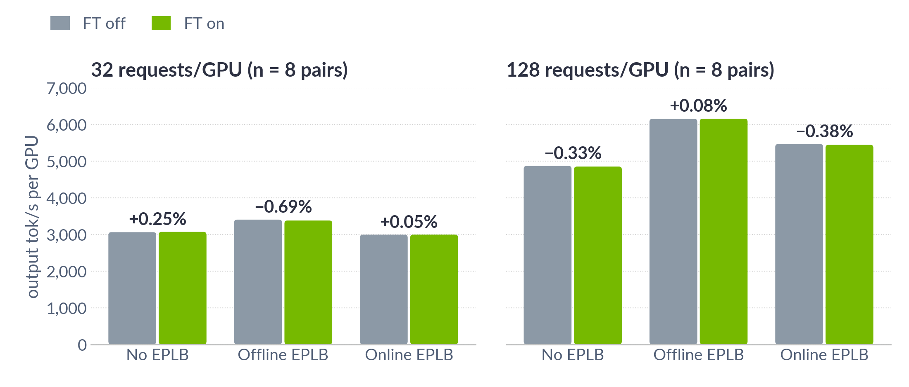

Caption (small, under the graph): DeepSeek-R1 NVFP4, DEP32 on 32 GB200, closed loop, 1k in / 1k out, mean of 8 same-node pairs

*Notes:*
- **Key message:** With no failure, FT on and off give the same throughput, within noise.
- Same-node pairs: n=8 at both loads (CLAIMS 206, 232; 4 more pairs per mode at 128/GPU overnight). All 24 CIs include 0.
- The original offline −2.0% did not replicate: pooled −0.69% [−2.80, +1.42].
- If asked for a bound: FT's throughput loss is at most 0.6% (no / online EPLB) and 2.4% (offline) at 32/GPU, and 1.1–1.4% at 128/GPU (one-sided 95%).

---

## 16. Healthy Cost: Per Step

Section bar (top of slide): 

**Slide text**

- Decode step +0.35% to +0.87% (51–150 µs): means under 1%
- Upper 95% bound reaches ~1% without EPLB
- All-to-all checks: ~1 µs × 59 calls ≈ 50–60 µs/step (no EPLB stats); rest not attributed

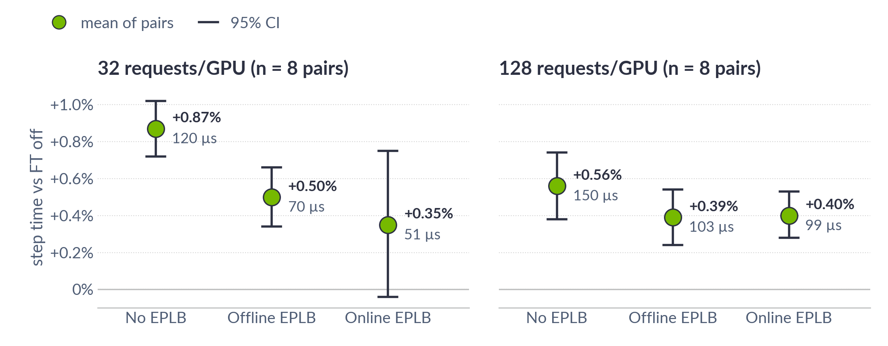

Caption (small, under the graph): DeepSeek-R1 NVFP4, DEP32 on 32 GB200, rank 0's decode step (stall steps excluded), mean and 95% CI over 8 same-node pairs

*Notes:*
- **Key message:** FT's measured cost per decode step is small: +0.4–0.9%.
- Step time = mean of rank 0's decode steps ≤ 1.5× the median (the "trimmed mean"; pre-registered in FINALS_PLAN v6, the same rule for both arms). Pooled n=8 at both loads (CLAIMS 206, 232).
- Why exclude stalls: a stall step is tens to hundreds of ms, far larger than FT's ~0.1 ms, and hits both arms at random, so the plain mean cannot resolve a ~1% effect (its 95% CIs were ±2–3% at n=4, design doc Appendix). All steps, stalls included, are in slide 15's throughput, where no difference is detected.
- If asked whether FT causes more stalls: across builds FT had more rank-0 stalls in 12 of 16 pairs (p = 0.035; p = 0.17 with 4 more pairs, CLAIMS 207); per-rank logs trace them to other ranks' prefill, hitting FT off as often (43 vs 33, CLAIMS 201). Not attributed to FT; not ruled out.
- Kernel ablation (CLAIMS 210): +0.88 µs per round trip without stats, +3.00 µs with online-EPLB stats; fully attributed in the kernel bench (backup B3). In serving, online's stats-path cost (~3 µs × 59) does not show; overlap probably hides it (not measured).
- Attribution in serving is medium confidence.
- The pre-registered rule (every cell's upper bound < 1% on the trimmed and the full mean) is not met, so "< 1% per step" is not claimed; the means are all below 1%. The later trimmed-only rule now holds in every cell at both loads (one-sided 95% upper bounds ≤ 0.99%; the chart shows two-sided CIs, which reach 1.02%), disclosed but not claimed (it was set after the rehearsal).
- Client metrics stay flat partly because FT runs fewer, larger prefill steps (likely).

---

## 16b. Late Writes: Quarantine vs Remap (new)

Section bar (top of slide): 

**Slide text**

- Remap cuts the healthy cost per step by ~40%: 0.22 → 0.13 ms (same job, same nodes)
- Recovery 0.88 s vs 1.09 s: the remap adds 0.5 s, offset by faster spare-slot mapping

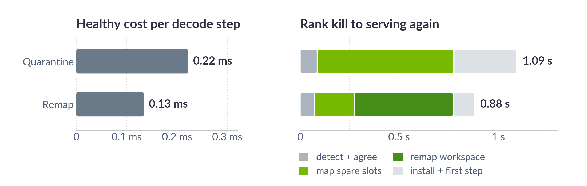

Caption (small, under the graph): DeepSeek-R1 NVFP4, DEP32 on 32 GB200; left: no EPLB, 32 requests/GPU, one job on 2 node sets; right: online EPLB rank kills (quarantine n = 3, remap n = 8)

*Notes:*
- **Key message:** The remap design costs less on every step and does not recover slower; it also keeps main's all-to-all and works with R1's mixed row sizes (slides 8–9).
- Left (CLAIMS 171, 243): quarantine (fixed mailboxes) +0.221 / +0.224 ms, remap +0.112 / +0.156 ms over FT off, two node sets of one job, FT off in the same run; +1.7% vs +1.0% of the step. The remap build here is the design's first build; the final build's pooled cost in this cell is +0.12 ms (+0.87%, n=8, slide 16).
- Right (CLAIMS 121, 241, 243): the quarantine build had no remap but spent 0.69 s mapping spare slots before the fence; the final build maps in 0.20 s and remaps in 0.50 s. The faster mapping is a separate improvement between builds, not part of the remap design (cause not isolated); without it the remap would make recovery ~0.3 s slower. Different builds and nodes; the quarantine bar is n=3 (0.92 / 1.05 / 1.31 s).
- Other differences, if asked:

| | Quarantine (fixed mailboxes) | Same-address remap (final) |
|---|---|---|
| Safe with R1's mixed row sizes | No | Yes |
| Changes main's all-to-all | Yes: per-sender rows, new kernels | No: rank mask + abort flag only |
| Extra GPU memory to make it safe for R1 | +7.5 GB/GPU (a workspace per row size) | None while healthy; 7.5 GB swapped in at recovery |
| Relies on | One row size for all layers | CUDA keeping old pages until the dead process is gone |

- Transition in: "Back to the late-write choice from slides 8 and 9, now with numbers."
---

## 18. Other Situations

Section bar (top of slide): 

**Slide text**

| Situation | Serving again |
|---|---|
| Kill during prefill | 1.7–2.7 s |
| Kill in an EPLB update | 0.8–1.0 s |
| Two losses in a row | 0.8–2.2 s each |
| Frozen rank (hang) | 33–37 s |
| Random kills under realistic traffic (8; B15) | 0.9–2.0 s |

- Survivors' requests: all complete
- Lost rank's requests: retryable error (128 of 4,096 at 128/GPU; restart: all 4,096)
- GSM8K after a kill: 0.948 vs 0.947 FT off (1 run, within 2 SE)
- Healthy soak: 0 hangs in 7 h per arm (1 hang in 36 earlier FT runs, not attributed; B10)

Option: this chart with or instead of the table (same v5-final runs; random kills under realistic traffic are in backup B15).

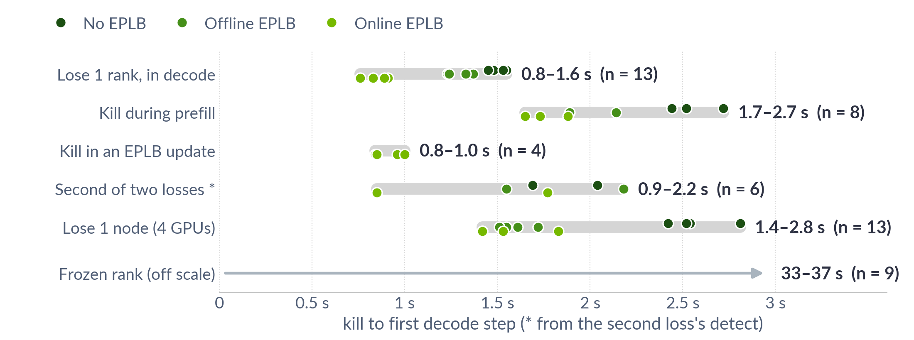

Caption (small, under the graph): DeepSeek-R1 NVFP4, DEP32 on 32 GB200, FT on, kill to rank 0's first decode step, every v5-final run

*Notes:*
- **Key message:** Recovery also works for prefill kills, EPLB updates, repeated losses and hangs, and accuracy is unchanged.
- Chart: every v5-final row, kill → first decode step; the second of two losses from its own detect; dot color = EPLB mode (fig7c_other_situations.csv; CLAIMS 193, 202, 203, 213, 227, 235).
- n: prefill n=2–3 per mode, EPLB update n=4 (online only); two losses n=2 per mode (second timed from its detect); frozen n=3 per mode (CLAIMS 193, 213, 216, 218, 219, 227, 235, 238).
- A node loss ends 512 requests (12.5%).
- Right after a prefill kill, client throughput dips more than after a decode kill: 0.73–0.94× of before on the first wave (median 0.89×, n=7) vs 0.95× (CLAIMS 220, 229); cause not known.
- GSM8K difference is within ±0.017 (2 SE).
- Soak: 7.09 / 7.21 loaded h, rate < 0.42/h (CLAIMS 222).
- A second random loss 15 min later also recovered: 30 ranks served at the end (CLAIMS 218).

---

## 19. What We Learned

**Slide text**

- Mixed row sizes (MTP vs NVFP4) broke fixed mailboxes → safety moved to recovery
- Host copies in /dev/shm hit Linux memory compaction (30–80 s stalls) → stalls reduced to the FT-off level, as far as measured
- ~1% costs hide in client noise → measure per step, same-node pairs
- Closed-loop benchmark: median TTFT +7% with FT (cause open; under realistic traffic +0.9%, B16)
- Hang confirm: 5 s killed a busy healthy rank → 30 s

No diagram.

*Notes:*
- **Key message:** The lessons that changed the design or how we measured it.
- Compaction: Appendix E (CLAIMS 184, 187, 194, 196, 197).
- TTFT: FT runs start "locked" 14/18 vs 6/18 (18 soak runs per arm; CLAIMS 208, 223).
- Hang threshold: CLAIMS 77, 97, 103.

---

# Closing

## 20. Summary

**Slide text**

Problem
- One lost rank ends a 32-GPU WideEP job; restart takes 6–10 min

Solution
- Survivors keep serving on the same CUDA graphs
- Rank mask + abort flag, unbacked spare slots, workspace remap, recovery authority

Results (DeepSeek-R1, 32 GB200)
- Serving again in 0.8–2.8 s after a crash vs 6–10 min restart (hang: ~35 s)
- Only the lost ranks' requests fail (3% for a rank, 12.5% for a node at 128/GPU; restart: all)
- 94.5% / 86% throughput after losing a rank / node
- Healthy: throughput within noise; decode step +0.4–0.9%
- GSM8K after a kill matches FT off (1 run)

No diagram.

*Notes:*
- **Key message:** One lost rank no longer ends the job: ~1–3 s to recover, near-proportional throughput, healthy cost within noise.

---

## 21. Status, Next Steps & Open Questions

**Slide text**

Status (Phase 1 MVP)
- Done: design, code, measurements on DeepSeek-R1 at 32 GPUs
- PR stack drafted and tested per commit (not yet upstream)

Ask
- Owners' review of the PR stack

Next Steps
- Owner review → upstream PRs
- More models (GLM-5.3), disaggregated serving
- Phase 2: restore back to N (lost ranks rejoin)
- Faster remap, cheaper all-to-all checks
- FT config in LlmArgs; FT tests in CI

Open Questions
- Which failures matter most in production WideEP?
- Is a 30 s hang confirm OK?
- ULFM + mpirun only: OK for deployment?
- 390 GB/node of host copies: acceptable?
- Stall steps: does FT make them more frequent? (offline 32/GPU: +1.1% with every step vs +0.5% without; not attributed)

No diagram.

*Notes:*
- **Key message:** Phase 1 is built and measured; next is owner review and upstream, then more models, disaggregated serving and rejoin; and where we want input.
- Faster remap: size the workspace to the real max batch, or pre-map a spare.
- Cheaper checks: a ballot-based mask check in the stats loop and an 8-byte release-flag read, measured in the kernel bench only (CLAIMS 210).
- Found while preparing this deck (candidates, not yet acted on):
  - Token-exact testing needs a deterministic reference: on the standard config two healthy runs already differ (CLAIMS 230).
  - Right after a kill during prefill, throughput dips more than after a decode kill (median 0.89× vs 0.95× on the first wave; CLAIMS 229).
  - `/health` can miss the short "recovering" state (1 s cache; B15).
  - Restarts, FT off: 3 of 10 rebuilt flashinfer's sampling kernels (~60 s; CLAIMS 228), an upstream restart-time item.

---

## 22. Questions & Discussion

---

# Backup

## B1. Recovery in 5 Steps

Moved to the main deck as slide 4b.

---

## B2. Remap: Where the Time Goes

**Slide text**

- Most of the remap: importing peers' fresh memory
- Online EPLB: ~0.4–0.5 s
- No / offline EPLB: one ~0.5 s stall on the dead GPU's node-mate
- Why: open

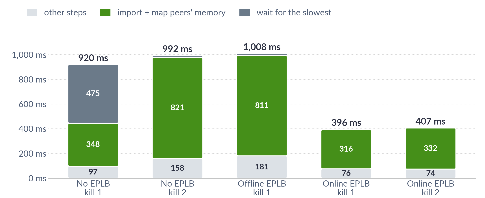

Caption (small, under the graph): DeepSeek-R1 NVFP4, DEP32 on 32 GB200, FT on, 1 rank killed, the survivor with the median remap time

*Notes:*
- **Key message:** Most of the remap is importing peers' fresh memory; one stall (cause open) accounts for most of no EPLB being ~2× slower.
- Diagnostic, 1 run per case, 31 survivors (CLAIMS 214, 215).

---

## B3. All-to-All Check Cost

**Slide text**

- FT adds +0.88 µs per round trip (+3.0 µs with online EPLB stats); removing all checks saves 0.85 / 2.86 µs (chart)
- Biggest: mask check in the stats loop (2.13 µs)
- Measured fixes, not shipped: ballot-based mask check in the stats loop (−1.62 µs), 8-byte release-flag read (−0.14 to −0.18 µs)

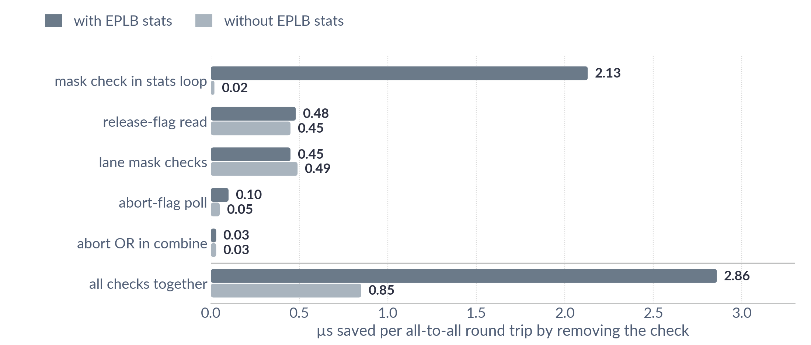

Caption (small, under the graph): Kernel benchmark, 32 GB200, 64 tokens/rank, median of 3 launches

*Notes:*
- **Key message:** FT's all-to-all checks cost ~1 µs per round trip, and one check dominates when EPLB statistics are on.
- EP32, 64 tokens/rank, n=3, diagnostic build (CLAIMS 210).
- Serving cannot resolve these µs (CLAIMS 212).

---

## B4. TTFT in the Closed-Loop Benchmark

**Slide text**

- All users start together → requests arrive in waves
- FT runs "lock" into tight waves more often (14/18 vs 6/18 soak runs)
- Locked: median TTFT +161 ms; steady: no detectable difference
- Realistic traffic: median TTFT +0.9% [−0.2, +1.9] (6 pairs)
- Cause: open

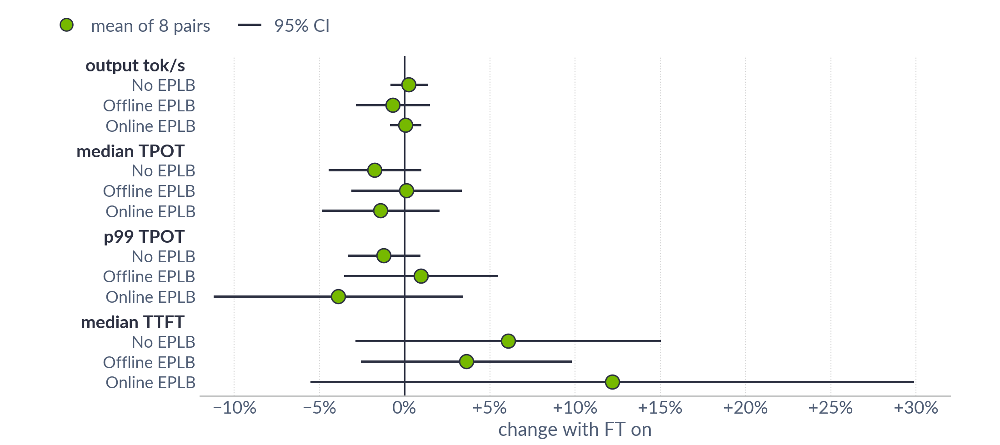

Caption (small, under the graph): DeepSeek-R1 NVFP4, DEP32 on 32 GB200, closed loop at 32 requests/GPU, mean and 95% CI over 8 same-node pairs

*Notes:*
- **Key message:** The +7% TTFT appears only in the synchronized-start benchmark, not under realistic traffic; cause open.
- Pooled at 32/GPU: +7.3% [+1.3, +13.3]. p99 unchanged. No shift detected at 128/GPU (CLAIMS 208, 223, 217).

---

## B5. Limits

**Slide text**

Fails Closed (job ends, as today)
- Rank 0 or its node
- A node plus its ring-copy node
- A loss the spare slots can't cover

Untested
- Host death, NVLink fabric faults
- Two frozen ranks at once
- CFT all-to-all path (needs driver ≥ 615)

Not Yet Supported
- Disaggregated serving
- Launchers other than mpirun + ULFM
- Lost rank rejoining (Phase 2)

No diagram.

*Notes:*
- **Key message:** What is not covered: it fails closed, as today.

---

## B6. Resource Costs

**Slide text**

- Host: /dev/shm copies, 390 GB/node (EPLB) or 49 GB (no EPLB)
- GPU, healthy: one small shared scratch per process
- GPU, after a loss: ≤ 0.44 GB (rank) / 1.75 GB (node) per survivor, until restart
- GPU, at recovery: fresh 7.5 GB workspace; old freed when the dead process exits
- Launch: ULFM Open MPI, host collectives over TCP

No diagram.

*Notes:*
- **Key message:** FT's resource cost is mostly host memory for expert copies; little GPU memory.
- Online EPLB on main already keeps the 390 GB. FT adds it for offline EPLB, and the 49 GB ring for no EPLB.
- Min MemFree: FT 356–374 GB vs off 745–759 GB.
- TCP launch: host collectives ~20–40% slower, step −0.1% (CLAIMS 158, 180).

---

## B7. Alternatives Considered

**Slide text**

| Alternative | Why not |
|---|---|
| Second CUDA graph set for N−k | 2× graph memory and capture time |
| Backed spare slots | Hold GPU memory forever (used only where VMM can't be CPU-mapped) |
| Restore into replica slots only | Drops replicas, raises peak load (used when spares run out) |
| Replica failover at orchestrator | Needs 32 spare GPUs; in-flight fail; 6–10 min down |
| Fixed mailboxes | Unsafe for R1's row sizes; healthy cost |
| Reuse workspace after a wait | Needs a bound on dead-GPU writes |

No diagram (table).

*Notes:*
- **Key message:** Why we did not choose the alternatives.

---

## B8. Turning It On

**Slide text**

- Off by default; FT off = main
- `TLLM_FAULT_TOLERANCE_MODE=1` + authority address + HMAC key
- Start the authority: `python3 -m tensorrt_llm.executor.recovery.authority --endpoint tcp://<ip>:5555 --world-size 32`
- Launch: `mpirun --with-ft ulfm ... trtllm-llmapi-launch trtllm-serve ...`
- Optional YAML: hang detection, timeouts, failure domain, spare-slot kind

No diagram.

*Notes:*
- **Key message:** How to turn FT on: env vars, the authority, and a ULFM mpirun launch.
- Env vars: `TLLM_FAULT_TOLERANCE_AUTHORITY`, `TLLM_FAULT_TOLERANCE_AUTHORITY_KEY`, `TLLM_FAULT_TOLERANCE_CONFIG`.
- Mode alone = detection only.
- User guide: `docs/source/features/wide-ep-fault-tolerance.md`.

---

## B9. What Happens to Each Request

**Slide text**

| Request | Outcome |
|---|---|
| Survivor's, in a discarded step | Replayed from its committed tokens |
| Lost rank's, nothing sent yet | Re-run on a survivor |
| Lost rank's, tokens already streamed | Retryable error (HTTP 503 / SSE error) |
| Interrupted twice, no progress | Retryable error |
| New, pinned to a lost rank | HTTP 400 |

No diagram (table).

*Notes:*
- **Key message:** Survivors' requests continue; only the lost rank's streamed requests get a retryable error.
- Token-exact vs a no-failure run: held on v5-final in 6 of 6 kills on a deterministic small config; pre-set rule PASS in 2 of 2 once the harness's placement check was fixed (CLAIMS 231, 233, 237); on the standard config healthy runs are not token-deterministic (CLAIMS 230).

---

## B10. The One Healthy Hang

**Slide text**

- 1 of 36 FT runs hung (0 of 31 FT off)
- All ranks stuck in a host allgather over TCP
- FT's hang detection doesn't cover all-rank host stalls → the job ended after 600 s (main's 300 s detector, then 300 s in Shrink)
- Soak after: 0 hangs in 7.1 h (FT) / 7.2 h (off)
- Follow-up: detector fixes

No diagram.

*Notes:*
- **Key message:** One healthy run hung (not attributed to FT); a 7-hour soak since showed no hangs.
- Fisher p ≈ 1, so the counts can't tell whether FT caused it (CLAIMS 204).
- Soak rate < 0.42/h per arm (CLAIMS 222).

---

## B11. Benchmark Caveats

**Slide text**

- MTP acceptance forced to 1 (perf recipe)
- All requests released at once (closed loop)
- Exact 1k/1k; one model; one cluster size
- FT on: ULFM over TCP; FT off: default launcher
- Restart time is a lower bound (caches kept)

No diagram.

*Notes:*
- **Key message:** Benchmark settings to keep in mind when reading the numbers.

---

## B12. Throughput vs Per-User Speed

**Slide text**

- FT on and off sit on the same curve in every mode
- 32 → 128 requests/GPU: ~1.6–1.8× throughput per GPU, ~2–2.3× slower per user

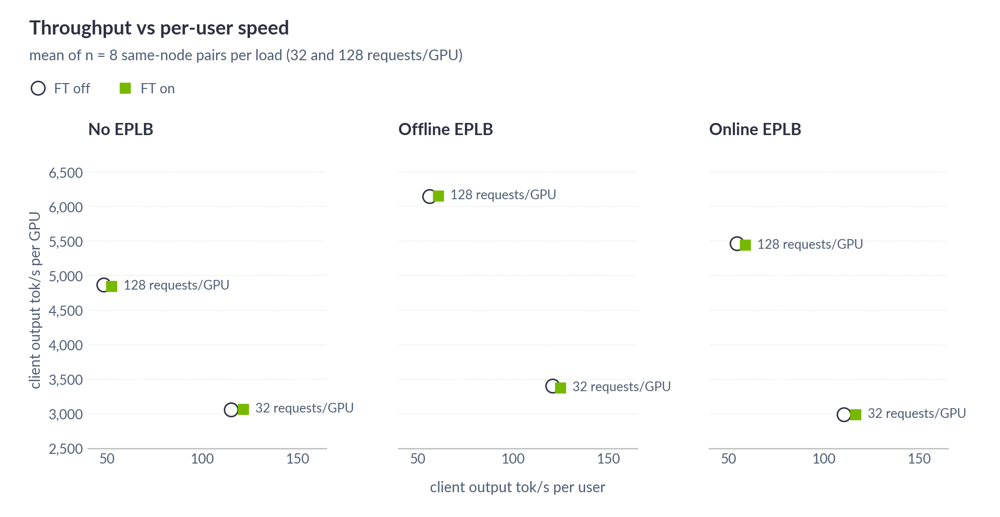

Caption (small, under the graph): DeepSeek-R1 NVFP4, DEP32 on 32 GB200, closed loop, 1k in / 1k out, mean of 8 same-node pairs per load

*Notes:*
- **Key message:** FT does not change the throughput–latency trade-off.
- Mean of n = 8 same-node pairs per load (CLAIMS 206, 232).

---

## B13. TTFT Around a Kill

**Slide text**

- Requests arriving right after the kill: median TTFT 0.9 → 1.14 s
- Then ~1.05 s: the same load on 31 GPUs
- Only the lost rank's in-flight requests fail

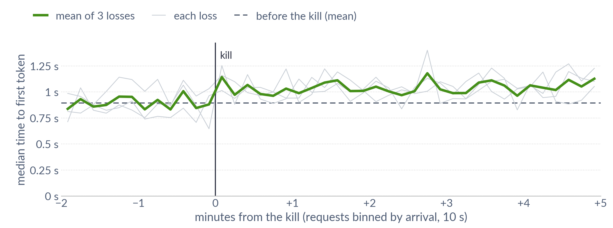

Caption (small, under the graph): DeepSeek-R1 NVFP4, DEP32 on 32 GB200, online EPLB, FT on, realistic traffic at ~80% load, 3 rank kills

*Notes:*
- **Key message:** Users see a brief TTFT bump right after a kill, then a slightly higher steady TTFT because the same traffic now runs on fewer GPUs.
- Median TTFT of requests binned by arrival (10 s), mean over the same 3 losses as slide 14's figure (not slide 14's TTFT bullet, which uses whole windows of 2 S2 cases); 895 → 1143 ms (first 10 s) → 1046 ms (+1 to +5 min) (CLAIMS 225).
- 66 failed requests in these windows = the lost ranks' in-flight requests (21 + 22 + 23).

---

## B14. Likely Questions (Q&A prep)

**Slide text**

- Do survivors' requests continue exactly (same tokens)?
- What else can a dead GPU write to?
- Which failures are covered?
- Why do the lost rank's streamed requests fail?
- Does it scale past 32 GPUs, other models?
- Healthy cost at low concurrency?
- Is a 30 s hang confirmation OK?
- Authority failure, or a loss during recovery?
- Is the healthy comparison confounded by the launcher?
- How many losses can it take?

No diagram.

*Notes:*
- **Key message:** The questions reviewers will ask, with the honest short answer and where it is in the deck.
- Exact: the design replays survivors' unfinished steps from their committed tokens (B9). Token-exact check passed on an older build with a deterministic reference (CLAIMS 95, n=2). On v5-final's standard config the check cannot decide: two healthy runs of the same greedy requests already differ (first diff at tokens 26, 47, 1 of 400; CLAIMS 230). On a deterministic small config (MTP + overlap, real acceptance) survivors' and the re-run victim's 400 tokens equal the no-failure run exactly in 6 of 6 kills; the first two jobs failed the pre-set rule only on a harness bug in the control-placement check, and after fixing it the rule passes in 2 of 2 (EXACT-SMALL 8356173, EXACT-SMALL2 8360292, EXACT-SMALL3 8363137; CLAIMS 231, 233, 237). It tests the recovery path only: no expert moves, same batches; the expert-restore path is covered by GSM8K. GSM8K after a kill: 0.948 vs 0.947 (one run).
- Dead-GPU writes: the all-to-all workspaces bound to the MoE execution state are remapped (slide 9). Other peer-writable allocations were not audited. Late-write tests: 2–4 GPUs, relying on CUDA VMM page lifetime; no at-scale run observed an absorbed late write.
- Coverage: process death (kill, crash, OOM), a node's processes, further losses, a frozen rank with hang detection (slide 3, B5). Not covered: rank 0 or its node, a node plus its ring-copy node. Host death and NVLink faults are untested (expected to fail closed).
- Lost rank's requests: ones that returned nothing re-run on a survivor; ones that already streamed end with a retryable error (B9). Re-prefilling prompt + streamed tokens on a survivor is possible future work.
- Scale: measured only on DeepSeek-R1, 32 GB200. Each survivor imports every peer's fresh workspace in the remap, so that part grows with the peer count (B2). GLM-5.3 is next (slide 21).
- Low concurrency: the step cost is a fixed ~51–150 µs (slide 16), so the percentage is larger on shorter steps; measured only at 32 and 128 requests/GPU.
- 30 s: at 5 s a healthy rank holding the GIL was falsely fenced; at 30 s a 45 s GIL hog and all-rank or node host stalls were not (older builds, n=1 each; CLAIMS 77, 97, 103). Values in between untested.
- Authority loss: serving continues, `/health` reports unprotected, a further loss ends the job (EP4 only, CLAIMS 88, 101). A loss before Install restarts the round with every lost rank; a loss after Install ends the job.
- Launcher: FT off over FT's ULFM/TCP launcher vs the default launcher: decode step −0.08% / −0.13% (n=2, CLAIMS 180). The soak ran both arms on the ULFM launcher.
- Loss budget: spare slots are sized so the survivors of one node loss hold every expert; further losses recover while the survivors' slots still hold every expert (two sequential losses tested, slide 18). A node plus its ring-copy node fails closed.

---

## B15. Kill Under Realistic Traffic (was slide 14; timeline also on slide 13b)

**Slide text**

- Poisson arrivals, mixed lengths, ~80% load, online EPLB
- Random rank or node killed mid-run
- First 10 s after a rank kill: −10% (mean of 7; −3 to −16%), then around the offered load
- Only the lost rank's in-flight requests fail (18–23 per rank kill, 73 for the node kill)
- After the loss, same load: median TTFT +24–25% (2 rank kills)

Caption (small, under the graph): DeepSeek-R1 NVFP4, DEP32 on 32 GB200, online EPLB, FT on, realistic traffic at ~80% load, 7 rank kills

*Notes:*
- Realistic traffic: requests arrive at random (Poisson) at a fixed 51 req/s, not a fixed number in flight; input 128–4k and output 64–2k tokens (uniform random); 90% completions, 10% chat; streamed; online EPLB.
- "~80% load": 51 req/s ≈ 80% of the request rate a closed-loop run (fixed 32 requests/GPU) with the same lengths sustains (64.1 req/s in the S1C FT-on arm; the rate was fixed from the S2 jobs, 0.8 × their FT-on closed-loop rate).
- **Key message:** Under realistic traffic, a kill costs a ~10% dip for 10 s, then serving keeps up; only the lost rank's requests fail.
- Jobs: S2 8299473 / 8318006 and S3 8314070 (CLAIMS 216, 218, 219).
- All 8 losses recovered in 0.87–1.96 s (the node kill: 1.96 s).
- Failed requests = the lost ranks' in-flight requests: 18–23 per rank, 73 for the node.
- Offered load stayed below post-loss capacity, so served ≈ 1.0×.
- Capacity = closed-loop calibration before the run vs at its end.
- TTFT 826 → 1021 ms and 842 → 1049 ms (CLAIMS 216): the same offered load now runs on 31 GPUs, so each is busier.
- TTFT over time around the kill: backup B13.
- Capacity left after the loss: 0.92–0.93× (4 cases). It differs from slide 13 (94.5%): 32 vs 128 requests/GPU, mixed lengths vs 1k/1k, and an end-of-run row vs the first wave after the resume; not decomposed.
- The chart averages all 7 rank kills (thin lines: each kill). The node kill (4 GPUs) dips −30% in its first 10 s, then also returns to the offered load (CLAIMS 236).
- `/health` missed the short "recovering" state in 3 of 8 (1 s cache). Fix candidate.

---

## B16. Healthy Cost Under Realistic Traffic (was slide 17)

**Slide text**

- Online EPLB, 51 req/s (~80% load), 35 min per run, 6 pairs
- Median TTFT +0.9% [−0.2, +1.9] (95% CI); median TPOT +0.1 ms in 5 of 6 pairs (+0.7%)
- p99: one outlier run each way; no change detected (TTFT +3.0% [−4.5, +10.4], TPOT −3.8% [−18.6, +11.0])
- Served throughput within ~0.2%
- The closed-loop benchmark's TTFT +7% (B4) does not appear here

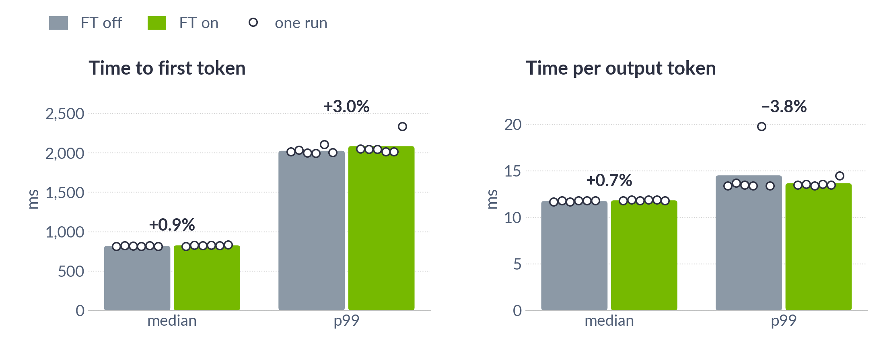

Caption (small, under the graph): DeepSeek-R1 NVFP4, DEP32 on 32 GB200, online EPLB, realistic traffic at 51 requests/s (~80% load), mean of 6 same-node pairs, dots = each run, label = mean change per pair

*Notes:*
- Traffic definition: B15 notes.
- **Key message:** Under realistic traffic, FT's latency changes are small: median TTFT +0.9%, median TPOT +0.1 ms; p99s vary more between runs than with FT (6 pairs).
- S1 8310100 + S1B 8359063 + S1C 8363138 (CLAIMS 217, 234, 240). n=6 pairs; mean of per-pair % change with a 95% t-CI (descriptive; the plan sets no pass bar). S1C was planned before any S1B data.
- TPOT is recorded to 0.1 ms: the median TPOT change is one 0.1 ms step in 5 pairs and 0.0 in 1.
- p99 outliers: in S1C pair 1 the FT-off run's p99 TPOT was 19.8 ms (other 11 runs 13.4–14.5 ms); in S1C pair 2 the FT-on run's p99 TTFT was 2338 ms (+16.6%) and p99 TPOT 14.5 ms (+8.2%). Medians are within 2.3% in all 6 pairs. With 4 pairs p99 TTFT was +1.4% [+0.1, +2.7]; with 6 the CI includes 0.
- Chart labels = mean of per-pair % changes (as in this text); bars = mean of runs.
- Host-memory growth check: FT-on arms 6/6 pass; FT-off arms 4/6 (both FAILs in FT-off); latency pairs are kept (CLAIMS 217, 234, 240).
- The closed-loop benchmark showed median TTFT +7% at 32/GPU; it does not show here (backup B4).

---

## Figure Sources

- Slide charts (`figures/talk/*_talk.png`):
  - Generator: `review/figures/final_clean/make_talk_figs.py`.
  - Drawn from the CSVs the doc scripts write, so every plotted number matches the doc figures and CLAIMS.
  - Style: one slide style, wide frames, larger text, solid mode colors.
- Slide diagrams:
  - `detect_talk` and `phases_rise_talk`: `make_talk_design.py`.
  - The other diagrams are the doc versions (`figures/*_final.png`, `figH_oct20_late_writes.png`).
- Quality rounds:
  - Blind judges compare the slide figures with public TRT-LLM tech-blog charts and diagrams.
  - Keys: `review/diag/blind_key_talk_r<N>_{charts,design}.txt`.
- `tools/sync_final.sh` copies `*_talk.png` into `figures/talk/`.
- `tools/regen_figs.sh` rebuilds every figure and CSV from the run records, backs up what changed (TRASH/<date>/) and syncs FINAL.
