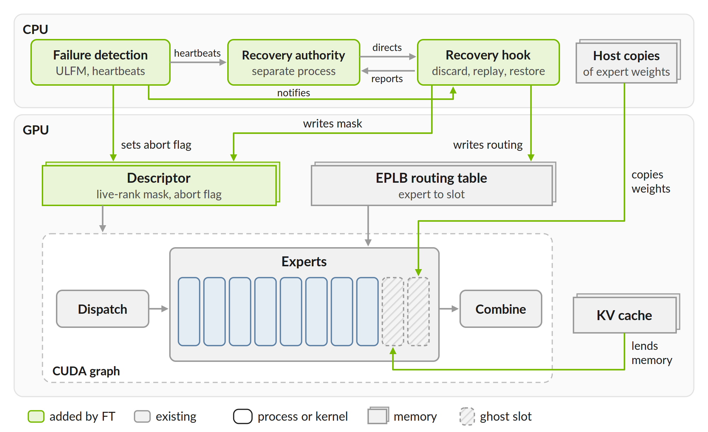
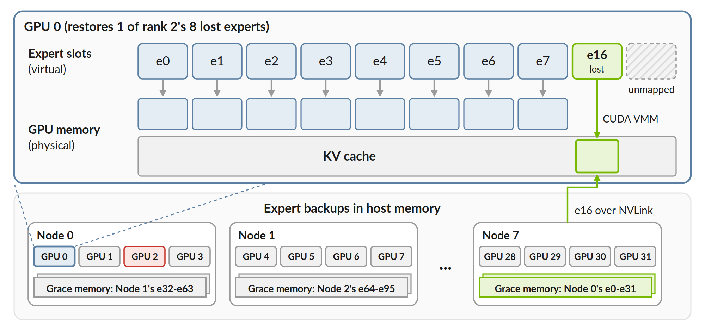
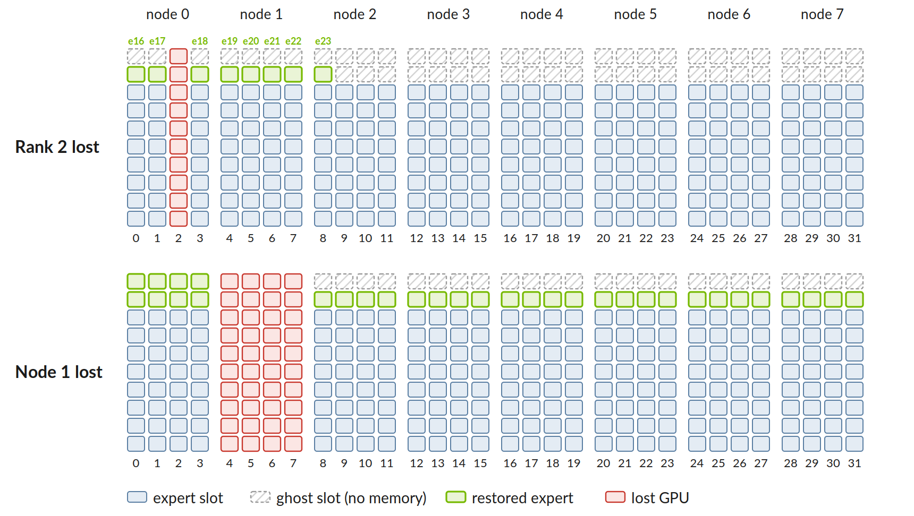
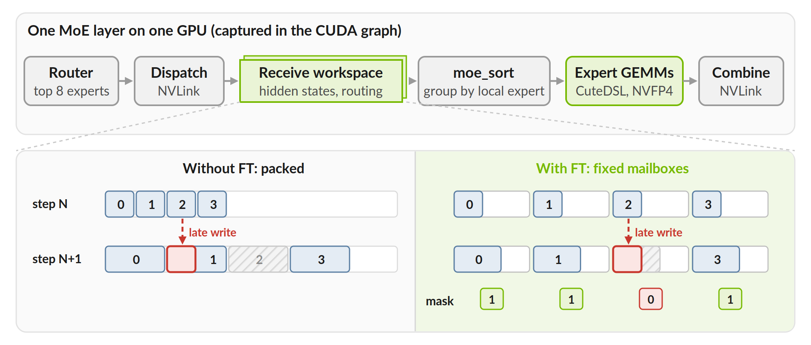
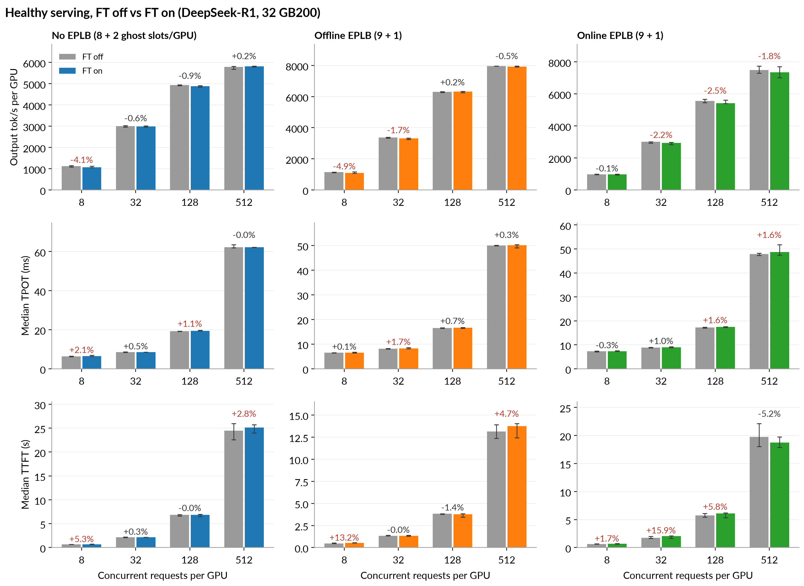
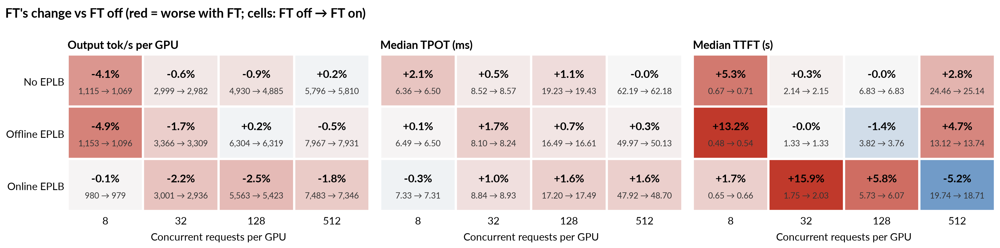
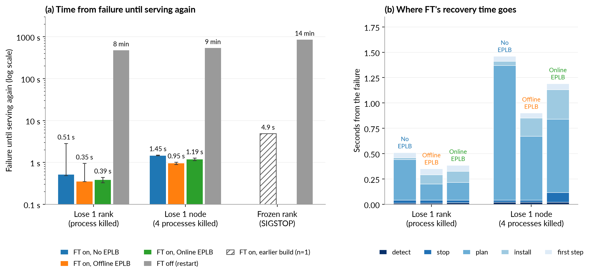
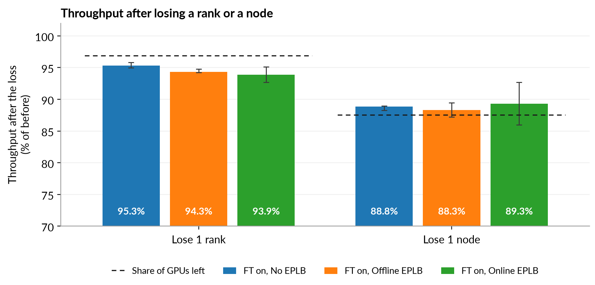
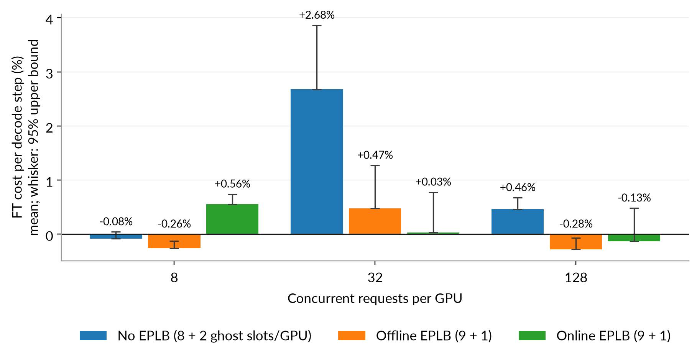
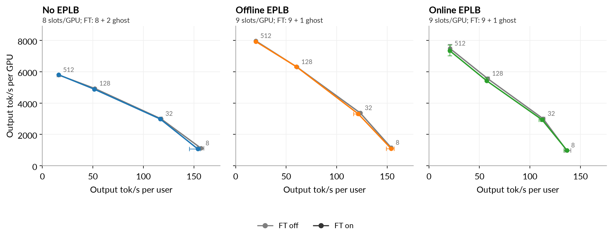

# WideEP Fault Tolerance MVP Design Doc

Andrew Rusli | Created: Oct 19, 2026 | Update: Oct 21, 2026 | Status: Prototyping

## Overview & Motivation

Today, losing one rank of a wide expert-parallel (WideEP) deployment ends the whole job, and serving resumes only
after the job restarts (minutes). This design allows the surviving ranks to regroup in about a second and continue serving on
the same CUDA graphs captured at startup.

What this means for a 32-GPU DeepSeek-R1 deployment at 4,096 concurrent requests:

| | Without FT (restart) | With FT |
|---|---|---|
| Lose one rank | all 4,096 requests fail; ~8 min down | ~125 requests end with a retryable error; serving resumes in 0.4-0.5 s |
| Lose all processes of one node | all fail; ~9 min down | ~500 end with a retryable error; resumes in 1.0-1.5 s |
| A frozen process | all fail; ~14 min down (300 s hang detector + restart) | serving resumes in ~5 s (earlier build, hang detection on) |

While healthy, clients see 0-5% lower throughput with FT (within 1% in 6 of 12 load points; worst -4.9% and -4.1%
at 8 requests/GPU, -2.5% with online EPLB at 128). FT's decode step itself costs under 1%, except +2.7% without EPLB
at 32 requests/GPU; the rest is slow steps and longer prefill, not yet attributed to FT. Causes are being located
(see Evaluation).

The deployment then serves on N−k ranks with the same graphs. A lost rank does not rejoin yet, so FT turns an unplanned
outage into a planned restart at a convenient time; recovering back to N ranks while the survivors serve is the next
phase. See *RISE: WideEP Fault Tolerance in TRTLLM* for the broader project
plan.

This is motivated because failures are more common at large scale and restarts are costly [1, 2]. In an 18-week trace of
NVIDIA's Dynamo serving cluster running ~150 model replicas (mostly 8 GPUs or fewer per deployment), the cluster saw
restarts occurring 46 times a day with a median recovery of 3.5 min. 77% of these restarts were caused by engine
process deaths or hangs, leaving the GPU intact [1]. WideEP deployments span 32 to 64+ GPUs, making them even more
susceptible to hardware and process failures. See *TRTLLM WARP: Warm Artifact Reuse Pipeline* for work on speeding
up (re)startup.

## Goals & Scope

Main goals:

- **Performance:** FT mode while healthy (no failures) should cost as little throughput as possible. Throughput after
  failover should be reasonable as well, but since we aim to support recovery back to N later, this need not be hyper
  optimized.
- **Recovery time:** rank/node loss should recover in seconds by using the same CUDA graphs.
- **Correctness:** requests on survivors continue; requests on the failed ranks rerun or end with a retryable error
  (a new request strictly pinned to a lost attention-DP rank gets a non-retryable error).

This design currently supports:

- MoE models (tested with DeepSeek-R1; other models are the next priority)
- Aggregated serving (disaggregated serving is also a next priority)
- Attention DP and EP, with expert TP = 1
- NVLinkOneSided MoE all-to-all
- Offline and online EPLB
- Overlap scheduler
- MTP (other speculative decoding methods are currently untested)
- KV Cache Manager V2 (required)
- Open MPI built with ULFM (`ompi_info | grep ftmpi`), launched with `mpirun --with-ft ulfm`, and mpi4py ≥ 4 (FT
  checks both; our container has 4.1.2); our launcher selects the ob1/TCP transport

FT refuses to start with features it does not handle (e.g. guided decoding, beam search, disaggregated KV transfer,
KV connectors, PEFT, pipeline or context parallelism), and rejects requests it cannot replay (per-request
penalties, logits post-processors, multimodal input with the overlap scheduler).

Failures covered:

- One process-level rank failure, e.g. `SIGKILL`
- One process-level node failure (the machine/host stays up)
- Further process-level rank failures after a recovery (or during one, before the new placement is applied). A loss,
  counting every rank lost so far, is recovered if and only if it is a union of admitted failure domains that the
  survivors' slots still cover; otherwise every survivor raises before changing anything and the job ends (at the
  authority's recovery deadline). For DeepSeek-R1 the ghost slots cover exactly one node (24 x 10 = 240 < 256 slots
  after a second node), so losing a second node ends the job.
- A frozen process, e.g. `SIGSTOP`, or a rank that hangs while alive, only with the optional hang detection on (off
  by default; ~35-40 s for a live hang; a frozen process served again in ~5 s on an earlier build). Without it, a
  stopped rank holds the survivors' agreement until it ends.
- Anything else (rank 0, rank 0's node, host death, NVLink fabric) ends the job as it would without FT, possibly only
  after the executor's hang timeout; silent wrong results are not detected.

**Terms.** *Rank*: one GPU process. *Attention DP (ADP)*: each rank serves its own requests. *EPLB*: the MoE expert
load balancer that places experts into *slots* (online: updated while serving; offline: a fixed placement).
*Ghost slot*: a slot with reserved addresses but no memory until a restore. *ULFM*: Open MPI's fault-tolerance
extension that lets survivors keep communicating. *Recovery authority*: the process that decides membership.

## Design Overview

FT uses the same CUDA graphs, even when a rank is lost. This means the number of ranks and expert slots, buffer
addresses, and kernels stay fixed. A failure changes small tables the graphs read on every launch, like the
live-rank mask and EPLB's expert-to-slot table (Figure 1). Three ideas make this work:

- **Ghost slots:** spare expert slots (reserved virtual addresses the CUDA graphs already know) with no memory behind
  them while healthy. On a failure, memory is mapped behind them, from free GPU memory first and from the KV cache if
  needed. Lost experts are copied in from host copies.
- **Per-sender mailboxes:** each GPU's counters and flags in every peer's all-to-all buffer are its own and fixed, and
  tokens are read in place where the MoE backend supports it. Once the survivors agree on who failed, the failed GPU
  is fenced (its process ended) before they change routing or the live-rank mask; see Late writes for what that does
  and does not guarantee.
- **Recovery authority:** one process outside MPI that decides who is alive and the new expert placement. Every
  survivor applies the same change; if one fails to install it, the job ends at the authority's deadline.

In Figure 1, a failure detector on each rank reports to the recovery authority. The authority tells every rank's
recovery hook what to change. The hook rewrites the tables and fills ghost slots from host copies while no graph is
running, and the next graph launch picks up the change.

*Figure 1. One rank: detection, the recovery authority, the recovery hook, and the fixed tables the CUDA graph reads.*

## Ghost Slots

On each GPU, a layer's experts are stored stacked in one array, and each position in that stack is an expert slot.
EPLB's table tells the kernels which slot holds which expert. FT adds a few spare positions at the end of the stack
whose addresses are reserved but have no memory behind them: these are ghost slots. Since the table never points at
them while healthy, they cost no device memory and receive no tokens (the MoE kernels still see the larger slot
count, ~1 µs per layer in our no-EPLB profile at 32 requests/GPU).

When a rank dies, each survivor that receives one of its experts maps memory behind a ghost slot and copies the
expert in from a host copy (Figure 2). The memory comes from free GPU memory first, and from the KV cache only if
needed. The copy never reads from the dead GPU.

*Figure 2. Restoring rank 2's expert e16 into a ghost slot on GPU 0 (DeepSeek-R1, 32 GPUs, no EPLB).*

Where the host copies live:

- **With replicas (online or offline EPLB):** every node keeps every expert in host memory (368 GB of `/dev/shm` per
  node for DeepSeek-R1), so the copy stays on the node. With online EPLB, CPU threads write it through GDRCopy, the
  same path EPLB uses for its updates; with offline EPLB, the GPU copies it in. FT off with offline EPLB keeps no host
  copies, so this memory is new.
- **Without replicas (no EPLB):** each node keeps the next node's experts, so every expert has a copy on a different
  node.

Each GPU gets a few spare slots (e.g. 8 + 2, or 9 + 1 with online EPLB, for DeepSeek-R1 on 32 GPUs). At startup, FT
checks that the survivors of any one-node loss can still hold every expert. Both arms of our runs use one pre-tuned GEMM table, checked
in every run, so tuning noise is removed; but the table is keyed by the total slot count, so FT (320 slots) picks
different tiles than FT off (256/288) at some batch sizes (identical at 32 requests/GPU; different at 8 and 128,
where the measured cost is small). Keying tuning on the slots in use would remove this. FT is not fully kernel-neutral, though: without EPLB its extra slots move the
routing kernel to a larger tier (off the critical path in our profile), its all-to-all does more work per
layer (see Evaluation), FT turns on the load-balancer path that FT off without EPLB never
runs, and with online EPLB the host-writable ghost memory holds GDRCopy mappings (13 GiB of BAR1 on rank 0). If GPU memory can't be made CPU-writable, online EPLB defaults to
spare slots that are backed by memory and left empty (`extra_slots: empty`, which can also be chosen in config).

## Expert Placement

Every survivor computes the same plan from the same inputs. Each lost expert goes to a ghost slot on the survivor
that has received the fewest so far, lowest rank first, which spreads the extra work evenly (Figure 3). With replicas
(online or offline EPLB), if ghost slots run out, the remaining experts take slots of experts that still have a second copy, and the
next EPLB update rebalances as usual.

*Figure 3. Where lost experts go after losing rank 2 or node 1 (no EPLB: 8 experts + 2 ghost slots per GPU).*

## Late Writes from a Dead Rank

A dead rank may still have NVLink writes in flight. Upstream already gives each sender a region of every receiver's
buffer, but its stride follows that step's largest sender, so a late write can land on a live sender's tokens in the
next step. FT fixes the stride, giving each sender a fixed mailbox (Figure 4):

- Everything a sender writes into a peer is indexed by the sender: its completion flag, its receive count, its EPLB
  statistics row and its payload rows (fixed slots: row = sender x capacity + i). Each payload layout (e.g. NVFP4
  layers vs DeepSeek-R1's BF16 MTP layer) has its own fixed dispatch region, so a late write from a dead sender, however
  late it lands, only reaches that sender's rows, which receivers ignore once it is masked. No timing assumption is
  needed. The fence-path combine pulls, so a dead rank writes no combine data into survivors.
- The proof is kernel-level plus R1's layout, not a serving-scale spray. A GPU test SIGKILLs a peer mid-dispatch
  (NVFP4 payloads into a workspace whose survivor runs BF16) at 0, 3 and 50 ms, and every byte outside the dead
  sender's rows keeps its sentinel. The same test with both signatures sharing one region (no per-layout regions)
  writes into live rows at the same timings, so the test detects the hazard. At startup, rank 0 logs each signature's
  region, which shows that R1's MTP and NVFP4 layers get disjoint regions [pending: v5 serving run].
- Reusing that mailbox, when scaling back to N ranks, will need a guarantee that the dead GPU's writes have stopped.
  With that guarantee we can also reconsider this mailbox design.
- Where the MoE backend supports it (CuteDSL NVFP4 except SM107, Cutlass unquantized without LoRA), the expert GEMMs
  read each token's hidden state straight from its mailbox and only each token's small routing row (top-8 slot ids
  and scales, ~64 bytes) is compacted; other paths copy the received tokens into a compact buffer.
- The failed rank is always fenced before the survivors resume: the authority has rank 0 end every failed rank through
  the MPI runtime before it proposes a plan, with or without hang detection, and aborts the recovery if one cannot be
  ended. Survivors resume only after the plan's agreement and install, hundreds of ms after the fence; we assume a
  killed GPU's NVLink writes have drained by then. That assumption is not measured under a real kill (CLAIMS 100: the
  late-write cases were INVALID).

*Figure 4. The dispatch pipeline (top); a late write in a packed buffer (left) vs per-sender mailboxes (right).*

## Recovery Flow

1. **Detect:** a native watcher plus Open MPI's failure detector notice the loss: a killed rank in ~0.1 s, a frozen
   process in ~5 s (`mpi_ft_detector_timeout`; recovering from it needs hang detection). An abort flag stops kernels waiting on the dead rank.
2. **Agree:** survivors stop, agree on who failed (the ULFM shrink) and discard uncommitted steps. Each survivor
   computes the new placement and maps memory for its ghost slots while the authority fences the failed ranks and
   proposes a new generation.
3. **Plan:** without EPLB, survivors copy in the lost experts; each survivor replies with a hash of the plan
   (placement and copy plan).
4. **Install:** once all hashes match, survivors copy in the lost experts (with EPLB replicas), update the routing
   table and live-rank mask, and the authority commits.
5. **Resume:** discarded steps replay on the new placement, and serving continues on the same CUDA graphs.

Other notes:

- A loss before install restarts the round with every lost rank; a loss during install fails closed.
- Surviving requests continue from exactly the tokens they had. A lost rank's requests rerun if they had returned no
  output yet; otherwise they end with a retryable error. A request that a later loss interrupts again without
  progress ends with a retryable error on any rank; a cancelled request stays cancelled.
- `/health` returns 200 with `healthy`, `degraded` (fewer ranks), `unprotected` (the authority is gone) or
  `unknown`, and 503 with `recovering` (~1 s, at most `authority_timeout_s`) or `terminal`. Load balancers stop routing on
  503; liveness probes must tolerate it for `authority_timeout_s`.

## Deployment Costs

- **Healthy throughput:** clients see 0-5% lower output throughput (6 of 12 load points within 1%; worst -4.9%
  offline and -4.1% no EPLB at 8 requests/GPU, -2.5% online at 128). Per decode step: under 1% except +2.7% without
  EPLB at 32 requests/GPU (see Evaluation).
- **Host memory:** with replicas (online or offline EPLB), every node keeps every expert in `/dev/shm` (368 GB per
  node for DeepSeek-R1); without replicas, each node keeps one other node's experts.
- **Launch:** Open MPI built with ULFM (not in the release container yet), mpi4py ≥ 4, the ob1/TCP transport
  (selected by our launcher), and one extra recovery-authority process.
- **Shutdown:** slower than without FT (see Limitations); set the orchestrator's grace period accordingly.
- **Not covered:** rank 0 or its node, a dead host, an NVLink fabric failure, and (for DeepSeek-R1) a
  second node; these end the job as without FT. Disaggregated serving, guided decoding, per-request penalties,
  logits post-processors and multimodal input with the overlap scheduler are not supported with FT yet.
- **When to enable:** when restarts are frequent enough that minutes of downtime and thousands of failed requests per
  failure cost more than FT's healthy-path cost; at 32+ GPUs a failure every day or two is typical [1, 2].

## Configuration

FT is enabled per deployment with `TLLM_FAULT_TOLERANCE_MODE`, the authority's address and key
(`TLLM_FAULT_TOLERANCE_AUTHORITY`, `TLLM_FAULT_TOLERANCE_AUTHORITY_KEY`; the mode alone enables detection only) and a
small YAML file (`TLLM_FAULT_TOLERANCE_CONFIG`):
`extra_slots` (`ghost` or `empty`), `failure_domain` (`node` by default), `recovery_timeout_s` (30),
`authority_timeout_s` (20) and the optional hang detection. The recovery authority runs as one extra process
(`python -m tensorrt_llm.executor.recovery.authority`, `executor/recovery/authority.py`). Moving these settings into `LlmArgs` is a follow-up.

## Evaluation

**Setup.** DeepSeek-R1 (NVFP4) on 32 GB200 GPUs (8 nodes × 4), attention DP + 32-way EP, overlap scheduler, MTP
(one draft token), the TRT-LLM reference serving configs for each mode, `benchmark_serving` with 1k input / 1k output
random tokens. **Scope:** aggregated serving, i.e. TRT-LLM's aggregated GB200 DeepSeek-R1 FP4 perf recipe
(`tests/scripts/perf-sanity/aggregated/deepseek_r1_fp4_v2_2_nodes_grace_blackwell.yaml`) scaled to DEP32, with prefill
and decode on the same ranks. It is not the repo's disaggregated wide-EP generation server
(`examples/wide_ep/slurm_scripts/config.yaml`: max batch 128, 512 tokens, MTP3); results do not transfer to it as is.
Three modes: no EPLB (256 experts; FT adds restore slots), offline EPLB (a fixed placement with
replicas, from offline statistics) and online EPLB (288 slots, one layer updated per iteration). FT off is main's
code path on its default launcher; FT on adds the FT config, the ULFM launcher and the recovery authority. FT reserves a separate dispatch region
per payload layout, so a dead rank's late writes stay in its own rows across layers of different precision
(DeepSeek-R1's MTP layer is BF16, the others NVFP4); this takes about 1.07 GB per rank from the KV cache, with FT on
only.
FT on and FT off alternate on the same nodes and build; each load point runs ≥150 s after a discarded warm-up row.

*Final runs (Oct 21, build `v2`): a protocol fixed before the runs, with node groups as the unit (3-4 groups per mode),
FT on and FT off in mirrored order within each group, a discarded 60 s warm-up row, ≥150 s per load point, and one
shared GEMM tuning table checked in every run. Kill and accuracy runs use the same build.*

### Healthy cost

FT on vs FT off with the standard client metrics at 8, 32, 128 and 512 concurrent requests per GPU. Bars: median over
3-4 paired runs per arm; whiskers: min-max; labels: FT's change of the medians (red: worse by 1% or more). One
offline FT-off run at 512 is excluded (late arrivals at the network level). Single runs vary by up to ~8% at 8-32
requests/GPU, so differences of a few percent are indicative. Slots per GPU: no EPLB 8 (FT: + 2 ghost), offline and
online EPLB 9 (FT: + 1 ghost).

*Figure 5. Healthy serving, FT off vs FT on: output throughput, time per output token (TPOT) and time to first token (TTFT).*

The same data as FT's change at every point, with the raw medians (FT off → FT on); red is worse with FT, blue
better:

*Figure 6. FT's change vs FT off at every load (red = worse with FT; cells: FT off → FT on).*

- **Throughput:** within 1% at 6 of 12 load points; 1.7-4.9% lower at the others (no EPLB 8: -4.1%; offline 8/32:
  -4.9/-1.7%; online 32/128/512: -2.2/-2.5/-1.8%).
- **Latency:** median TPOT up to +2.1%; median TTFT up to +16% (online, 32) and +13% (offline, 8).
- **Where it comes from:** FT doesn't slow a normal step (<1%, except no EPLB at 32; Appendix A1). The gaps come
  from occasional freezes and from prefill, which users see but a normal step doesn't:
  - **8 requests/GPU:** ~0.17 s freezes on all GPUs every ~60 steps, in FT-off runs too. Cause (job 8126134, all-rank
    logs): in some launches the attention-DP ranks fall out of step, so a few ranks admit new requests while the
    rest decode; any prefill on any rank makes every rank run that step without CUDA graphs. A benchmark-phase effect
    at low load, not an FT cost per step (+0.06%); FT runs happened to fall out of step more often (6 of 8 pairs),
    and whether FT makes that likelier is open.
  - **Online EPLB TTFT and throughput:** within launch-to-launch variance. A rerun (job 8127379, 2 groups) gave
    FT-off TTFT of 3.1 s and 5.9 s for two launches at 128/GPU, a bigger spread than FT on vs off; FT's decode step
    there is +0.2-0.4%.
  - **No EPLB at 32:** here FT does slow every step, in the all-to-all (+6 µs per layer); the kernels alone show no
    cost. The combine runs with nothing else on the GPU and is still ~2.4 µs slower, so the cost is inside FT's combine
    kernel. A benchmark with serving's settings reproduces only ~1 µs of it per round trip, with or without serving's
    buffer size and real uneven routing (job 8129075, n=3); the rest appears only in full serving. Ruled out: buffer
    size, routing skew, PDL, concurrent kernels, GEMM tactics. Mechanism open; no obvious fix yet.
- **Memory:** ghost slots 0 GiB while healthy; plain restore slots ~1.3 GiB per GPU.

Details and the per-step statistics are in the Appendix.

### Recovery

Failures are injected during decode at 128 requests/GPU on the final build: one rank's process killed, or all four
processes of one node killed (the host stays up); 2-3 kills per case and mode, 16 in total, no client failures. A
frozen rank (SIGSTOP) needs hang detection (wave 2, off in the final runs) and was measured once on an earlier build;
a frozen node and a real host loss were not tested. FT off restarts the server in the same allocation (CLAIMS #117:
online EPLB, 128/GPU, earlier build; the restart does not depend on FT). Bars: median; whiskers: min-max.

*Figure 7. Recovery: (a) time from failure until serving again, FT on vs a restart without FT (log scale); (b) where FT's recovery time goes.*

- **FT serves again in 0.4-0.5 s after losing a rank and 1.0-1.5 s after losing a node; a restart takes 8-9 min**
  (14 min for a frozen rank, including the 300 s hang detector). Clients see it ~0.5 s later (the benchmark polls).
- **Outliers:** a no-EPLB rank kill took 2.8 s (a survivor's log write stalled on the shared file system); an offline
  rank kill took 0.95 s (slow first step).
- **Frozen rank:** 4.9 s on an earlier build, ~4.3 s of it failure detection (CLAIMS #102, #109; n=1).
- **Plan** (mapping memory behind restored slots) is the largest phase, especially after a node loss.
- **Requests:** those streaming from the lost rank end with a retryable error; those not yet streamed rerun on the
  survivors; all others continue from their exact tokens (a request a later loss interrupts again without progress
  would end with a retryable error).

After recovery the deployment serves on the remaining GPUs. Decode throughput (rank 0's decode tokens per second
times live ranks, in the decode steps before vs after the loss) drops roughly in proportion to the GPUs lost:

*Figure 8. Throughput after losing a rank or a node, as a share of before (dashed: share of GPUs left).*

- **Lose 1 rank:** 94-95% of before (97% of the GPUs left); **lose 1 node:** 88-89% (87.5% of the GPUs left).

## Alternatives Considered

- **Restore over replicas first:** overwriting a live replica needs no new memory, but in our placement simulation it roughly
  doubled peak expert load after a node loss, and it couples recovery to EPLB's state. Ghost slots keep every
  surviving replica.
- **Spare slots backed by memory:** faster to restore, but the memory is held out of the KV cache permanently. The
  default only where GPU memory can't be made CPU-writable; otherwise a config choice (`extra_slots: empty`).
- **A second set of CUDA graphs for the degraded layout:** doubles graph memory and capture time; fixed addresses
  with changing table contents make one set enough.
- **Compacting the mailboxes into a packed buffer:** simpler for existing kernels, but a copy on every step.
- **Load-aware placement of restored experts:** needs new placement APIs for a state that lasts only until the next
  EPLB update or restart; an even spread is enough.

## Related Work

| System | In-place recovery | Graphs | In-flight requests | Recovery | Healthy cost |
|---|---|---|---|---|---|
| SGLang Elastic EP / EEP [3, 5] | Dead ranks masked; experts from GPU replicas, else a DRAM backup | Not recaptured | Failed; client retries | 6–11 s | Up to 4.4% vs DeepEP |
| vLLM FT EP (open PR) [6] | Dead ranks masked; orphaned experts reloaded from disk | Not recaptured | Aborted | Waits for an orchestrator | — |
| ReviveMoE [4] | Step reverted; communication domain rebuilt | Recompiled (precompiled per case) | Recomputed | 10.2 s | — |
| Dynamo [1] | Whole-replica restart (shadow engines) | — | Migrated | < 7 s (replica) | — |
| **This design** | Dead ranks masked; experts into ghost slots | Not recaptured | Survivors continue; lost rank's rerun or retryable error | 0.4-1.5 s | <1% per step (mean) except +2.7% without EPLB at one load |

Masking dead ranks inside the EP all-to-all and reusing EPLB redundancy are established ideas [3, 5, 6]. What's new
here is the combination: spare capacity that costs no memory while healthy, protection against late writes without
a per-step copy, an agreement that survives a second loss mid-recovery (before install), and overlap-safe replay that lets surviving
requests continue from exactly their tokens. FluxMoE [7] uses the same virtual-memory technique to stream experts,
not for fault tolerance.

## Limitations & Open Questions

- **Aggregated serving only:** all results are aggregated DEP32 on one model at 1k/1k; disaggregated serving (the
  common production WideEP setup) is the first feature after the midpoint.
- **Late writes at context teardown:** driver behavior for a dead GPU's in-flight NVLink writes is not specified;
  reusing a dead sender's mailbox will need that guarantee.
- **Counted-write (CFT) dispatch:** FT uses the fence-based dispatch. Where CFT is available (CUDA ≥ 13.4, driver ≥
  615) it must be turned off (`TRTLLM_NVLINK_ONE_SIDED_A2A_FORCE_CFT=0`), or FT fails at startup. CFT has not been tested with FT, and
  its cost relative to the fence path is not measured on such drivers (ours run 580).
- **Host collectives under ULFM:** the FT launcher selects ob1 over TCP, also between ranks on one node, so FT on runs a
  different host transport than FT off (UCX). FT's per-step host collectives take about 20-40% longer at the median
  than on UCX (CLAIMS 158), but serving throughput shows no difference beyond run-to-run noise from this. Shared memory
  within a node (`--mca btl self,sm,tcp`) cuts that latency and recovers from losses, but gains no measured throughput
  and may lose some at online-EPLB 128/GPU (CLAIMS 158, 161), so it is an opt-in. The healthy-cost numbers include the
  transport by design.
- **No-EPLB routing tier:** FT's 320 slots put the routing sort in its 512-slot tier; its real work after the
  dispatch matches FT off's sanitize + routing in our profile. A 384 tier or a local-slot histogram is an upstream follow-up.
- **Backend coverage:** in-place mailbox reads exist for CuteDSL NVFP4 (except SM107) and Cutlass unquantized
  without LoRA; other paths, including DeepGEMM and TRTLLM-Gen, compact the receive buffer.
- **Fail-closed paths:** a second loss during a recovery that is a GPU error (after a recovery, a rank with a GPU
  error exits alone and is recovered if the slots cover it), a loss after commit and before resume, a loss during
  install, and losing a node together with the node that holds its host copies end the job. Rank 0 is never
  recoverable by design. A lost commit message from the authority stalls ~30 s, then ends the job. Losing the
  authority leaves the deployment serving but unprotected (`/health` `unprotected`).
- **Known gap with MTP:** a loss in a narrow window after a step commits can leak its rejected-draft KV pages once
  per recovery (no wrong output; a follow-up fix).
- **FT-off changes:** the container moves to mpi4py 4.1.2; a few MoE kernel and op signatures change (FT off passes
  extra arguments it does not use); failed OpenAI streams now end with an error event.
- **Shutdown under ULFM:** FT's shutdown is held by `MPI_Finalize` in Open MPI's in-band failure detector; a fix is
  in progress (the current 3 s bound in code is a stopgap under review).
  When the benchmark harness tears a run down by killing `mpirun`, FT's survivors log "loss of ranks [0-3] is not
  recoverable" (FT off exits silently; both exit with code 1).
- **Untested:** recovery with a full KV cache; more than two sequential losses; a fatal CUDA error or OOM as the
  failure cause at scale.
- **Future optimizations:** token-major mailboxes (denser reads at high load); keeping resident experts in their
  EPLB slots (fewer weight copies, an upstream EPLB improvement).

## Next Steps

Before the feature leaves experimental:

- **Configuration:** a `fault_tolerance` section on `TorchLlmArgs` (reusing the validated config), with FT's
  compatibility checks moved into its validator so incompatible setups fail before model load; env vars only for the
  authority key and address.
- **Launch:** spawn the recovery authority next to rank 0 with a generated key, instead of a separate operator step.
- **CI:** a ULFM Open MPI stage so the FT tests run instead of skipping; the mpi4py upgrade lands as its own PR.
- **MoE interfaces:** bundle the all-to-all's new optional arguments and expose in-place receive slots as a
  communication capability, with an FT-off kernel parity microbenchmark.
- **Code structure:** split the three large FT modules, move module-level state into objects, and gather the hang
  detectors and kill paths behind one policy.

After that: recovery back to N ranks while the survivors serve; disaggregated serving (most production WideEP);
the no-EPLB routing tier; real-text EPLB measurements; launchers other than `mpirun` (Ray, Kubernetes, Dynamo).

## Appendix: Evaluation Details

- **Runs (build `v2`):** healthy cost in jobs 8116111, 8118573 and 8118134 (two 8-node groups each); kills and
  accuracy in 8115497; tests in 8114247, 8115508, 8117713 and 8118061 (integration); stock-launch comparison in
  8112755. The full per-cell output (means, bounds, per-group costs, client metrics, slow-step tables) is in
  `analysis/readout_final.txt`, the prefill-step table in `analysis/ctx_final.txt`.
- **Static load-balancer control, no EPLB, one node group (ms per step):**

  | Req/GPU | FT off | Static LB, FT off | FT on |
  |---|---|---|---|
  | 8 | 11.92 | 12.03 | 11.92 |
  | 32 | 13.80 | 13.82 | 14.34 |
  | 128 | 24.61 | 24.75 | 24.73 |
  | 512 | 71.07 | 71.68 | 70.59 |

- **No EPLB at 32 requests/GPU by group:** +2.76, +1.53, +3.97 and +2.45% (the cost varies by node group).
- **Online EPLB tail (not FT):** online EPLB has rare slow steps. A plain `trtllm-serve` launch of main shows them
  too, so they are upstream online-EPLB behaviour on this cluster; FT on and FT off show them alike, and the benchmark
  harness matches the stock launch. Share of time lost to slow token gaps, main, 32 requests/GPU, two node groups:

  | Mode | Stock `trtllm-serve` | Benchmark harness |
  |---|---|---|
  | No EPLB | 2.4%, 1.9% (2,953 / 2,975 tok/s/GPU) | 1.7%, 2.1% (2,975 / 2,989) |
  | Online EPLB | 6.5%, 25.0% (2,775 / 2,167) | 7.4%, 4.5% (2,598 / 2,790) |

  The headline uses the median step, which these episodes do not move; the means and p99s are in the full table.
- **Post-startup stalls:** FT used to prefault host copies while serving its first requests; the final build
  finishes before reporting ready. A stall-over-time plot for the first minutes after ready shows the effect.
- **Method notes:** the FT-on arms include the ULFM TCP transport by design; three harness settings (16 GiB KV host
  cache, fabric memory off, one FMHA kernel workaround) are identical in every arm; routing uses random tokens, so
  real-text EPLB behaviour is a follow-up; 512 requests/GPU goes beyond the reference recipe.
- **Accuracy:** GSM8K (1,319 questions) with rank 5 killed during the evaluation scored 0.947 (strict) on the final
  build, against 0.945 for FT off with no failure (difference +0.002, two standard errors 0.018); no request failed
  or was retried. Question by question, 19 answers went right→wrong and 21 wrong→right, the symmetric pattern of
  run-to-run nondeterminism rather than of a bad restore (which would only lose answers).
- **All-to-all unit tests** need MPI spawn, so they ran under `mpirun` on the final build (job 8120397):
  `test_nvlink_one_sided` 32 passed, 0 failed, including the FT fixed-slot path (`test_dispatch_through_slot_table`);
  `test_moe_comm` 41/41. Not run: 15 eight-GPU-per-node cases (nodes here have 4 GPUs) and 4 cases that need a newer
  driver.
- **Tests on the final build:** the 12-case integration suite on a 4-GPU model (rank loss idle and in flight with
  both schedulers, loss under load, two ranks together, a loss during recovery, restores into ghost and plain extra
  slots, a hung rank, losing the authority) passed 12/12; C++ load-balancer tests 41/41; all 27 runnable FT unit
  files pass. These need a ULFM-enabled Open MPI, which CI does not have yet.
- **Coverage gaps:** a real host loss (only processes are killed), a GPU hang at scale, failures during prefill, an
  EPLB update or a recovery, and a second failure that is a GPU error.

### Appendix: per-step cost and throughput-latency curves

The server's decode step is the time of one decode iteration for the whole batch (TPOT is made of these; with MTP
each step yields ~1.1-1.9 tokens per request). Compared per node group it is far less noisy than client metrics, so
it isolates FT's own decode cost. Median step at full load, paired within each node group (3-4 groups per mode);
bars: mean over groups; whiskers: one-sided 95% upper bound.

*Figure A1. FT's cost per decode step.*

| Mode | 8 req/GPU | 32 req/GPU | 128 req/GPU | Node groups |
|---|---|---|---|---|
| Online EPLB | +0.56% (≤ +0.74%) | +0.03% (≤ +0.78%) | -0.13% (≤ +0.48%) | 4 |
| Offline EPLB | -0.26% (≤ -0.13%) | +0.47% (≤ +1.27%) | -0.28% (≤ -0.07%) | 3 |
| No EPLB | -0.08% (≤ +0.04%) | **+2.68% (≤ +3.86%)** | +0.46% (≤ +0.67%) | 4 |

*Figure A2. Output throughput per GPU vs per user (median over runs; bars: min-max; labels: requests per GPU).*

### Appendix: healthy-cost details

- **Online and offline EPLB:** the mean cost is under 1% in every cell. With 3-4 node groups the statistics establish
  "below 1%" at 8 and 128 requests/GPU in every mode; at 32 requests/GPU they do not yet (online: bound +0.78% but not
  significant after correcting for the nine comparisons; offline: bound +1.27%). Two node groups share each job, so
  the groups are not fully independent and the bounds are somewhat optimistic (online at 128 requests/GPU, averaged
  per job, has a bound of +0.95%).
- **No EPLB at 32 requests/GPU, +2.7% (+0.37 ms per step):** this cost is FT's own. A static load-balancer control
  without FT matched FT off (13.82 vs 13.80 ms), while FT on took 14.34 ms in the same node group. An nsys profile
  (one node group, 2 ranks, 48 steps) places it in FT's all-to-all: the GPU step is +0.32 ms (+2.1%, +5.5 µs per
  layer) over the control. The dispatch is +2.8 µs per layer (a larger grid: FT adds one block per source rank, which
  in the code copies that source's routing into compact lists) and the combine +3.4 µs per layer (its cross-rank floor
  rises, so it is kernel time, not waiting); the expert section adds +0.9 µs per layer (two more local slots) with
  identical GEMM tactics, and the rest of the layer is 1.6 µs faster (FT skips a sanitize kernel). The load-balancer
  path is excluded by the control (one node group). The cost is largest at ~64 tokens per rank (MTP doubles 32
  requests to 64 tokens): +0.46% at 128 requests/GPU (an interval that excludes 0) and ~0 at 8. Why this message size
  is hit hardest is open. Run alone, the all-to-all shows no such cost: a CUDA-graph microbenchmark at 4-32 GPUs (8 vs
  10 slots per GPU, 16-128 tokens per GPU, job 8121785) puts FT's round trip within +0-3 µs of FT off, and at 32 GPUs
  and 64 tokens within 0.2 µs. The cost therefore comes from how these kernels interact with the rest of the layer in
  serving. The profile shows the dispatch and combine themselves run longer (not waiting on earlier kernels). Turning
  off programmatic dependent launch, which serving enables and the microbenchmark did not, keeps most of the cost
  (+1.3% vs +2.0% in one node group, job 8121996), so it is not the main mechanism; the mechanism is not yet
  established.
- **Prefill steps with online EPLB:** time per prompt token with FT on ranged from -8.8% to +12.5% across node groups
  (32 requests/GPU: +7.5, -4.2, +12.5, +6.1%); not established either way. The first prefill profile (job 8119878)
  hung after capture on the profiled ranks with FT off; a rerun with shorter windows is pending. Online client TPOT is +1.7-1.9% at 32 and 128 requests/GPU with ~0 decode cost, consistent with a small prefill effect.
- **512 requests/GPU** is beyond the reference recipe and outside the headline: FT's step cost there is -0.6% (no
  EPLB), -0.4% (offline) and +0.9% (online, an interval that excludes 0). In every mode, some 512 runs did not reach full load.
  One FT-off run was excluded from its client-throughput comparison because 12% of its requests arrived ~63 s late at
  the network level (a rule fixed before the runs).
- **Slow steps** (steps over twice the median): in the first minute after the server reports ready, offline EPLB with
  FT spent 8% of its time in slow steps (FT off: 2%), from the kernel compacting FT's host copies of the experts. In
  the measured rows, slow-step time is 0-12% per run with FT off and FT on alike. The pre-set rule (median paired
  difference at most +0.5 points and no single pair above +2 points) fails in 8 of 12 cells: the median difference is
  above +0.5 points in four (no EPLB at 8 and 128, offline at 8 and 512; largest +1.9 points, no EPLB at 8), and the
  others fail on one pair (up to +4.9 points, online at 8). The cause is not established; online EPLB also has an
  upstream slow-step tail (Appendix).
- **Without EPLB at 8 requests/GPU, clients lose throughput to these stalls** even though the median step is
  unchanged: 1,115 → 1,070 tok/s/GPU (-4.0%) in the finals, and 1,156 → 1,082 (-6.4%) in a follow-up pair with the
  harness's monitoring on (job 8122177, 2 groups; slow-step time 2.7-2.8% → 8.0-8.7%). FT adds 2-3 extra ~0.2 s
  steps per wave of requests, each exactly when the requests have generated another 120 tokens (every 60
  iterations); host memory pressure is ruled out. Whether a launch has these stalls is decided at startup and holds for
  the whole run, in FT-on and FT-off launches alike (job 8123150: plain-launcher FT off had them in one group, FT on
  had none in the other). Stall steps per launch, FT off vs on: finals 33/66, 14/21, 9/28, 29/38; follow-up pair
  0/45, 0/33; job 8123150 0 and 32 (plain), 0 and 11 (FT). FT had more in 6 of 8 pairs; not shown to be caused by FT;
  cause open.
- **Memory:** ghost slots take 0 GiB while healthy; plain restore slots take ~1.3 GiB (1.44 GB) per GPU for
  DeepSeek-R1 (one slot × 58 layers × 24.8 MB).

## References

1. Dynamo production fault-tolerance study, arXiv 2609.25451.
2. TENT (Mooncake team), LLM-serving fault data, arXiv 2604.00368, Table 1.
3. Surviving Partial Rank Failures in Wide Expert-Parallel MoE Inference (EEP), arXiv 2605.10670.
4. ReviveMoE, arXiv 2602.21140.
5. LMSYS, "Elastic EP: partial failure tolerance," 2026-03-25; SGLang PRs #10423, #10606, #15771.
6. vLLM PR #46370, fault-tolerant EP using scale-down.
7. FluxMoE, arXiv 2604.02715.
