# WideEP Fault Tolerance MVP Design Doc

Andrew Rusli | Created: Oct 19, 2026 | Updated: Oct 23, 2026 | Code: v5-final `58caa0fde6`

## Overview & Motivation

Today, losing one rank of a wide expert-parallel (WideEP) deployment ends the whole job. Serving resumes only after a
restart (minutes).

With fault tolerance (FT), the surviving ranks regroup in about a second and keep serving on the same CUDA graphs
captured at startup. The next phase is recovery from N-k back to N ranks while the survivors serve.

Why it matters:

- Failures are more common at large scale, and restarts are costly.
- An 18-week trace of NVIDIA's Dynamo serving cluster (~150 replicas, mostly 8 GPUs or fewer) saw 46 restarts a day,
  with a median recovery of 3.5 min. 77% came from engine process deaths or hangs that left the GPU intact (Dynamo
  paper).
- WideEP deployments span 32 to 64+ GPUs, so they are even more exposed.

| | Without FT | With FT |
|---|---|---|
| One rank lost | job ends; restart | serving resumes in [FINALS: rank-kill time to resume, median/min-max, n] |
| One node's ranks lost | job ends; restart | serving resumes in [FINALS: node-kill time to resume, median/min-max, n] |
| One rank frozen | job ends after the 300 s hang detector | fenced after ~35 s, then recovered |
| Healthy throughput | baseline | [FINALS: FT on vs off output throughput, per mode and load] |

## Goals & Scope

Goals:

- **Performance.** FT costs as little as possible while healthy (target < 1%). Throughput after a loss only needs to be
  reasonable; recovery back to N comes later.
- **Recovery time.** Seconds, on the same CUDA graphs: no recapture, reload or restart.
- **Correctness.** Survivors' requests continue from exactly their tokens. A lost rank's requests run again or end
  with a retryable error.

Supported:

- MoE models (tested with DeepSeek-R1); aggregated serving.
- Attention DP + EP over all ranks (DEP), expert TP 1.
- NVLinkOneSided all-to-all.
- No EPLB, offline EPLB and online EPLB.
- Overlap scheduler; MTP (other speculative decoding is untested).
- KV Cache Manager V2.
- Open MPI with ULFM (`mpirun --with-ft ulfm`), mpi4py >= 4.

Failures covered:

- One rank process lost (SIGKILL, crash, OOM kill).
- One node's rank processes lost, host up.
- Further losses after a recovery, while the survivors' slots still hold every expert.
- One frozen rank (SIGSTOP), with hang detection on.

Anything else fails closed: rank 0, rank 0's node, host death, NVLink fabric faults, a loss the slots cannot cover.

Startup checks every requirement and refuses with its name. The full list is in Appendix A.

## Design Overview

FT keeps the same CUDA graphs after a loss. Rank count, slots per rank, buffer addresses and kernels stay fixed. A
recovery changes only what the graphs read on every launch:

- the live-rank mask;
- the abort flag;
- EPLB's expert-to-slot tables;
- the contents of expert slots.

Three ideas make this work:

- **Ghost slots.** Spare expert slots at addresses the graphs already know, with no memory behind them while healthy.
  On a failure they get memory, and lost experts are copied in from host copies.
- **Same-address remap.** Survivors move the all-to-all buffers to fresh memory at the same addresses. A dead rank's
  late writes land in old memory no survivor reads.
- **Recovery authority.** One process outside MPI that admits the loss, fences the failed ranks, and makes every
  survivor apply the same plan, or none.

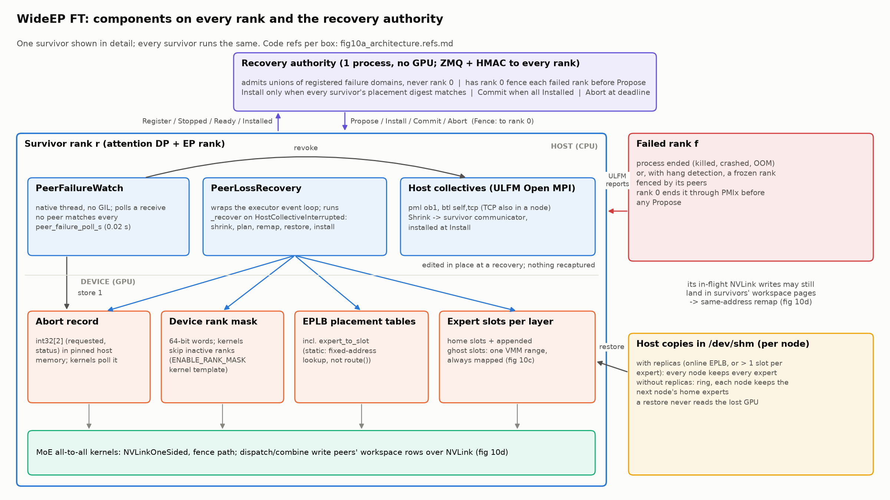
*Figure 1. Each rank's watch reports to the authority; each rank's recovery hook edits the tables in place.*

While healthy, FT adds only:

- **Rank mask.** Kernels skip ranks that are not live. [FINALS: per-step cost, no EPLB / offline / online]
- **Abort polling.** A wait on a peer checks the abort flag only after ~100k cycles, so normal waits never poll.
- **Step commit.** A step applies only if no peer failed. This is one host check per step.
- **Extra slots.** A few spare slots per rank. Kernel tuning uses only the loaded slots.
- **Transport.** ULFM needs Open MPI's ob1 layer, so host collectives run over TCP.

## Ghost Slots

A layer's experts are stacked in one tensor per GPU; each position is a slot. FT adds spare slots at the end: the ghost
slots.

- **Layout.** The tensor is one virtual address range. Resident slots get GPU memory at startup.
- **Healthy.** Ghost slots map a small shared scratch area (a few MB per process). Routing never points at them, so
  they add no GEMM work.
- **On a failure.** Each survivor that receives a lost expert maps GPU memory behind a ghost slot and copies the expert
  in. Memory comes from free GPU memory first, then from the KV cache.
- **Abandoned plan.** The memory goes back to scratch.

Example, DeepSeek-R1 on 32 GPUs: 8 + 2 slots per rank without EPLB, 9 + 1 with online EPLB (288 slots).

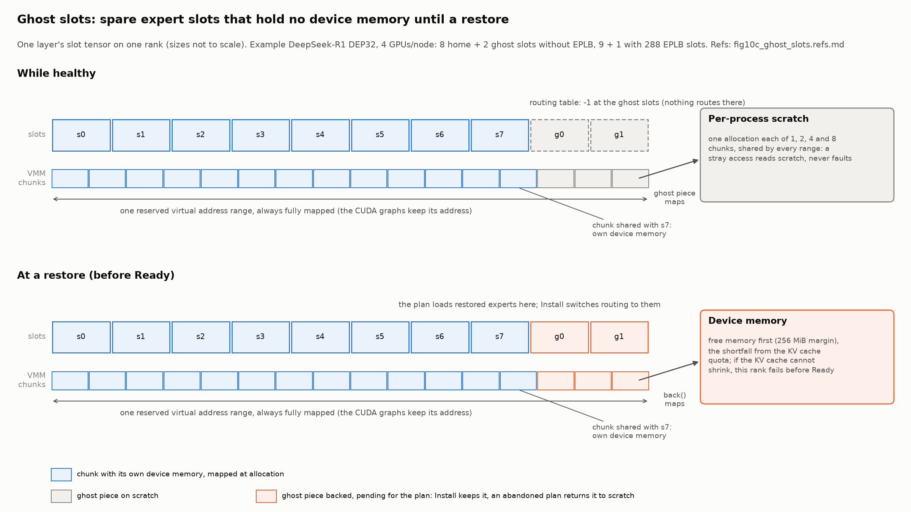
*Figure 2. Ghost slots: scratch while healthy, GPU memory after a restore.*

A restore never reads from the lost GPU. It copies from host copies in `/dev/shm`:

| Placement | Host copies | Restore |
|---|---|---|
| Online EPLB, or replicas | Every node keeps every expert | From the node's own copies, at Install |
| No replicas | Each node keeps the next node's experts (a ring) | A copy-node rank stages each expert to the target, then the target loads it |

- Startup reserves all host-copy pages, so a full `/dev/shm` fails at startup, not later.
- Ring copies cost about 1 / (number of nodes) of the expert weights per node.

## Expert Placement

Every survivor computes the same plan from the same inputs. Each lost expert:

- goes to an empty slot on a live rank first;
- else takes the slot of an expert with at least two copies;
- prefers the rank that has restored the fewest experts, then the lowest rank.

This spreads the extra work evenly. An expert with no copy left makes the loss unrecoverable. Online EPLB rebalances at
its next update.

## Late Writes

A dead rank may still have NVLink writes in flight. Fencing ends the process, but not the writes. So FT never reads the
old all-to-all memory again:

1. Each survivor clears the failed ranks in the mask, unmaps the buffers, and keeps the addresses.
2. Each survivor maps fresh memory at the same addresses. Failed ranks' rows stay unmapped.
3. Survivors confirm that all of them mapped, or all of them stop.
4. The graphs replay on the fresh memory.

- Late writes land in released memory that no survivor maps.
- The old memory frees only when the failed processes end, so the remap may borrow KV cache for a moment. It is
  returned at the commit, or soon after.

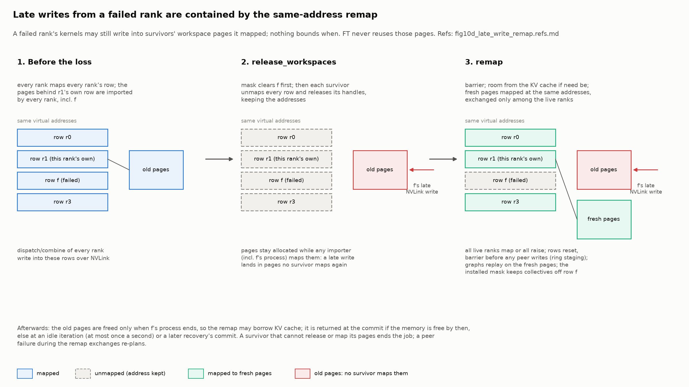
*Figure 3. Late writes land in released memory; survivors map fresh memory at the same addresses.*

## Recovery Flow

| Failure | Detected by | Time |
|---|---|---|
| Process ends | ULFM, polled by a native watch every 20 ms | [FINALS: kill-to-detect] |
| Fatal CUDA error | The rank kills itself | as above |
| Frozen rank | Hang detection: no heartbeat for 5 s, held 30 s | ~35 s, then fenced |
| All ranks stuck, or rank 0 hung | Hang detection | job ends after 30 s |

- **Detect.** The watch sets the abort flag. Kernels waiting on the dead rank return.
- **Agree.** Survivors run the ULFM shrink and agree on who failed. They stop, discard uncommitted steps (reverting KV
  and requests), and tell the authority they stopped.
- **Plan.** Each survivor computes the new placement and maps memory for its ghost slots. The authority fences the
  failed ranks and proposes a new generation. Survivors remap the all-to-all buffers, stage ring copies, and reply
  with a hash of the plan.
- **Install.** Once all hashes match, survivors load the lost experts, switch routing and install the new mask. Then
  the authority commits.
- **Resume.** Discarded steps replay on the new placement. Serving continues on the same CUDA graphs.

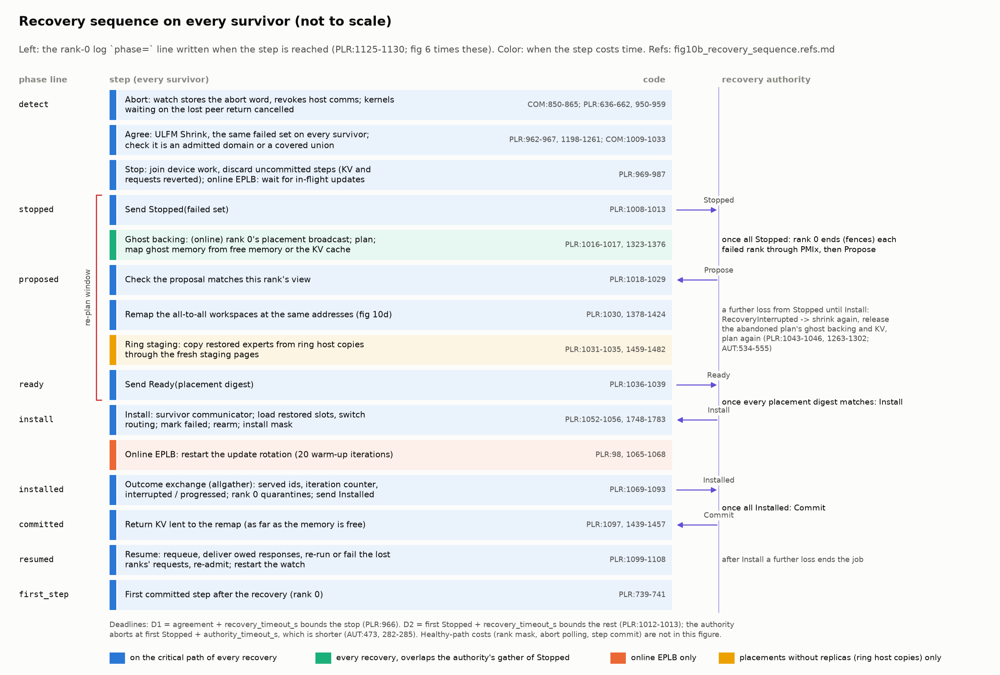
*Figure 4. Recovery sequence on the survivors and the authority.*

A recovery is bounded: about twice `recovery_timeout_s` (30 s) in the worst case. The authority aborts first if it
stalls.

## Other Notes

- **A loss before Install** restarts the round with every lost rank. A loss after Install ends the job.
- **Requests.**
  - Surviving requests continue from exactly the tokens they had.
  - A lost rank's request reruns if it returned nothing yet; otherwise it ends with a retryable error.
  - A request interrupted twice without progress is quarantined (retryable error).
  - Details are in Appendix B.
- **`/health`** reports `healthy`, `degraded` or `unprotected` (200), and `recovering` or `terminal` (503). So
  orchestrators don't restart a job that is only recovering.
- **Security.** The authority's HMAC key leaves the environment once read; no child process inherits it.
- **Shutdown.** Stop `trtllm-serve`. A SIGTERM to `mpirun` looks like a loss that includes rank 0, so the job ends
  through the fail-closed path.

## Results

DeepSeek-R1 NVFP4 on 32 GB200 GPUs (8 nodes x 4); overlap scheduler, MTP, 1k/1k tokens; no, offline and online EPLB.
FT on vs off on the same build and nodes.

- **Healthy cost.** [FINALS: output throughput, TPOT, TTFT per mode at 8/32/128 req/GPU; per-step decode cost]
- **Online EPLB at low load.** [FINALS: online decomposition]
- **Recovery.** [FINALS: time from kill to resume, rank and node kills, per mode; phase breakdown from the
  `phase=` log lines (PLR:1125-1130) and the authority's stage durations (AUT:585-597)]
- **After the loss.** [FINALS: decode throughput after vs before, rank and node loss]
- **Memory.** [FINALS: ghost slot healthy bytes per GPU; bytes mapped at restore; KV lent to the remap and when returned]
- **Accuracy.** [FINALS: GSM8K with a kill vs FT off without]
- **Baseline.** [FINALS: FT off vs main parity, per mode and load]; [FINALS: FT off on the ULFM launcher vs FT off on UCX, to
  separate the transport from FT]
- **Note.** Main's warmup leaves two token sizes to compile on first use, with or without FT (upstream). Kill runs warm
  them first.

| Figure | Shows |
|---|---|
| 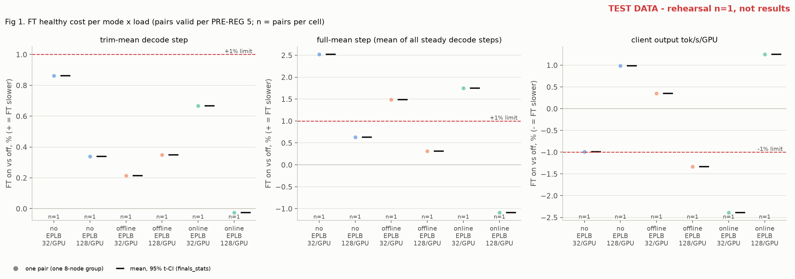 | 1. FT cost per mode and load |
| 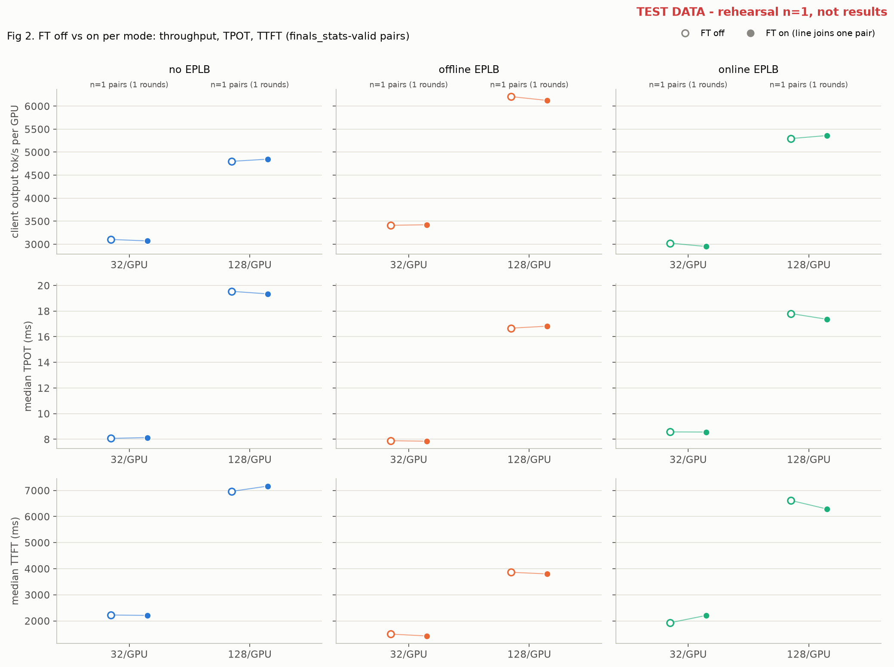 | 2. Throughput per mode at 32 and 128 req/GPU (2x: 8 and 512) |
| 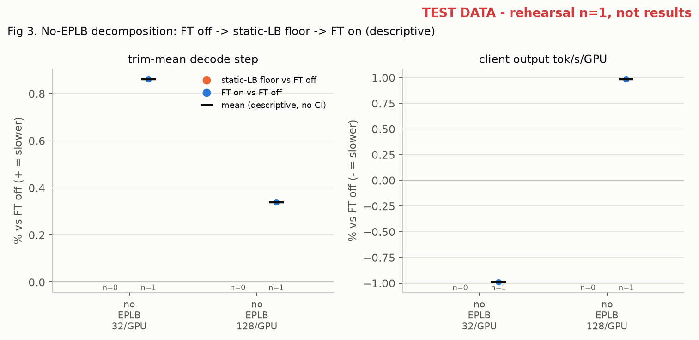 | 3. No-EPLB cost: load balancer vs FT |
| 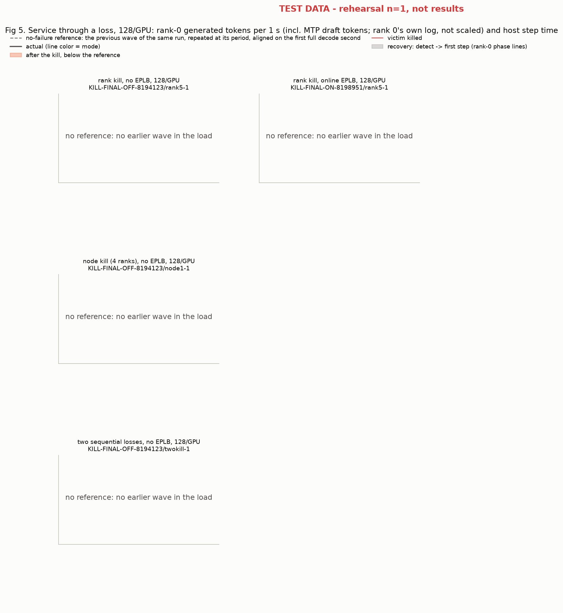 | 5. Throughput around a kill |
| 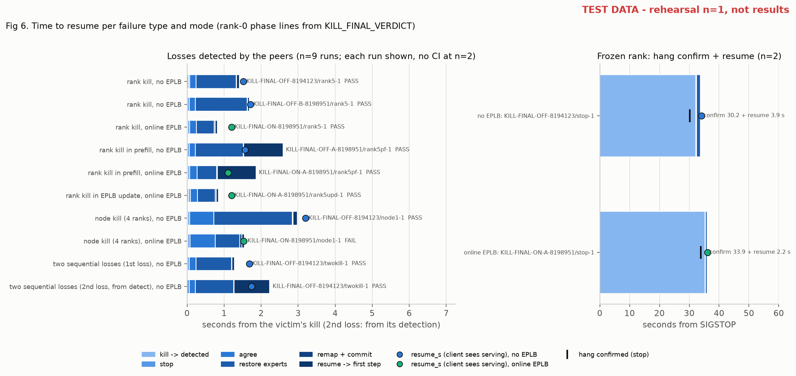 | 6. Kill to resume, by phase |
| 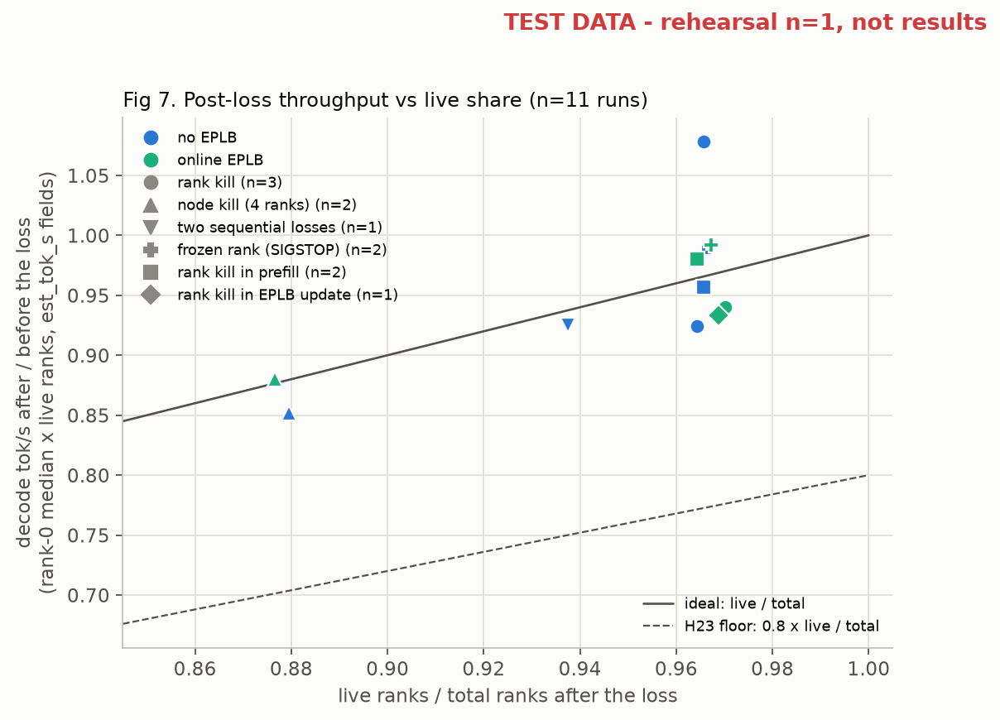 | 7. Throughput after vs before a loss |
| 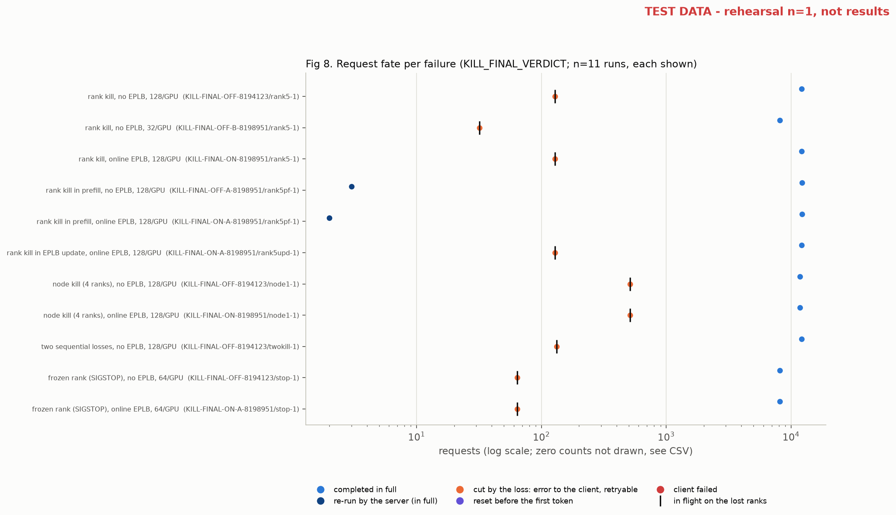 | 8. Fate of in-flight requests (8b: GSM8K) |
| 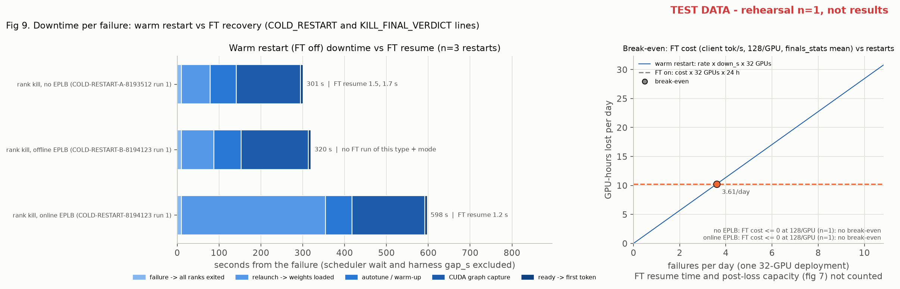 | 9. Downtime: FT vs restart |

## Known Limits

- **Frozen rank.** Fenced only with hang detection, after ~35 s. Two ranks frozen at once are not confirmed.
- **Second loss.** After Install, or a lost commit message, the job ends.
- **Not recoverable.** Rank 0 or its node; a node plus its ring-copy node; a loss the slots cannot cover.
- **Out of reach.** Host death, GPU loss and NVLink fabric faults end the job, as without FT.
- **No rejoin** until restart.
- **KV cache.** Memory given to restored experts stays until restart.
- **Online EPLB on GPUs whose memory is a NUMA node** uses backed spare slots.
- Validated: [FINALS: test matrix (integration cases, kill runs per mode, accuracy with a kill), runs and n]

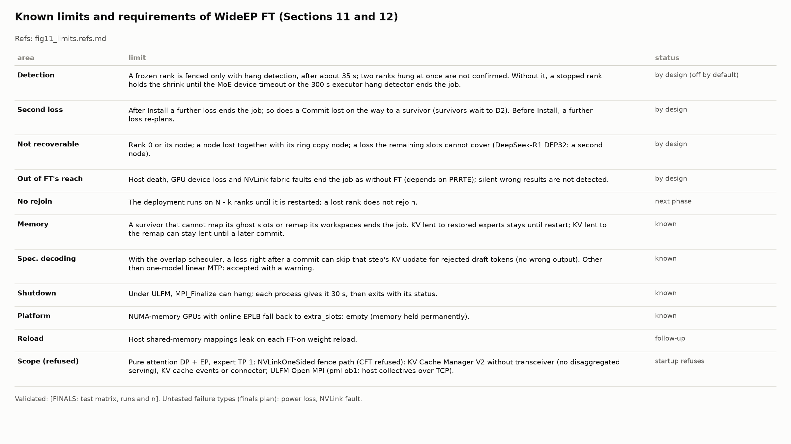
*Figure 5. Known limits and requirements.*

## Alternatives Considered

- **A second CUDA graph set for the degraded layout.** Doubles graph memory and capture time.
- **Restore only into replica slots.** No new memory, but drops replicas and raises the peak expert load after a node
  loss. Used only when ghost slots run out.
- **Backed spare slots.** No mapping at recovery, but keeps memory from the KV cache for good.
- **Reuse the all-to-all memory after a wait.** Needs a bound on a dead GPU's in-flight writes. The remap needs none.

---

## Appendix A. Requirements

Startup refuses a missing requirement and names it.

| Area | Required |
|---|---|
| Layout | TP size = EP size = world size; no PP or CP; expert TP 1; no LM-head TP; default attention-DP router; MPI executor |
| MoE | NVLinkOneSided fence path; an EPLB load balancer |
| KV cache | V2; no transceiver, connector, SWA scratch reuse, KV pool rebalance, KV cache events, conversation manager, cross KV |
| Executor | A generation sampler; no guided decoding, beam search, PEFT or sleep; hang timeout above `shrink_timeout_s + 2 x recovery_timeout_s` |
| MPI | ULFM (`--with-ft ulfm`, shrink, revoke); `MPI_THREAD_MULTIPLE`; ob1; hcoll off (the launcher defaults `coll ^hcoll,ucc`) |
| Coverage | The survivors of every failure domain hold every expert; `/dev/shm` fits the host copies |
| Authority | Reachable; same FT config; HMAC key in hex, >= 16 bytes |

Rejected per request: repetition, presence and frequency penalties; multimodal input with the overlap scheduler;
logits post-processors.

## Appendix B. Request Fate

| Request | Outcome |
|---|---|
| Survivor, in a discarded step | Replayed from its exact tokens |
| Interrupted again before any progress | Quarantined: retryable error |
| Lost rank, nothing returned yet | Re-run on a survivor |
| Lost rank, tokens already streamed | Retryable: HTTP 503, or an SSE error then `[DONE]` |
| Lost rank, cancel pending | Cancelled |
| Not yet received by every rank | Re-admitted |
| New, pinned to a lost DP rank | HTTP 400 |

## Appendix C. FT-off differences vs main

| Change | Effect |
|---|---|
| Attention-DP burst-release rule (not FT) | Scheduling and TTFT with `attention_dp_enable_balance`; its own PR |
| mpi4py 3.1.5 -> 4.1.2 (not FT) | Same in every measured arm |
| All-to-all flag word 4 -> 8 bytes | Layout only |
| FT kernel branches | Compiled out when FT is off |
| Failed streams end with an SSE error and `[DONE]` (not FT) | Client-visible; its own PR |
| Recovery hook call sites | A few no-op calls per step |

## Appendix D. Code map

Code refs at `58caa0fde6`, for reviewers.

| Topic | Code |
|---|---|
| Recovery orchestration | `_torch/pyexecutor/peer_loss_recovery.py` (requirements 416-463; recovery 950-1111; remap 1379-1458; quarantine 1570-1607) |
| Authority, config, client | `executor/recovery/{authority,config,client}.py` |
| Ghost slot memory | `cpp/tensorrt_llm/runtime/moeLoadBalancer/ghostSlotMemory.{h,cpp}` |
| Load balancer, placement, host copies | `_torch/moe/fused_moe/moe_load_balancer.py` (997-1043, 1208-1223, 1467-1560) |
| Mask, abort, commit | `_torch/moe/fused_moe/communication/execution_state.py`; `cpp/.../moeAlltoAllKernels.cu` (223-311) |
| Remap | `_torch/distributed/mnnvl_memory.py` (943-1021) |
| ULFM, watch, hcoll check | `_torch/distributed/communicator.py` (850-1091) |
| Shutdown | `llmapi/mpi_session.py` (141-200) |
