# WideEP Fault Tolerance MVP Design Doc

Andrew Rusli | Created Oct 19, 2026 | Updated Oct 27, 2026 (overnight runs, FINAL/OVERNIGHT_LOG.md) | Code: v5-final 27442bd91d

How to read citations: (CLAIMS N) = row N in mvp/CLAIMS.md (run, scale, n, metric); job IDs (e.g. 8269102) are Slurm
jobs; file paths are relative to the runs root (bare file names: notes and readouts under review/ or review/diag/,
run outputs such as kill_final.txt under mvp/runs/; harness/ = mvp/harness/). "main" = upstream TensorRT-LLM.

## Overview & Motivation

Today, losing one rank of a wide expert-parallel (WideEP) deployment ends the whole job. A restart takes 6-10 min on average:
5.7 / 6.2 / 10.4 min with no / offline / online EPLB, single runs 301-693 s, from the kill to the new server's first
token (CLAIMS 224, 228). This excludes 7.5-29 s of test-harness delay
between the old server's exit and the relaunch (harness gap), and any scheduler wait.

With fault tolerance (FT), the surviving ranks resume serving in 0.8-2.8 s (kill -> first step, server timestamps, all
runs) on the CUDA graphs captured at startup. The deployment then serves on N-k ranks (N = ranks at startup, k = ranks
lost). A lost rank does not rejoin yet, so FT turns an unplanned outage into a restart you can schedule. Bringing lost
ranks back (N-k to N) while the survivors serve is the next phase.

What this means for a 32-GPU DeepSeek-R1 deployment at 4096 concurrent requests (128/GPU):

| | FT off | FT on |
|---|---|---|
| One rank lost | job ends; all 4096 requests fail; restart 6-10 min on average | serving resumes in 0.8-1.6 s (1.7-2.7 s if killed in prefill, n=2-3 per mode); 128 requests end with a retryable error |
| One node's ranks lost | job ends; restart | serving resumes in 1.4-2.8 s; 512 requests end with a retryable error |
| One rank frozen | job ends when main's hang detector (`HangDetector`, default 300 s) fires (not run with FT off) | with hang detection (`hang_detection`) on: FT ends (fences) the frozen rank 29.5-34.1 s after the freeze, then recovers |
| Healthy, per decode step | baseline | +0.87% no EPLB, +0.50% offline EPLB, +0.35% online EPLB at 32/GPU (pooled n=8, trimmed mean; CLAIMS 206); the pre-registered "< 1% per step" rule is not met, so it is not claimed (Healthy cost) |
| Healthy, client throughput | baseline | loss at most 0.58% no EPLB, 2.38% offline, 0.63% online at 32/GPU (one-sided 95% upper bound on FT's loss, pooled n=8) |
| Healthy, median TTFT | baseline | +7.3% [+1.3, +13.3] at 32/GPU in the closed-loop benchmark (24 pairs pooled over modes; CLAIMS 208, 223); not seen at 128/GPU; under realistic open-loop traffic at ~80% load median TTFT is +0.9% [-0.2, +1.9] (6 pairs; CLAIMS 217, 234, 240) |
| After one rank lost, realistic traffic at ~80% load | job ends | median TTFT 826 -> 1021 ms and 842 -> 1049 ms (+24% / +25%), median TPOT 11.8 -> 13.2 ms (one case) at the same load; capacity left 0.92-0.93x (4 cases; CLAIMS 216) |

Resume times are kill -> rank 0's first step after the recovery, from server timestamps, min-max over all v5-final runs.
Not covered: losing rank 0, rank 0's node, or a node plus its ring-copy node ends the job, as without FT (Limits).
EPLB = the MoE expert load balancer (offline: a fixed placement with replicas; online: placement updated while
serving). Pooled n=8 = 8 FT-on/FT-off pairs; trimmed mean = mean over steps up to 1.5x the median (drops stall steps).

Why it matters:

- Failures are more common at large scale, and restarts are costly [1, 2].
- NVIDIA's Dynamo cluster, 18-week trace (~150 replicas, mostly <= 8 GPUs): 46 restarts a day, median 3.5 min each;
  77% were process deaths or hangs with the GPU intact [1].
- WideEP deployments span 32 to 64+ GPUs, so they are even more exposed (not quantified here).

## Goals & Scope

Goals:

- **Performance.** Healthy cost < 1%. After a loss, throughput near the share of GPUs left. Recovery back to N comes
  later.
- **Recovery time.** Seconds, on the same CUDA graphs: no recapture, reload or restart.
- **Correctness.** Survivors' requests continue from the tokens they already have. A lost rank's requests run again or end
  with a retryable error.

Turning it on (off by default):

- Environment variables, not `LlmArgs`: `TLLM_FAULT_TOLERANCE_MODE=1` plus the recovery authority's address in
  `TLLM_FAULT_TOLERANCE_AUTHORITY` and a shared HMAC key in `TLLM_FAULT_TOLERANCE_AUTHORITY_KEY`. Mode alone only
  detects a loss; recovery needs the authority address (`tensorrt_llm/_utils.py:516-538`).
- Start the recovery authority (`RecoveryAuthority`) first:
  `python3 -m tensorrt_llm.executor.recovery.authority --endpoint tcp://<ip>:5555 --world-size 32` (`executor/recovery/authority.py:829-877`).
- Launch `trtllm-serve` under `mpirun --with-ft ulfm ... trtllm-llmapi-launch`; the launcher then selects ob1/TCP and
  turns hcoll/UCC off (`llmapi/trtllm-llmapi-launch:201-206`). Other settings (hang detection, timeouts, failure domain,
  spare-slot kind `extra_slots`) come from an optional YAML file named by `TLLM_FAULT_TOLERANCE_CONFIG`
  (`executor/recovery/config.py`).
- The user guide is `docs/source/features/wide-ep-fault-tolerance.md`. Moving these settings into `LlmArgs` is a next
  step.
- **FT off is main plus a few non-FT changes (Appendix C).** FT's kernel branches are compiled out; the only FT-off
  kernel change is the flag-value slot (4 -> 8 bytes). Our FT off matches main's step within -0.26% to +0.37% (online
  and no EPLB, pre-fix build; Baseline).

Supported:

- MoE models (tested with DeepSeek-R1); aggregated serving.
- DEP: attention data parallel (each rank serves its own requests) plus expert parallel over all ranks; expert TP 1.
  DEPn = DEP over n GPUs.
- NVLinkOneSided all-to-all on its *fence path*: main's packed all-to-all synchronization (rows packed per call; a
  memory fence plus a completion flag tells the receiver the data landed). The other path, CFT (counted writes), needs
  driver >= 615 and is untested. Elsewhere in this doc, *fencing a rank* means ending its process.
- No EPLB, offline EPLB and online EPLB. EPLB is the MoE expert load balancer; it places experts into *slots*
  (offline: a fixed placement with replicas; online: updated while serving).
- Overlap scheduler; MTP (multi-token prediction, the speculative decoding DeepSeek-R1 uses; other speculative
  decoding is untested).
- KV Cache Manager V2.
- Open MPI with ULFM (`mpirun --with-ft ulfm`), mpi4py >= 4. ULFM is Open MPI's fault-tolerance extension that lets
  survivors keep communicating; it needs Open MPI's ob1 messaging layer, which our launcher runs over TCP. FT needs an
  Open MPI built with ULFM and launched by `mpirun --with-ft ulfm`; startup refuses otherwise
  (`communicator.py:964-967`). Other launchers (e.g. srun without `mpirun`) and disaggregated serving are not
  supported yet, and the FT tests do not run in CI yet.

Failures covered:

- One rank process lost (SIGKILL, crash, OOM kill).
- One node's rank processes lost, host up.
- Further losses after a recovery, while the survivors' slots still hold every expert.
- One frozen rank (SIGSTOP), with hang detection on.

Anything else fails closed: rank 0, rank 0's node, a loss the slots cannot cover. Host death and NVLink fabric faults
are expected to fail closed too (untested).

Startup checks every requirement and refuses with its name. The full list is in Appendix A.

## Design Overview

FT keeps the same CUDA graphs after a loss. Rank count, slots per rank, buffer addresses and kernels stay fixed. A
recovery changes only what the graphs read on every launch:

- the live-rank mask (`active_rank_mask`);
- the abort flag (`MoeA2AAbortState`);
- the EPLB routing table (expert to slot, `MoePlacementInfo`);
- the contents of expert slots.

Three ideas make this work:

- **Unbacked spare slots** (`extra_slots: ghost`, the default; `GhostSlotMemory`). Spare expert slots at addresses the
  graphs already know, with no memory of their own while healthy (they map a small shared scratch); *backed* spare slots (`empty`) hold memory
  from startup. On a failure unbacked slots get memory, and lost experts are copied in from *host copies*
  (copies of the expert weights kept in each node's CPU memory, `/dev/shm`; `HostMoeTensorSharer`).
- **Same-address remap** (`_remap_workspaces`). Survivors move the all-to-all workspace (`MnnvlMemory`) to fresh memory
  at the same addresses. A dead rank's late writes land in old memory no survivor reads.
- **Recovery authority.** One process outside MPI (talking to the ranks over ZeroMQ) that admits the loss, fences
  (ends) the failed ranks, and makes every survivor apply the same plan, or none.

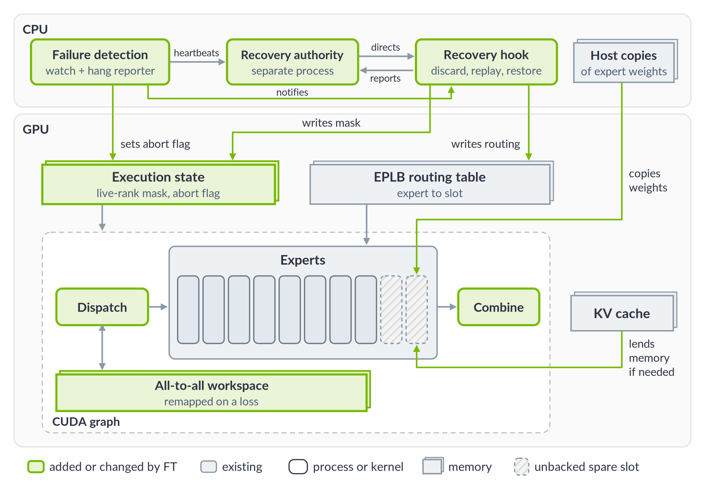

*Figure 1. FT's parts on one rank. Failure detection (failure watch and hang reporter) notifies the recovery hook and
sends heartbeats to the recovery authority; the authority directs the hook, which edits the tables the CUDA graph reads
and remaps the all-to-all workspace on a loss. Thicker green outline = added or changed by FT.*

*Names: failure watch = `PeerFailureWatch`, hang reporter = `HangEvidenceReporter`, recovery authority =
`RecoveryAuthority`, recovery hook = `PeerLossRecovery`, execution state = `MoeExecutionState` (live-rank mask
`active_rank_mask`, abort flag `MoeA2AAbortState`), EPLB routing table = `MoePlacementInfo`, all-to-all workspace =
NVLinkOneSided's `MnnvlMemory`, host copies = `HostMoeTensorSharer` / ring copies, unbacked spare slot = `GhostSlotMemory`.*

- The graph never changes; only the small tables it reads do, edited by the recovery hook (`PeerLossRecovery`). That is
  why recovery needs no recapture.
- Hang detection: each rank's hang reporter (`HangEvidenceReporter`) reports to the hang monitor (`HangMonitor`) in
  the authority. It has two triggers: a peer that has waited 2 s on the rank inside a GPU all-to-all kernel reports a
  device wait (`hang_suspect_s`, default 2 s, `executor/recovery/config.py:78-80`), or the rank sends no heartbeat (a
  host message each rank sends every 1 s) for 5 s. Either must hold 30 s before the rank is fenced.
- The execution state (`MoeExecutionState`) is drawn on the GPU, but only its live-rank mask is in GPU memory; the
  abort flag the kernels poll lives in pinned host memory (`execution_state.py:49`).

While healthy, FT adds only:

- **Live-rank mask.** Kernels skip ranks that are not live.
- **Abort polling.** A wait on a peer checks the abort flag only after ~100k cycles (~50 µs, `kAbortPollCycles`), so
  waits shorter than ~50 µs never poll; longer ones read the abort flag once per ~50 µs
  (`moeAlltoAllKernels.cu:290-311`). Removing the abort poll saves 0.05 µs per round trip without EPLB statistics and
  0.10 µs with them (EP32 ablation, CLAIMS 210).
- **Step commit** (`commit_step`). A step applies only if no peer failed: one host check per step. Removing the
  per-step host checks changed the trimmed step by ~0 (+39 / -48 / -7 µs; v3 build, n=2 per arm, one node set, diagnostic;
  steady_cost_analysis.md section 3, CLAIMS 159).
- **Spare slots.** A few spare slots per rank. Kernel tuning uses only the loaded slots.
- **Transport.** Host collectives run over ob1/TCP. FT off over FT's launcher (`mpirun --with-ft ulfm`, ob1/TCP) vs
  the default launcher (plain `mpirun`, UCX; CLAIMS 93): trimmed step -0.08% / -0.13% (n=2, CLAIMS 180); host
  collectives are ~20-40% slower (rank-median p50; v3 build, n=1 per arm, diagnostic; CLAIMS 158). The one healthy
  hang was in an ob1/TCP collective (CLAIMS 204).

## Unbacked Spare Slots

A layer's experts are stacked in one tensor per GPU; each position is a slot. FT adds spare slots at the end: unbacked
spare slots by default.

- **Layout.** The tensor is one virtual address range. Resident slots get GPU memory at startup.
- **Healthy.** Unbacked spare slots have no memory of their own: they map a shared scratch (one allocation each of 1, 2, 4
  and 8 CUDA virtual memory management (VMM) chunks per process, 15 chunks: ~30 MiB if the granularity is 2 MiB;
  `ghostSlotMemory.h:40-41`, `.cpp:453`). A stray access reads or writes the scratch instead of faulting
  (`ghostSlotMemory.h:41`). Routing never points at them, so they add no GEMM work.
- **On a failure.** Each survivor that receives a lost expert maps GPU memory behind an unbacked spare slot and copies the expert
  in. Memory comes from free GPU memory first, then from the KV cache. Restored experts took up to 444 MB per survivor
  after a rank kill, 1752 MB after a node kill and 912 MB after two rank kills (no EPLB; online 396 / 1476 / 780 MB;
  kill_final.txt restored_mb, V5F-REC 8269102).
- **Abandoned plan.** The memory goes back to scratch.

Spares are added only where the survivors of a failure domain's loss (the set of ranks that can fail together; here a
node) cannot hold every expert (`moe_load_balancer.py:1197-1201`; the kind is `config.py` `extra_slots`). Example,
DeepSeek-R1 on 32 GPUs: 8 resident + 2 unbacked spare slots per rank without EPLB; 9 + 1 with online EPLB (288 + 32 slots).
After a node loss 28 ranks remain: 28 x 8 = 224 and 28 x 9 = 252 are below 256 experts, so no EPLB needs 2 spares;
28 x 10 = 280, so online's 9 slots need 1 (arithmetic from the code's rule).

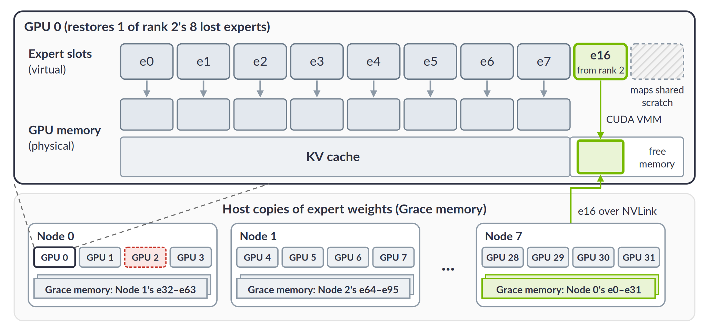

*Figure 2. GPU 0's expert slots after it restores one of rank 2's lost experts. Unbacked spare slots map a shared scratch while
healthy and get GPU memory of their own on a restore (drawn from free GPU memory; the KV cache lends memory only if free memory is short, which no logged run needed); host copies sit in each node's
Grace CPU memory. Green = the restored expert, its memory, and the host copy it comes from; dashed red
outline = lost rank.*

*Names: unbacked spare slot = `extra_slots: ghost` (`GhostSlotMemory`, ghostSlotMemory.h); shared scratch = its scratch
pieces; host copies = here ring copies (`ring_host_weights`, moe_load_balancer.py).*

- Unbacked spare slots have no memory of their own while healthy (they map a small shared scratch); the KV cache keeps the rest.
- A restore never reads from the lost GPU; it copies from host copies.

Host copies live in `/dev/shm`:

| Placement | Host copies | Restore |
|---|---|---|
| Online EPLB, or replicas | Every node keeps every expert (~390 GB per node for R1) | From the node's own copies, when survivors install the plan (Recovery Flow, step 4) |
| No replicas | Ring copies: each node keeps the next node's experts (~49 GB per node) | A rank on the node holding the ring copy (the copy node) stages each expert to the target, then the target loads it |

- Startup reserves all host-copy pages, so a full `/dev/shm` fails at startup, not later. Seen once when main left
  ~390 GB of segments (CLAIMS 128, earlier build); not a dedicated test.
- FT keeps no host-copy pages mapped while healthy (a restore faults in what it copies; online EPLB's own per-step
  reads still touch them, as on main). Measured Linux kernel memory compaction stalls (kcompactd moving
  pages to build huge pages; a thread touching a moving page waits) then match FT off (Appendix E).
- Ring copies cost about 1 / (number of nodes) of the expert weights per node: ~49 GB vs ~390 GB at 8 nodes
  (hostmem-N.log; CLAIMS 194).
- Staging (no EPLB): per chunk, the copy-node rank writes from its host copy into the target's slice of an idle
  [ep_size, bytes] workspace, all live ranks hit a barrier, then the target copies into its slot
  (`stage_restored_slots`, `moe_load_balancer.py:1515-1543`).
- Why unbacked and not backed spare slots (spares with their own GPU memory from startup) on every GPU: online EPLB
  loads slots from host copies through GDRCopy (CPU-mapped GPU memory), which cannot map unbacked-slot (VMM) memory unless the
  platform supports GPUDirect RDMA on VMM memory, or where GPU memory is a NUMA node. There FT defaults to backed spare
  slots (`extra_slots: empty`). On the tested GB200, online used unbacked spare slots (CLAIMS 182).

## Expert Placement

Every survivor computes the same plan from the same inputs. Each lost expert:

- goes to an empty slot on a live rank first;
- else takes a slot of the expert with the most copies (at least two), so no expert loses its last copy;
- ties go to the rank that has restored the fewest experts so far across layers, then the lowest rank and slot
  (`moe_load_balancer.py:986-1032`).

An expert with no copy left makes the loss unrecoverable. Online EPLB rebalances at its next update.

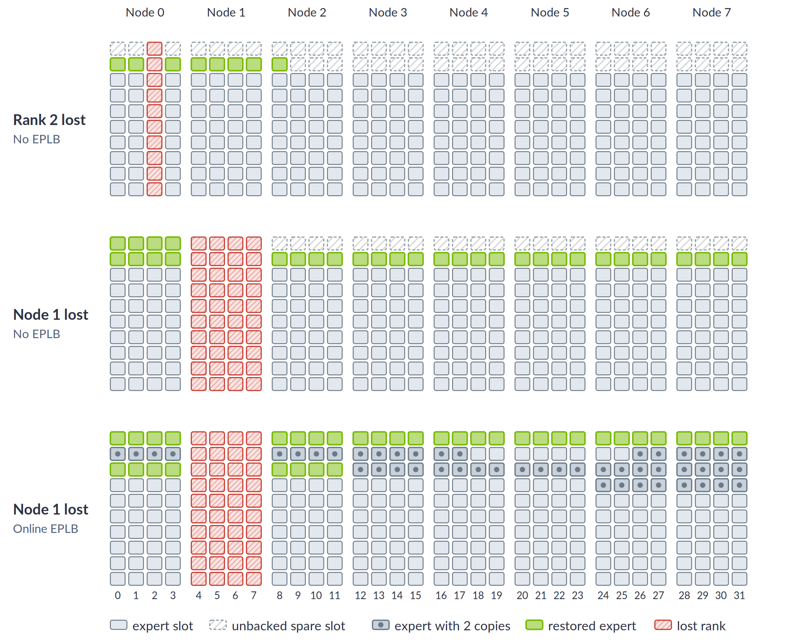

*Figure 3. Where lost experts go after losing rank 2 or node 1, one layer. The no-EPLB panels (8 + 2 slots) come from a
copy of v5-final's `restore_lost_experts` rule; the online-EPLB panel (9 + 1 slots) uses an illustrative layout, not a
real placement. Rank loss: lost experts e16-e23 are restored one per survivor.*

*Names: unbacked spare slot = `extra_slots: ghost`; placement rule = `restore_lost_experts` (moe_load_balancer.py);
expert with 2 copies = an EPLB replica.*

- Lost experts spread one per survivor, lowest rank first, until they run out. Rank loss: the 8 lost experts go one
  each to the 8 lowest survivors (ranks 0-1, 3-8); the other 23 survivors get none. Node loss: 32 lost experts over 28
  survivors, one each, and a second one each to ranks 0-3.
- The spread is even in count per layer, not across layers: the busiest survivor holds 1.18-1.27x the median survivor's
  restored-expert memory (rank kills; node kills ~1.00-1.05x; kill_final.txt restored_mb, 8269102). Expert load after a
  loss was not measured. Load-aware placement is not done (see Alternatives).
- With online EPLB, unbacked spare slots fill first; when they run out, restored experts take replica slots (8 of 36 in the
  illustrated node loss); the next EPLB update rebalances.

## Late Writes

**The problem.** A dead rank may still have NVLink writes in flight. Fencing a rank ends its process, but not
necessarily its writes. A late write into a survivor's all-to-all workspace could corrupt the next step's tokens.

**The design: a same-address remap at recovery.** Late-write containment (keeping a dead rank's late writes out of
every survivor's data) adds no healthy-path work (main's packed layout is kept); it is paid during recovery
(HEALTHY_ZERO.md). FT's measured healthy cost, from its other parts, is +0.35-0.87% per step at 32/GPU
(Healthy cost). Healthy dispatch (send tokens to their experts' ranks) and combine (return the expert outputs) use the
all-to-all's fence path (main's packed all-to-all synchronization, Goals & Scope) plus the live-rank mask. At recovery:

1. Each survivor clears the failed ranks in the live-rank mask, unmaps and releases the workspace (`release_backing`:
   `cuMemUnmap`, `cuMemRelease`), and keeps the addresses.
2. Each survivor maps fresh memory at the same addresses (`remap`), exchanging handles among survivors only. Failed
   ranks' rows stay unmapped, and the mask keeps collectives off them.
3. Survivors confirm that all of them mapped, or all of them stop.
4. The graphs replay on the fresh memory.

**Why a late write cannot reach live data.**

- The dead rank reaches a survivor's buffer only through its own old mapping, which points at the old physical pages.
  It never receives the new handles.
- Survivors never map the old pages again. A write that arrives before the swap lands in the step being discarded; one
  that arrives after lands in pages no survivor reads. Timing does not matter.
- CUDA keeps the old pages allocated while the dead process still maps them, so they cannot be handed to anything new
  (not even our fresh remap). They are freed only after the dead process ends; the fence ends a hung one.
- Writes already in the NVLink fabric when the process ends land within microseconds; in the kill test the pages were
  freed before its 60 s limit (polled every 0.1 s; the exact time is not logged). We rely on that gap and on CUDA's behaviour; we do not prove the driver waits.

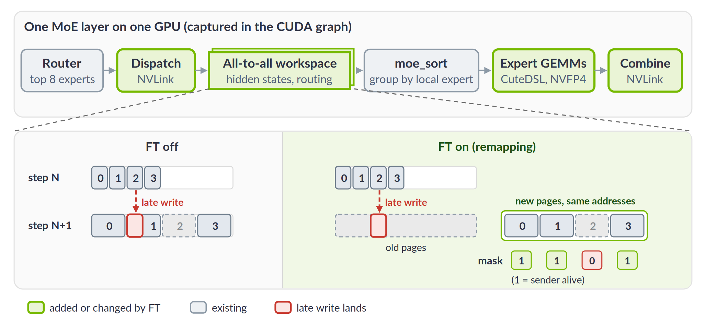

*Figure 4. One MoE layer's all-to-all workspace, FT off vs on. With FT, survivors map fresh memory at the same
addresses, and the lost rank's late write lands in the old, released memory that no survivor maps. Thicker green
outline = added or changed by FT.*

*Names: all-to-all workspace = NVLinkOneSided's `MnnvlMemory`; remap = `PeerLossRecovery._remap_workspaces` ->
`MnnvlMemory.release_backing` / `remap`; mask = live-rank mask (`active_rank_mask`, execution_state.py).*

- Both panels use the same layout: sender s's rows start at s x capacity x row width, so all rows move when a call's
  capacity or row width changes (here step N+1 has wider rows).
- Without the remap (mask only), a late write from step N can then land in another sender's rows at step N+1 (left).
- With FT, the dead rank's mask bit is 0 and its writes land in released memory (right).
- Containment needs no bound on when the dead GPU's writes stop, and no fixed layout.
- The cost moves from every healthy step to the recovery.

**Cost at recovery** (V5F-REC 8269102, CLAIMS 193; per survivor, "Remapped 7535067136 bytes"). "Proposed -> ready" =
from the authority's proposal to all survivors ready (Recovery Flow, step 3):

| Case | n (survivors) | Remap min / median / max | proposed -> ready |
|---|---|---|---|
| Rank kill, online EPLB | 31 | 455 / 537 / 537 ms | 0.54 s |
| Node kill, online EPLB | 28 | 405 / 484 / 485 ms | 0.48 s |
| Rank kill in prefill, online | 31 | 484.5 / 484.8 / 485.2 ms | 0.48 s |
| Frozen rank, online | 31 | 448 / 591 / 591 ms | - |
| Two losses, first, online | 31 | 452 / 466 / 466 ms | - |
| Two losses, second, online | 30 | 478.1 / 478.3 / 478.8 ms | - |
| Rank kill, no EPLB | 31 | 912 / 962 / 973 ms | 1.25 s |

n counts survivors (one remap time each); each row is a single kill (one run).

- 7.5 GB per GPU is remapped in 0.41-0.97 s (medians 0.47-0.96 s). A second loss redoes the full release and remap of
  the same bytes with every rank lost so far (`peer_loss_recovery.py:1030, 1379-1425`; twokill-1 rank logs,
  review/diag/remap_secondloss.md).
- Measured: 0 bytes taken from the KV cache in every logged case.
- By design, if free memory is short, the remap borrows KV cache for a moment and returns it at the commit or soon
  after, so there is no lasting memory loss.
- The remap is ~all of the proposed -> ready interval with online EPLB (0.48-0.54 s in the rows above; 0.42-0.68 s over
  all online rows).
- Without EPLB the remap is slow on v5-final (~0.8-1.0 s), about twice online's (v5-final runs only, 8269102, 8285728,
  8271210, 8283311, THIN-CELLS 8302191; review/diag/why_remap_noeplb.md, why_remap_noeplb_table.txt):
  - Measured: no-EPLB rank-type kills (rank, prefill, stop, two losses' first) were slow in 9/9: 808-1007 ms critical
    path (the last rank to enter; 7 runs in 8269102 and 8285728) and 1007-1035 ms in THIN-CELLS (stop, two losses; max
    over survivors of "Remapped ... in X ms"). Online EPLB was never slow: rank-type kills 422-485 ms (8 runs),
    node kills 397-438 ms (4 runs), THIN-CELLS stop 446 ms and two losses 712 / 505 ms. Offline rank kills were slow in
    their 3 runs (871 ms critical path; THIN-CELLS 904 / 916 ms); offline node kills read 705, 600 and 626 ms.
  - Since the host-copy fixes, all 12 no-EPLB rank-type kills with a critical-path time were slow (0/12 fast: fix-1
    0/5, v5-final 0/7 through THIN-CELLS 8302191; the later RECOV2/RECOV3 rows were not checked); before them 15 of 36 were fast, a per-run split within a job (Appendix I.1). Whether the fixes
    cause this is not established.
  - Where (REMAP-TIMER 8308514, CLAIMS 214; REMAP-PEER 8310851, CLAIMS 215; v5-final plus logging-only timers,
    diagnostic, 1 run per case, 31 survivors): the extra ~450 ms is importing and mapping the other survivors' fresh
    memory (cuMemImport / map / set access), not peer waiting, KV-cache borrowing, size or concurrent recovery work
    (inferred). Median per-rank import + map: no EPLB 348 ms (the victim's three node-mates took 822 ms; the rest
    waited) and 821 ms, offline 813 ms, online 316 / 332 ms. Every other phase (release, `empty_cache`, which ran in
    every mode, allocation, export, handle exchange) is < 120 ms and similar across modes.
  - It is one stall, not slower calls: with static routing 28 of 31 survivors spend ~460-600 ms on one import, the dead
    GPU's node-mate's fresh memory, and ~3 ms on each other import (online's largest: ~110-150 ms, the first import
    from each remote node). A no-EPLB kill with recovery held 3 s showed no stall (observation; the hold also pauses
    kernels).
  - The pre-set rule gave no conclusion (stall ends spread 117-640 ms over all 31 ranks). Descriptively, the 28 stalls
    (~0.5 s) end within 3-22 ms of each other: likely node teardown, not established. Why online avoids it is unknown;
    one candidate is that it reaches the import later.

**End to end it is not slower than the Oct 20 design:** online rank kill -> first step 0.76-1.00 s on v5-final vs
0.92-1.31 s on the Oct 20 build (Appendix G).

**Why not per-sender rows (the Oct 20 design).** Each sender owned fixed rows in every receiver's buffer, so a
dead sender's late write could only hit its own rows. That does not hold for R1:

- All 59 MoE layers share one all-to-all workspace per GPU. On each call, sender s's rows start at
  s x capacity x row width, where row width = the bytes one token's payload takes in that call.
- R1 has two row widths: ~4 KB in the 58 NVFP4 layers, ~14 KB in the BF16 MTP layer. So the row boundaries move
  between calls: sender 8's MTP rows sit where sender 2's NVFP4 rows sit. A late write from dead sender 8 during an
  MTP call lands in live sender 2's tokens on the next NVFP4 call (mvp/DECISIONS.md:128-135).
- Fixing that meant one row width for all layers (kernel and reader changes, silent-corruption risk) or one workspace
  per width (+7.5 GB per GPU). The per-sender rows also cost ~0.16-0.22 ms per step while healthy (CLAIMS 167).
- So we kept main's packed layout (no healthy cost) and moved containment to the recovery-time remap above, which does
  not depend on the layout (direction of Oct 22, HEALTHY_ZERO.md).

**Test coverage.**

- 2-GPU test (`test_moe_a2a_late_writes.py`): the victim keeps dispatching real all-to-all rows into the survivor's
  row, killed at 0, 3 or 50 ms or still writing. After release + remap, the survivor's whole row keeps every byte over
  a grace window, and a pre-loss CUDA graph replays exactly. A no-remap control shows contamination, so the test
  detects the hazard.
- 4-GPU test (`test_remap_orphans_late_writer`, stop and kill): through the real `_remap_workspaces`, only the victim's
  row is unmapped; the released pages stay held while the victim lives; after 1.0 s of the victim's writes every
  survivor row equals the reset state; masked round trips are exact. On kill the pages free before the test's 60 s limit; on stop the
  victim exits 0, so its writes never faulted. A second test covers a later loss of an importer of the fresh pages.
- Earlier-build late-write tests are in Appendix G.

**Caveats.**

- The tests use polling windows (1 s grace, 1.0 s writes), not a proof for unbounded time, on 2-4 GPUs in one NVLink
  domain. "Stays allocated, no fault" is CUDA VMM refcount semantics that the tests check; the code does not prove it.
- The tests pass on v5-final (27442bd91d; LATEWRITE-V5F 8322395, CLAIMS 221): late writes 5/5, recovery 5/5 (incl.
  stop/kill late writers, a second loss and an aborted round), fake-driver remap 11/11, each in 3 runs, 0 skipped.
- Only workspaces bound to `MoeExecutionState` are remapped. Other peer-writable allocations were not audited.
- No v5-final evidence at scale of a late write actually absorbed by the remap.

**Ways to shrink the remap.**

- Size the all-to-all workspace to the real max batch instead of the current 7.5 GB per GPU.
- Pre-map a spare backing at startup, so recovery only swaps mappings. This costs a second workspace of GPU memory
  (7.5 GB per GPU today) on the healthy path, so it is worth it only after the workspace is sized down.
- Neither is built or measured.

## Recovery Flow

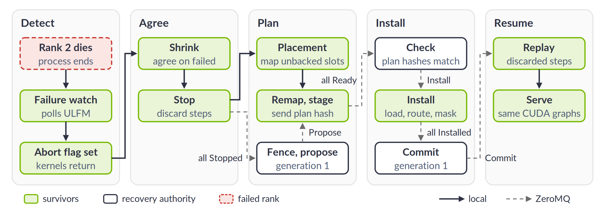

*Figure R. Recovery sequence on the survivors and the authority: Detect, Agree, Plan, Install, Resume. Kill -> first
step is 0.8-1.6 s for a rank and 1.4-2.8 s for a node; times per phase are in the Recovery phases table. Dashed red
outline = failed rank.*

*Names: Watch = failure watch (`PeerFailureWatch`); Shrink = `MPIDist.shrink` (ULFM); plan hash = `placement_digest`;
Stopped / Ready / Propose / Install / Installed / Commit / Fence = messages in recovery/protocol.py; generation =
`RecoveryAuthority.generation`; survivors' steps run in the recovery hook (`PeerLossRecovery`).*

1. **Detect.** The failure watch (`PeerFailureWatch`) sets the abort flag. Kernels waiting on the dead rank return.
2. **Agree.** Survivors run ULFM's shrink (build a new communicator without the failed ranks) and agree on who failed.
   Then they stop, discard uncommitted steps (reverting KV and requests), and tell the authority they
   stopped (`Stopped`).
3. **Plan.** Each survivor computes the new placement and maps memory for its unbacked spare slots. The authority
   fences the failed ranks and proposes a new *generation* (the next membership epoch; `Propose`). Survivors remap the
   all-to-all workspace, stage ring copies, and reply with the plan hash (`Ready`, `placement_digest`).
4. **Install.** Once all plan hashes match, survivors load the lost experts, switch routing and install the new mask. Then
   the authority commits (`Commit`).
5. **Resume.** Discarded steps replay on the new placement. Serving continues on the same CUDA graphs.

- Every survivor applies the same plan or none; the plan-hash check is the gate.
- Fencing waits for rank 0's own unbacked-slot mapping: rank 0 answers the authority's fence requests after it (CLAIMS 241).
  The mapping is much faster than on the Oct 20 build: 0.16 s vs 0.95 s on rank 0 for a no-EPLB rank kill (CLAIMS 119, 241).

| Failure | Detected by | Time |
|---|---|---|
| Process ends | ULFM, polled by the failure watch every 20 ms | ~0.02 s (median, rank and node kills) |
| Fatal CUDA error | The rank kills itself | as above (shown on DeepSeek-V3-Lite on 4 GPUs (EP4), n=2, CLAIMS 4; not at DEP32) |
| Frozen rank | Hang detection: evidence starts when a peer reports it has waited 2 s on the rank in a GPU kernel (device wait), or after 5 s without the rank's heartbeat (a host message each rank sends), must hold 30 s, then the rank is fenced | measured 29.5-34.1 s to the fence on v5-final (n=3 per mode: no EPLB 34.1 / 34.1 / 30.3 s, offline 30.1 / 29.5 / 30.0 s, online 30.0 / 30.5 / 33.4 s; CLAIMS 193, 213, 227, 238) |
| All ranks stuck in GPU all-to-all waits, or rank 0 hung | Hang detection | job ends after 30 s (from code; not run at DEP32) |
| All ranks stuck in a host collective | Not detected by FT; main's hang detector (300 s) | job ends (600 s seen once, CLAIMS 204) |

Why a frozen rank takes 30 s: Open MPI's own failure detector (heartbeats between MPI processes) declared a 10 s freeze
failed in 4.7 s (CLAIMS 97, older build), but it holds every shutdown's `MPI_Finalize` for 30 s (stop-to-exit 43.9/44.9
s vs 15.4/15.2 s without it; CLAIMS 145, 152). So it is off. FT's hang detection confirms only after 30 s: at 5 s a
healthy rank holding the GIL was falsely fenced, while at 30 s no 45 s GIL hog or all-rank or node host stall was (older
builds, n=1 each; CLAIMS 77, 97, 103).

The online and offline stops fenced at 29.5-30.5 s (rank 2 frozen in all four; THIN-CELLS 8302191, RECOV2 8353506; CLAIMS
213, 227), below the ~32 s
that a 2 s device-wait report plus the 30 s hold would give. Likely reasons, not confirmed (authority.log):

- 30.0-30.5 s is a measurement floor: the harness reads the authority's whole-second log stamp, up to 1 s early
  (`harness/draft_cases/val_verdicts.py:74-80`), and a peer blocked in a host collective counts as waiting on the frozen
  rank from its next heartbeat, without the 2 s report (`hang_monitor.py:145-163, 203-215`).
- Serving resumes 2.3-4.0 s after the fence (server first step; script 2.6-4.0 s; n=6; CLAIMS 193, 213, 227), vs ~1 s after
  a kill: a worker asks the MPI runtime to kill the rank 1 s after the Fence message, the kill may take up to 2 s before
  ULFM sees it (`RUNTIME_FENCE_GRACE_S`, `RUNTIME_FENCE_CALL_S`, `config.py:29-31`), then the ~1 s kill recovery runs
  (not measured).

How long a recovery can take:

- Recoveries past their deadline ended the job in 56.6-57.5 s (4/4, pre-fix build, CLAIMS 177), about
  2 x `recovery_timeout_s` (30 s).
- With hang detection, the agreement alone may take `shrink_timeout_s` = `hang_resolution_s` (40 s at the defaults:
  5 + 30 + 5) + `recovery_timeout_s` = 70 s (`config.py:110-128`); Appendix A requires main's hang detector timeout above
  shrink + 2 x recovery (130 s; main's default 300 s, `peer_loss_recovery.py:414`).
- A shrink that never returns is bounded only by main's 300 s hang detector (seen once, 600 s in total, CLAIMS 204).
- Rank 0 lost: the job ends with rc 75 in 33.9-41.1 s (pre-fix build, CLAIMS 177).

## Other Notes

- **A loss before Install** restarts the round with every lost rank (a loss during the all-to-all remap can fail
  the recovery instead; `peer_loss_recovery.py:988-989`). A two-round re-plan unit test passed 5/5 in 3 runs on
  v5-zero (UNITS-POINT 8167245, HANDOFF.md:452). A second loss during a recovery re-planned at DEP32
  and the load finished (CLAIMS 72: n=1 per load, older build); at EP4 the first try failed end to end (CLAIMS 17).
  Not run on v5-final. A loss after Install ends the job.
- **Requests.**
  - Surviving requests continue from the tokens they already had. At DEP32 with MTP, overlap and real acceptance,
    survivors' 400-token outputs equalled the healthy run, and the victim's request re-ran (CLAIMS 95, n=2, older
    build, a config whose reference run is deterministic). On v5-final's standard no-EPLB config the same check cannot
    decide: two healthy runs of the same greedy requests already differ (first differing token 26, 47, 1 of 400), so
    token-exactness vs a no-failure run is undefined there; the kill run recovered and every request completed. The
    online run did not start (the test's oracle exclusion of rank 5 conflicts with the std-online placement) and offline
    did not run (harness; EXACT 8354988, CLAIMS 230). On a config whose healthy runs are deterministic
    (tokens/config-small-mtp-overlap.yaml, CLAIMS 95's config) v5-final passes every token check in 6 of 6 kills:
    pre-kill tokens equal the reference, and after the kill the 3 survivors' and the re-run victim's 400-token outputs
    equal the no-failure run exactly. The pre-set verdict is FAIL on one condition only: the perturbed control's
    placement proof. In the first job the config printed no iteration log; in the rerun with it on, the check counts a
    cumulative counter (currank_total_requests), so it cannot pass as written (a test bug; read from the per-iteration
    num_scheduled_requests, the control placement held: 0 vs 200 two-request iterations, post-hoc). After fixing the check
    (rule intent unchanged, disclosed), a third job passes the pre-set rule in 2 of 2 runs. EXACT-SMALL 8356173,
    EXACT-SMALL2 8360292, EXACT-SMALL3 8363137; CLAIMS 231, 233, 237. The test holds expert placement and batches fixed, so
    it checks the recovery path itself (discard, replay, remap, mask); the expert-restore path is covered by GSM8K.
    v5-final also shows GSM8K after a kill (one run).
  - A lost rank's request reruns if it returned nothing yet; otherwise it ends with a retryable error. 0-7 re-runs per
    row on v5-final (kill_final.txt 8269102).
  - A request interrupted twice without progress is quarantined (retryable error); this fired at DEP32 (CLAIMS 99,
    n=1, older build build-next-fcc86b10b2).
  - Details are in Appendix B.
- **`/health`** reports `healthy` (no loss), `degraded` (serving on N-k) or `unprotected` (authority lost, no further
  recovery) with 200, and `recovering` or `terminal` with 503. So orchestrators don't restart a job that is only
  recovering. On v5-final under realistic traffic it read `degraded`, never `terminal`, after every
  loss, including two losses per server (CLAIMS 218; single losses CLAIMS 216, 219); it can miss the short `recovering`
  window (Limits).
- **Security.** The authority's HMAC key leaves the environment once read; no child process inherits it.
- **Authority.** It runs as its own process outside the MPI job, so it outlives any worker. If it is lost, serving
  continues, a further loss would end the job, and `/health` reports `unprotected` (tested on EP4 only, older builds,
  CLAIMS 88, 101).
- **Shutdown.** Stop `trtllm-serve`. It takes 15.2-15.4 s with Open MPI's detector off vs 16.7 s FT off (CLAIMS 145,
  v3 build; the MPI_Finalize path changed since, not remeasured on v5-final). A SIGTERM to `mpirun` looks like a loss
  that includes rank 0, so the job ends through the fail-closed path.

## Evaluation & Benchmarks

**Setup.** DeepSeek-R1 NVFP4 on 32 GB200 GPUs (8 nodes x 4), DEP32, overlap scheduler, MTP with 1 draft token. Load
N/GPU = N x 32 concurrent requests.

**Benchmark settings (all arms).** Random 1k/1k tokens exactly, `--ignore-eos`, all requests released at once, MTP
acceptance forced to 1 (`TLLM_SPEC_DECODE_FORCE_NUM_ACCEPTED_TOKENS`, as in TRT-LLM's perf recipes), stream_interval 10,
16 GiB host KV-cache offload tier, kernel tactics pinned (the same GEMM tactics in both arms), warm-up + burn-in before
measuring. FT arms use Open MPI ob1/TCP (ULFM needs it); FT-off arms use the default launcher. Absolute tok/s are not
comparable to published numbers.

**Builds.**

- **v5-final** `27442bd91d` (default): a Python-only patch (overlay, overlays/fix-dropmap-9f1fd4cab4) on the
  `58caa0fde6` C++ build (CLAIMS 193, 194). Its 5 product files' sha256 was also checked on every node of the kernel
  bench (CODE_V5F_OK 8/8; CLAIMS 200).
- **Pre-fix build** `58caa0fde6` (wheel build-freeze-58caa0fde6, CLAIMS 180, 198): the code before the two host-copy
  fixes; differs from v5-final only in how FT maps host copies.
- **Fix-1 build** `d71f169e4b`: only fix 1 of 2 (no peer prefault; Appendix E).
- **v5-zero**: the previous build (Python overlays on the same C++), cited only for unit tests.
- Rows not rerun on v5-final come from the pre-fix build; its pass/fail carries over, its times may not.
- A few earlier-build results stay in the main text, each marked with its build, only where v5-final has no equivalent
  measurement. Other earlier-build results are in Appendix I.

**Terms.** TPOT = time per output token. TTFT = time to first token. Decode step = one decode iteration for the whole
batch, from rank 0's server log. Trimmed mean = mean over steps up to 1.5x the median (drops stall steps;
pre-registered in FINALS_PLAN v6, `harness/steady_state.py:21,45-50`); full mean = all steps in the 300 s steady-state
window (CLAIMS 194). Wave = one full turnover of the concurrent requests (each request's ~1k decode steps). Context
step = a step that runs prefill.

### Baseline

Our FT off is a valid control: it matches main's decode step time, trimmed step -0.26% to +0.37% at 32 and 128/GPU
(online and no EPLB, n=4 pairs per cell, pre-fix build 58caa0fde6, descriptive; CLAIMS 180). FT off on the pre-fix
build runs the same code as v5-final's FT off: the two host-copy fixes act only with FT on
(review/diag/data_quality_audit.md section 1). Offline was not compared with main. Context scheduling differs by
design (Appendix C).

The current comparison is FT on vs FT off on v5-final (Healthy cost). FT off stands in for main: its step matched
main's (online and no EPLB; offline not compared), and its other differences are listed in Appendix C.
A direct FT-on-vs-main comparison exists only on the pre-fix build (Appendix I); it was not rerun on v5-final.

### Healthy cost

**Method.** `benchmark_serving` against `trtllm-serve` at fixed concurrency. Each pair runs FT on and FT off back to
back on the same 8 nodes. Each cell (mode x load) has 4 pairs on 4 node sets, order alternated (CLAIMS 194). At 32/GPU,
4 more pairs per mode were run (replication, CLAIMS 206; decided on 10-25 after the original n=4 was seen; the reporting
rule was set before any replication data; one online FT run hung and was replaced like for like). At 128/GPU, 4 more
pairs per mode were run the same way (CLAIMS 232; decided on 10-26 after the original n=4 was seen). Values: (FT on - FT
off) / FT off, mean over pairs, with a 95% CI (t). Negative tok/s or positive TPOT / TTFT = FT slower.

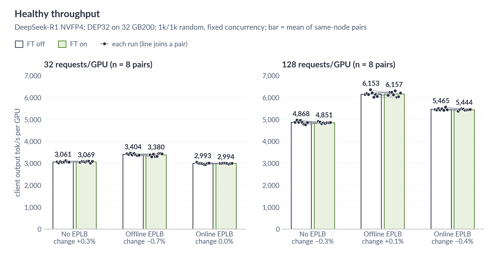

*Figure 5. Healthy client output throughput per GPU, FT off vs on: bar = mean of same-node pairs (32/GPU n=8, 128/GPU
n=8), dots = each run, a line joins each pair. Every change is within 0.7% (largest -0.7%, offline at 32/GPU).*

*Notes: a "change" label is the change of the displayed means, (FT on - FT off) / FT off; the table below and Figure 6
use the mean of per-pair changes, so the two can differ by up to 0.1 point (e.g. No EPLB at 32/GPU: +0.3% vs +0.25%).*

| Mode | Load | Output tok/s/GPU, off -> on | Median TPOT, off -> on |
|---|---|---|---|
| No EPLB | 32 | 3061 -> 3069 | 8.55 -> 8.40 ms |
| No EPLB | 128 | 4868 -> 4851 | 19.81 -> 19.97 ms |
| Offline EPLB | 32 | 3404 -> 3380 | 8.15 -> 8.16 ms |
| Offline EPLB | 128 | 6153 -> 6157 | 17.11 -> 17.06 ms |
| Online EPLB | 32 | 2993 -> 2994 | 8.88 -> 8.75 ms |
| Online EPLB | 128 | 5465 -> 5444 | 17.65 -> 17.65 ms |

- FT on and FT off overlap pair by pair in every cell. Pairs at 32/GPU range -3.8% to +2.8%.
- Median TPOT moves -1.8% to +0.1% at 32/GPU and -0.3% to +0.8% at 128/GPU (FT vs off, cell means); no cell is
  significant (table below).
- In the offline-32 cell, most of that spread is wave alignment (partial-batch decode steps, the number of context
  steps), which moves either arm by about +-1.5% (offline32_analysis.md section 1, medium confidence); other cells were
  not decomposed.
- Offline EPLB is the fastest mode in both arms. Likely its replicated placement; not measured here.

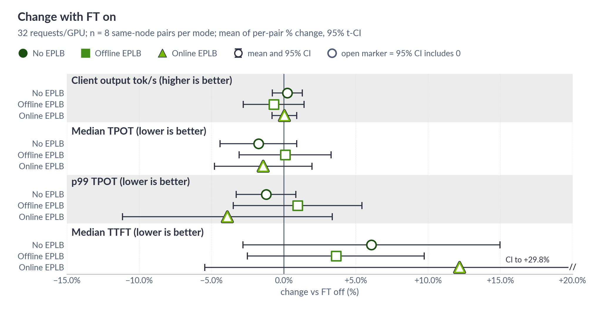

*Figure 6. Change in client throughput and latency with FT on vs off at 32/GPU: mean of per-pair % changes, n=8 pairs,
with a 95% t-CI (n - 1 df); open marker = CI includes 0. Every 95% CI includes 0 at n = 8 pairs; this does not rule
out the closed-loop TTFT effect shown pooled below (+7.3% [+1.3, +13.3], CLAIMS 208/223). 128/GPU is in the table
below.*

*Notes: CI half-widths are 0.9-2.1% for tok/s and up to 17.6% for TTFT, so these runs cannot rule out effects of a
few %.*

| Mode | Load | n | Output tok/s/GPU | Median TPOT | p99 TPOT | Median TTFT |
|---|---|---|---|---|---|---|
| No EPLB | 32 | 8 | +0.25% [-0.78, +1.28] | -1.75% [-4.40, +0.90] | -1.22% [-3.29, +0.85] | +6.07% [-2.83, +14.97] |
| No EPLB | 128 | 8 | -0.33% [-1.63, +0.96] | +0.82% [-1.19, +2.84] | +0.42% [-0.49, +1.34] | -0.65% [-10.95, +9.64] |
| Offline EPLB | 32 | 8 | -0.69% [-2.80, +1.42] | +0.10% [-3.08, +3.28] | +0.97% [-3.49, +5.42] | +3.62% [-2.51, +9.74] |
| Offline EPLB | 128 | 8 | +0.08% [-1.60, +1.77] | -0.28% [-0.94, +0.37] | -0.05% [-1.61, +1.52] | +1.31% [-5.35, +7.96] |
| Online EPLB | 32 | 8 | +0.05% [-0.81, +0.91] | -1.42% [-4.80, +1.96] | -3.90% [-11.16, +3.36] | +12.18% [-5.47, +29.82] |
| Online EPLB | 128 | 8 | -0.38% [-1.28, +0.51] | +0.02% [-0.82, +0.87] | +0.77% [-0.14, +1.68] | +0.85% [-3.39, +5.09] |

- Every CI includes 0 (24 of 24). These runs cannot detect a ~1% client cost.
- One-sided 95% bounds, pooled n=8 at 32/GPU: FT's throughput loss is at most 0.58% without EPLB, 2.38% offline and
  0.63% online (repl_cost_pooled.txt:79,89,99; checked two ways, pooled_onesided_check.txt). At 128/GPU, pooled n=8
  (CLAIMS 232): at most 1.37% without EPLB, 1.27% offline and 1.10% online (review/diag/healthy128_pooled_readout.txt).
- TTFT is up in 5 of 6 cells. Pooling all 24 pairs at 32/GPU across modes (descriptive, not pre-registered), median
  TTFT is +7.3% [+1.3, +13.3] with FT (19/24 positive); p99 TTFT is unchanged (+0.2% [-0.7, +1.0]); no shift at
  128/GPU (CLAIMS 208).
- Cause of the TTFT shift: FT runs ~5% fewer prefill steps (-4.89% [-9.13, -0.65]) with ~6% more requests each
  (+6.24% [+1.63, +10.85]), at the same prefill time per token (-0.14% [-2.09, +1.81]). In this closed-loop benchmark
  the median first token waits a little longer. It is not the TCP transport: FT off over the same transport shows no
  rise (5 pairs; weak, n <= 2 per job; 2 pairs on the pre-fix build's FT off, 3 from v3-era jobs 8140516 and 8139740;
  CLAIMS 208).
- Why FT batches prefill more: in this closed-loop benchmark all 1024 users start together, so requests arrive in
  waves, and each run either stays "locked" (tight waves, fewer and larger prefill batches, higher median TTFT) or
  disperses. A pre-registered test on the soak (6 jobs, 18 rows per arm, same ULFM launch for both; CLAIMS 223):
  - FT runs start locked more often: 14/18 vs 6/18 for FT off (two-sided Fisher p = 0.018). Over all 300 s windows,
    18/64 vs 7/67.
  - Within locked windows FT's median TTFT is +161 ms higher [+30, +293]; within dispersed (steady) windows there is no
    difference (+5 ms [-97, +72]).
  - So the TTFT rise is an FT effect in this closed-loop benchmark, not only a benchmark artifact. Under
    realistic open-loop traffic it is small (Figure 9: median TTFT +0.9% [-0.2, +1.9], 6 pairs; p99 TTFT +3.0% [-4.5, +10.4]; CLAIMS 240). Cause not known: FT does not touch ADP
    balancing, fetch or routing (code read), and step time differs by only the known +0.5%.
  - Caveats (set before data): the primary unit is the start-up window; one FT row was seen during the mechanics check.
- Healthy hang soak (CLAIMS 222): 0 hangs or stalls in 7.09 loaded h with FT on and 7.21 h with FT off (18 runs each,
  same ULFM ob1/TCP launch). The rate is below 0.42 per loaded hour (one-sided 95%) in each arm; transport vs FT is
  not separated because there were no events.
- What these numbers do not cover: one model (DeepSeek-R1 NVFP4 on 32 GB200), one shape (1k/1k), MTP acceptance
  forced to 1, a closed-loop benchmark at two loads (32 and 128/GPU), and one realistic open-loop load (~80%, Figure 9).
  The soak bounds hangs at < 0.42 per loaded hour (one-sided 95%), which does not rule out rarer hangs.

**Replication at 32/GPU** (jobs 8285727, 8287475, 8289412, 8289662; CLAIMS 206). Same code, knobs and method; 4 new
pairs per cell, order balanced 2/2.

| Mode (32/GPU) | Original n=4 | Replication n=4 | Pooled n=8 |
|---|---|---|---|
| No EPLB | +0.50% [-1.40, +2.41] | -0.01% [-2.22, +2.20] | +0.25% [-0.78, +1.28] |
| Offline EPLB | -2.03% [-3.56, -0.49] | +0.65% [-4.16, +5.46] | -0.69% [-2.80, +1.42] |
| Online EPLB | -0.18% [-1.94, +1.57] | +0.29% [-1.37, +1.95] | +0.05% [-0.81, +0.91] |

- Output tok/s/GPU, FT vs off. The original offline -2.0% (p99 TPOT +3.55%) did not replicate: pooled -0.7% [-2.8,
  +1.4] (analysis under Costs).
- In the original runs only offline at 32/GPU was significantly below FT off. 24 tests (6 cells x 4 metrics) should give
  about one 'significant' result by chance; it is disclosed under Costs, with its non-replication.
- At these sample sizes, FT's client throughput cost at 32/GPU cannot be separated from run-to-run noise. The per-step
  cost below is the measured FT cost.
- The decode step is +0.35-0.87% slower with FT at 32/GPU, while client TPOT and throughput are flat within noise. In
  these closed-loop runs FT also runs fewer, larger prefill steps (-4.89% context steps, CLAIMS 208), which can offset
  the step cost in client metrics (likely, not measured). Matching client numbers do not mean zero cost.
- Latency, pooled n=8 at 32/GPU: median TPOT -1.8% to +0.1%; p99 TPOT -3.9% to +1.0% (offline +3.6% did not replicate:
  +0.97% [-3.49, +5.42]); median TTFT +3.6% to +12.2%, largest online (+12.2% [-5.5, +29.8]). TTFT is noisy; it is not
  shown to be unchanged.
- The original per-cell table (n=4, both loads) is in Appendix F.

**Per-step cost.** Rank 0's decode step time, FT vs off (Appendix Figure A1).

| Mode | 32/GPU, pooled n=8 trimmed | 32/GPU, µs/step | 128/GPU, pooled n=8 trimmed | 128/GPU, µs/step |
|---|---|---|---|---|
| No EPLB | +0.87% [+0.72, +1.02] | ~120 | +0.56% [+0.38, +0.74] | ~150 |
| Offline EPLB | +0.50% [+0.34, +0.66] | ~70 | +0.39% [+0.24, +0.54] | ~103 |
| Online EPLB | +0.35% [-0.04, +0.75] | ~51 | +0.40% [+0.28, +0.53] | ~99 |

- "< 1% per step" is not claimed. The pre-registered rule (every cell's one-sided 95% upper bound < 1% for both the
  trimmed and the full mean) fails on the original n=4: full-mean bounds reach +3.76%. The trimmed-only rule added later
  also fails there: +1.18% (no EPLB 32), +1.09% (online 32).
- Pooled n=8 at 32/GPU: trimmed bounds are +0.99% / +0.63% / +0.67% (no EPLB just under 1%: +0.986); the full mean still
  fails (offline +2.18%). Pooled n=8 at 128/GPU (CLAIMS 232): trimmed bounds +0.70% / +0.51% / +0.50%, full mean
  +1.22% / +1.05% / +0.63%. So the trimmed-only rule now holds in every cell at both loads; the pre-registered trimmed-
  and-full rule still fails. Disclosed, not claimed: the trimmed rule came after the rehearsal.

### Recovery

Each failure is injected during decode at 128/GPU (frozen rank: 64/GPU), node failure domain. Time = kill -> rank 0's
first step after the commit (server timestamps). All v5-final rows pass (CLAIMS 193); the replication adds 8 rank and
node kills, 8/8 pass (CLAIMS 203); THIN-CELLS adds 2 offline rank kills, 2 offline node kills, and one frozen rank and
one two-loss case each for no EPLB and online, 8/8 pass (THIN-CELLS 8302191, CLAIMS 213).

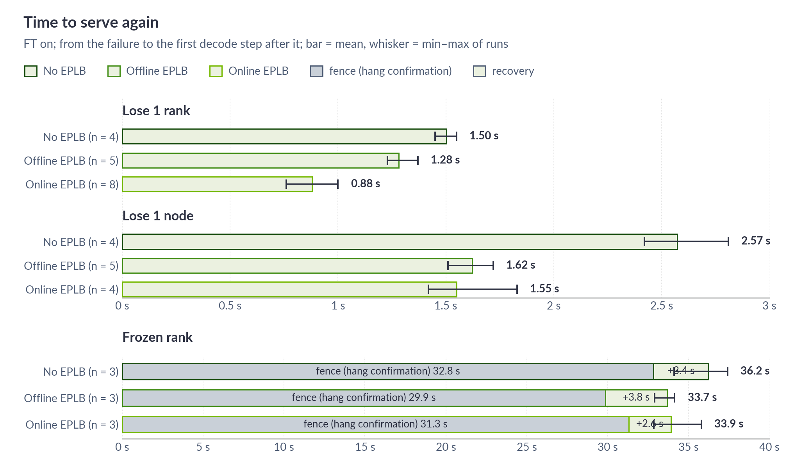

*Figure 7. Time from a failure to the first decode step after it, FT on. 0.88-2.57 s mean per mode for a rank or
node kill; 33.7-36.2 s for a frozen rank, almost all of it the hang confirmation before the fence. A restart with FT
off takes 5.0-11.6 min (Figure A4).*

*Notes: bar = mean, whisker = min-max of the runs; n in the row labels. Frozen rank: measured from the freeze, split into
the measured fence (32.8 s No EPLB, 29.9 s Offline, 31.3 s Online, including the 30 s hang confirmation) and the recovery
after it (+3.4 s, +3.8 s, +2.6 s). Restart is shown only for a rank loss (Figure A4): after a node loss DEP32
cannot relaunch until a spare node arrives, and with FT off a frozen rank hangs until something outside kills it, so
neither has a restart time of its own.*

*Names: fence = the recovery authority's `Fence` once the hang monitor (`HangMonitor`) confirms the hang.*

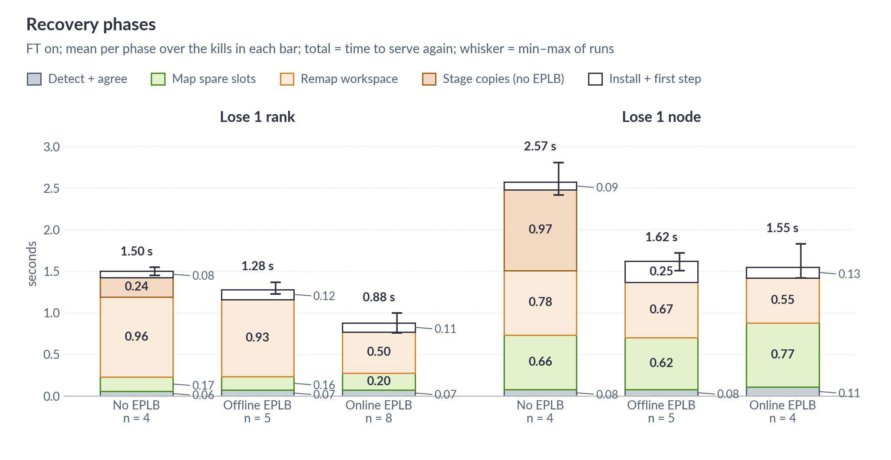

*Figure 7b. Recovery steps per kill (mean per step over the kills in each bar; totals equal the Recovery table's
means). The workspace remap is the largest step after a rank kill; after a node kill, mapping spare-slot memory grows
~4x and, without EPLB, staging copies from another node is the largest step. Parts may not sum exactly to the total
because of rounding (CLAIMS 241).*

*Names: agree = detected -> stopped (revoke, ULFM shrink, roll back); map spare slots = stopped -> proposed (`_restore_placements`,
then rank 0 fences the failed ranks); remap = `_remap_workspaces` (peer_loss_recovery.py); stage copies = ring-copy
staging (`stage_restored_slots`, moe_load_balancer.py), split from the remap by the slowest survivor's logged
staging time (review/diag/recovery_substeps.txt); commit = the authority's `Commit`.*

| Failure | No EPLB | Offline EPLB | Online EPLB |
|---|---|---|---|
| One rank killed | 1.50 s (1.45-1.55, n=4) | 1.28 s (1.23-1.37, n=5) | 0.88 s (0.76-1.00, n=8 incl. four kills in an EPLB update) |
| One node killed (4 ranks) | 2.57 s (2.42-2.81, n=4) | 1.62 s (1.51-1.72, n=5) | 1.55 s (1.42-1.83, n=4) |
| Frozen rank (SIGSTOP), 64/GPU | fenced 32.8 s (30.3-34.1, n=3), first step 36.2 s (34.1-37.4, n=3) | fenced 29.9 s (29.5-30.1, n=3), first step 33.7 s (32.9-34.1, n=3) | fenced 31.3 s (30.0-33.4, n=3), first step 33.9 s (32.9-35.8, n=3) |
| Restart instead, FT off (pooled warm restarts, CLAIMS 224, 228) | 339 s (301-416, n=6) | 371 s (320-541, n=7) | 626 s (580-693, n=7) |

- FT serves again 0.8-1.6 s after a rank kill and 1.4-2.8 s after a node kill (all runs; per-mode means 0.88-1.50 s
  and 1.55-2.57 s). A restart after a rank kill took 5.0-11.6 min (means 5.7 / 6.2 / 10.4 min, n=6 / 7 / 7; Figure A4). No node-kill restart was
  run (see the Figure 7 notes).
- Frozen-rank times are from the stop (SIGSTOP), not a kill; the frozen rank was rank 2 in all 9 runs (RECOV2 8353506, RECOV4 8363511; CLAIMS 227, 238).
- Remap + stage copies is the proposed -> ready interval. With EPLB all of it is the all-to-all remap (0.50-0.93 s);
  the experts load later, from the node's host copies at Install. No EPLB, it is the remap (0.96 s rank, 0.78 s node)
  plus staging ring copies from another node into the target slots (0.24 s rank, 0.97 s node; the slowest survivor's
  logged staging time; remap max + staging max match the interval within ~1 ms). That is why no EPLB is ~0.2-0.6 s
  slower after a rank kill and ~1.0 s after a node kill (CLAIMS 241).
- Agree (detected -> stopped: revoke, shrink, roll back) is 0.05-0.09 s. Map spare slots (stopped -> proposed) is
  0.16-0.20 s after a rank kill and 0.62-0.77 s after a node kill: each survivor maps memory behind its spare slots
  (`_restore_placements`) before it reads the authority's messages, so rank 0 answers the authority's fence requests
  only after its own mapping, and the authority proposes once every failed rank is fenced. Rank 0's own logged mapping
  is 145-718 ms of the 161-768 ms span (cell means; the rest, ~15-50 ms, is the fence). A node kill maps ~4x more per
  survivor (1752 vs 444 MB max, no EPLB; kill_final.txt restored_mb) (CLAIMS 241).
- Detect is 0.01-0.03 s (medians); install, commit and the first step add 0.08-0.25 s (means).
- The restart is slow because of weight loading, kernel compile and tuning (~74-77 s mean: ~51 s attention-kernel JIT,
  ~10 s autotuner, and in 3 of 20 restarts ~60 s rebuilding flashinfer's sampling kernels, cache miss not explained;
  CLAIMS 224, 228) and graph
  capture (~157-184 s mean incl. ~4-6 s to the first token; captured twice, a memory dry run and the final pass). Online restarts spent 304-378 s in model
  load vs 49-71 s without EPLB or with offline EPLB, apart from one 165 s and one 277 s load (rank-0 Model loading
  metrics over all 20 restarts, CLAIMS 211, 228).
- Why online loads slowly (rank-0 `Model loading metrics`, job 8206870; CLAIMS 211; review/diag/why_ttft_restart.md):
  - Measured: model load is 307-342 s with online EPLB on every launch, including the first launch (313.4 s), so it
    is not restart-specific. Without EPLB or with offline EPLB it is 58-68 s, even from a nearly cold page cache.
  - Inferred: the extra ~250 s is main's online-EPLB host-copy build: every node writes all experts (~390 GB) to
    /dev/shm through CPU staging (moe_load_balancer.py `HostMoeTensorSharer`). The load is CPU-bound (~50% CPU, low
    I/O pressure), not page-cache misses: 30 s after ready the online nodes had 312-403 GB available (291-375 GiB,
    CLAIMS 211). This corrects CLAIMS 198's "~60 GiB available" note.
  - The one slow offline restart (277 s model load, 1 of 2) coincided with the kernel evicting the checkpoint's page
    cache mid-load: an I/O outlier. The other offline restart loaded in 58 s.

Other v5-final rows (8269102; two losses plus THIN-CELLS 8302191, CLAIMS 213; prefill and EPLB-update rows plus RECOV2
8353506 and RECOV3 8361282, CLAIMS 227, 235), with the script-observed resume in
parentheses (kill -> the test script seeing rank 0's "resumed" line, polled every 0.5 s; it lags the first step by up to
~0.45 s, but comes before it when the step is slow). The same runs' rank / node rows (n=2): no EPLB 1.5 s (1.7 s) /
2.5 s (2.7 s), online 0.8 s (1.2 s) / 1.6 s (1.8 s).

| Failure | No EPLB | Offline EPLB | Online EPLB |
|---|---|---|---|
| One rank killed in prefill * | 2.4 / 2.7 / 2.5 s (1.7 / 1.7 / 1.6 s), n=3 | 1.9 / 2.1 s (1.5 / 1.7 s), n=2 | 1.9 / 1.7 / 1.7 s (1.1 / 1.2 / 1.2 s), n=3 |
| One rank killed in an EPLB update | - | - | 0.8 / 1.0 / 1.0 / 0.9 s (1.2 / 1.0 / 1.2 / 1.2 s), n=4 |
| Two losses, one after the other | first 1.7 / 1.7 s (1.7 / 1.7 s), second 2.0 / 1.7 s \*\* (2.1 / 2.1 s), n=2 | first 1.3 / 1.4 s (1.7 / 1.7 s), second 1.6 / 2.2 s \*\* (2.0 / 2.2 s), n=2 | first 0.8 / 1.1 s (1.2 / 1.2 s), second 1.8 / 0.9 s \*\* (1.6 / 1.5 s), n=2 |

- \* In the prefill rows the first step after the recovery is a full prefill, so it ends ~1 s after the resume line.
- \*\* Server time from the second loss's detect, not its kill (kill_final.txt phases2, `harness/job.sh:3804-3807`).
  Detect follows a kill by ~0.01-0.03 s. Two-loss runs: 8269102 / THIN-CELLS 8302191, CLAIMS 213; victims 5 -> 9 (no
  EPLB) and 13 -> 17 (online) in both; offline RECOV3 8361282 (CLAIMS 235), victims 5 -> 9 and 22 -> 26. Server values:
  no EPLB first 1.73 / 1.65 s, second 2.04 / 1.69 s; offline first 1.32 / 1.36 s, second 1.55 / 2.18 s; online first
  0.82 / 1.14 s, second 1.77 / 0.85 s.
- Restart = kill -> the new server's first token: old server's exit, then weight loading, kernel compile and tuning, and
  graph capture;
  page cache and autotuner cache kept, same allocation (pooled warm restarts, CLAIMS 224, 228).

Recovery phases (cumulative time since kill):

| Phase | Rank kill | Node kill |
|---|---|---|
| Detected | 0.02 s | 0.02 s |
| Plan | 0.2-0.3 s | 0.7-0.9 s |
| Ready: remap done, online EPLB (experts load at Install) | 0.7-0.8 s | 1.3-1.7 s |
| Ready: remap + ring copies staged into slots, no EPLB | 1.4-1.5 s | 2.4-2.5 s |

- Replication on v5-final (job 8285728, CLAIMS 203; same code and knobs, decided after the first results were seen):
  first step no EPLB rank 1.53 / 1.45 s, node 2.42 / 2.81 s; online rank 0.89 / 0.83 s, node 1.42 / 1.53 s (means over
  all 4 runs in the Recovery table).
- Offline EPLB (v5-final, n=3 each, CLAIMS 202 and THIN-CELLS 8302191, CLAIMS 213; same expert placement as the
  healthy-cost runs, only the CUDA-graph batch sizes differ): rank kill 1.37 / 1.23 / 1.24 s (1.71 / 1.19 / 1.51 s; victims rank 5, 5, 22),
  median 1.24 s; node kill 1.72 / 1.55 / 1.61 s (1.71 / 1.69 / 1.71 s; node 1, 1, 5), median 1.61 s; all pass. The
  victim position (rank 5 vs 22, node 1 vs 5) moved the result by no more than the run-to-run
  spread (<= 0.32 s script resume, <= 0.06 s server, <= 0.018 in throughput ratio).
- Rank 0 lost, or recovery past its deadline: the job ends cleanly, as designed (pre-fix build, 4/4 each).

**Requests.** Survivors' requests all completed. In these decode-kill runs every request held by the lost rank(s) had
already streamed tokens, so each ended with a retryable error (0 re-runs): 128 per rank kill, 512 per node kill (3.1% / 12.5% of the 4096 in flight). No other
request failed. A restart instead drops all 4096.

### After the loss

Client throughput after / before a loss: the first full decode wave after the resume vs the waves before the kill, at
fixed concurrency (CLAIMS 209). Proportional = share of GPUs left.

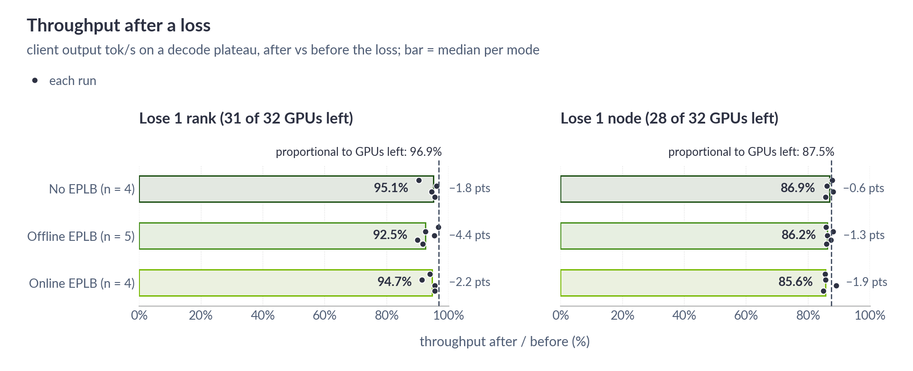

*Figure 8. Client throughput after vs before a loss, median per mode (dots: each run; n = 4 / 5 / 4, CLAIMS 220, 239);
dashed: proportional to the GPUs left (96.9% / 87.5%). Every median is 0.6-4.4 points below the dashed line; the
lowest rank-kill run, 0.900x, is 6.9 points below.*

*Notes: before = mean of the full decode plateaus before the kill; after = the first full plateau starting >= 2 s after
the resume; proportional = linear scaling with the GPUs left, a reference, not an upper bound (below); pts = percentage points between the displayed
values; outline shade (dark / mid / light green) marks the mode.*

| Failure | No EPLB | Offline | Online | All modes | Proportional |
|---|---|---|---|---|---|
| One rank (31/32 live), 128/GPU | 0.951x (n=4) | 0.925x (n=5) | 0.947x (n=4) | 0.945x (n=13) | 0.969x |
| One node (28/32 live), 128/GPU | 0.869x (n=4) | 0.862x (n=5) | 0.856x (n=4) | 0.860x (n=13) | 0.875x |

Values are medians over runs (rounded half up from CLAIMS 220's 4-decimal medians, e.g. 0.9505), from
review/diag/client_tput_after_kill.txt (CLAIMS 209 + 213; CLAIMS 220 holds the n=11 medians, CLAIMS 239 the n=13 medians with RECOV4; plotted from
review/figures/final_clean/fig8_after_loss.csv). Offline adds THIN-CELLS 8302191 (client ratios, CLAIMS 220: rank 5
0.925x, rank 22 0.954x; node 1 0.881x, node 5 0.862x) and RECOV4 8363511 (rank 5 0.900x, rank 22 0.916x; node 1
0.873x, node 5 0.859x).

- Per-mode medians land 0.6-4.4 percentage points below the share of GPUs left (pooled: rank 0.945x vs 0.969x, node 0.860x vs 0.875x). Single runs
  span 0.900-0.967x for rank kills (none above proportional; the lowest, 0.900x, is 6.9 percentage points below) and 0.849-0.891x
  for node kills, where four runs are above proportional (0.877x and 0.880x no EPLB, 0.881x offline, 0.891x online).
- Proportional is a reference, not an upper bound: at fixed concurrency each survivor serves more requests (~132 after
  a rank kill, ~146 after a node kill, vs 128), and per-GPU throughput rises with batch (Figure A2).
- Why they fall slightly below proportional is not settled. Diagnostic (rank 0's own log, CLAIMS 226): rank 0's batch
  grows as expected, but its decode steps run ~4-5% longer than the bigger batch explains (rank kill median step +5% vs
  ~+1% expected). Candidates, not separated: CUDA-graph padding (below), uneven restored experts per survivor (memory
  proxy 1.18-1.27x after rank kills, Expert Placement), the 31-rank all-to-all.
- Likely, not measured: after a loss the client spreads 4096 requests over fewer ranks, ~132 per rank after a rank kill
  and ~146 after a node kill, and attention-DP CUDA-graph padding rounds each rank's batch up to the next batch size
  captured as a CUDA graph, 136 or 148 (cuda_graph_config in the 8269102
  effective configs). CLAIMS 120 measured this mechanism on the Oct 20 build (larger padding there).
- An earlier estimate (rank-0 host time x live ranks: 0.95x / 0.89x) read high for node kills (8 of 9; 8 of 11 with
  THIN-CELLS); the client measurement replaces it.
- Two cases dip more right after recovery: a frozen rank (0.82-0.88x on the first post wave, 0.86-0.89x over 5 waves;
  n=2 per mode; THIN-CELLS 8302191, RECOV2 8353506, CLAIMS 213, 229; review/diag/client_tput_after_kill.txt) and a rank
  killed during prefill (0.73-0.94x on the first wave, median 0.89x, 0.82-0.94x over two; n=7 over the three modes;
  CLAIMS 229; review/diag/client_tput_prefill_stop_2026-10-27.txt). Cause not known.
- One post-kill wave per case (12-14 s), and healthy waves vary 0-5%, so each case is noisy.

### Early-user stress tests

Realistic traffic instead of the lab pattern: requests arrive over time (open loop, Poisson), input 128-4k and output
64-2k tokens, online EPLB, R1 on 32 GB200, v5-final. Pass rules were set before data (review/PRODUCT_STRESS_PLAN.md).

**Healthy, FT on vs off (S1 8310100 and its replication S1B 8359063, CLAIMS 217, 234).** 51.0 req/s, 79-81% of each arm's calibrated closed-loop
request rate (served tok/s 77-79% of calibrated); 35 min per arm, two same-node groups in opposite order (ABBA); ~92k
requests in each measured window (107,100 sent per arm). FT off used the default launcher, as in Healthy cost.

| Group | Arm | TTFT p50 / p99 (ms) | TPOT p50 / p99 (ms) | Served tok/s |
|---|---|---|---|---|
| G0 | FT off | 816.9 / 2018.0 | 11.7 / 13.4 | 52,365 |
| G0 | FT on | 816.6 / 2052.5 | 11.8 / 13.5 | 52,258 |
| G8 | FT off | 827.1 / 2039.5 | 11.8 / 13.7 | 52,216 |
| G8 | FT on | 831.9 / 2049.9 | 11.9 / 13.6 | 52,188 |
| S1B G0 | FT off | 819.6 / 2000.1 | 11.7 / 13.5 | 52,166 |
| S1B G0 | FT on | 826.9 / 2046.7 | 11.8 / 13.4 | 52,164 |
| S1B G8 | FT off | 815.3 / 1998.4 | 11.8 / 13.4 | 52,144 |
| S1B G8 | FT on | 829.8 / 2016.4 | 11.9 / 13.6 | 52,164 |

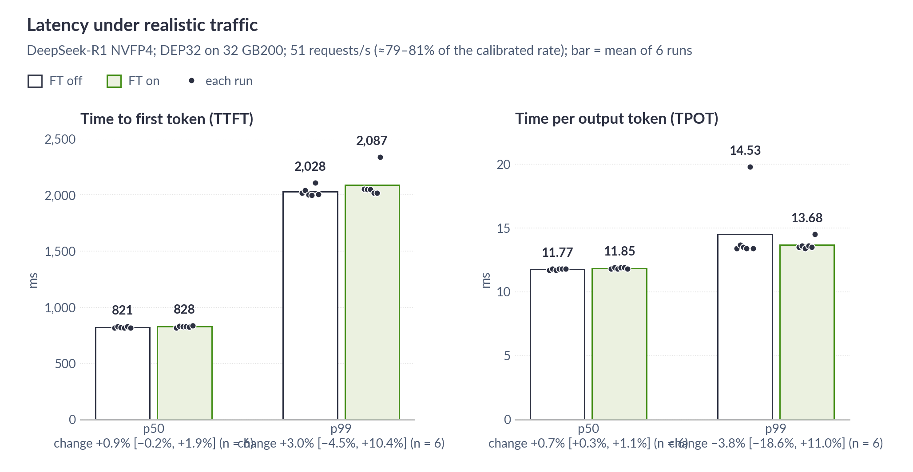

*Figure 9. p50 and p99 TTFT and TPOT under realistic open-loop traffic, FT off vs on: bar = mean of 6 same-node pairs
(S1 8310100, S1B 8359063, S1C 8363138; CLAIMS 217, 234, 240), dots = each run. Medians change by less than 1%; each
p99 has one outlier run (one FT off, one FT on).*

*Notes: p50 / p99 are per run, then averaged over the 4 runs; the labels give the mean of per-pair % changes with a 95%
t-CI (n = 6, descriptive); the load (51 req/s) is ~79-81% of the calibrated closed-loop request rate. TPOT is
recorded to 0.1 ms; the median TPOT change is one 0.1 ms step in 5 of the 6 pairs and 0.0 in one.*

- Under realistic load the medians of FT on and off are within 2.3% in all 6 pairs. Mean over pairs: median TTFT +0.9%
  [-0.2, +1.9], median TPOT +0.7% [+0.3, +1.1] (+0.1 ms in 5 pairs, 0.0 in 1), served throughput -0.03% [-0.14, +0.08]
  (CLAIMS 240).
- p99s: TTFT +3.0% [-4.5, +10.4], TPOT -3.8% [-18.6, +11.0]. Each has one outlier run: S1C pair 1's FT-off run had p99
  TPOT 19.8 ms (the other 11 runs 13.4-14.5 ms); S1C pair 2's FT-on run had p99 TTFT 2337.8 ms (+16.6%) and p99 TPOT
  14.5 ms (+8.2%). The other 4 pairs are within 2.4% on every percentile. With the first 4 pairs p99 TTFT was +1.4%
  [+0.1, +2.7] (CLAIMS 234).
- In S1 and S1B one FT-off arm each failed the host-memory growth check (job 1 +8228 MiB, S1B +3201 MiB on one node; all
  6 FT-on arms and both S1C FT-off arms pass); the latency pairs are kept as in CLAIMS 217. Job 1's case: node 0 host memory available fell 6.9 GB
  over the window; it is not in the serving processes (RSS growth <= 4.7 MiB in that arm, shared memory flat); the other
  ~6.3 GB is in fields the sampler did not record (page cache, slab, kernel), so it cannot be attributed from these logs.
- The closed-loop TTFT shift (+7%, Healthy cost) does not appear under this open-loop load.
- No stall, no client failure, no GPU memory growth (<= 2 MiB) and process RSS growth <= 5.9 MiB in any arm.

**Random kills under traffic (S2, job 8299473, CLAIMS 216).** One random non-0 rank killed at a random time, then 20+
min degraded:

| Kill | Resume | Failed requests | Served after / before (load kept up) | Capacity after / before (calib-end / calib) | /health |
|---|---|---|---|---|---|
| rank 14 at 954 s | 1.03 s | 21, all the lost rank's | 0.999x | 0.93x | healthy -> recovering -> degraded |
| rank 13 at 1895 s | 1.03 s | 19, all the lost rank's | 1.010x | 0.927x | healthy -> degraded (recovering missed) |
| node 2 (ranks 8-11) at 731 s (job 8318006, CLAIMS 219) | 1.96 s | 73, all the lost ranks' | 1.006x | 0.919x | healthy -> recovering -> degraded |
| rank 25 at 2183 s (job 8318006, CLAIMS 219) | 1.05 s | 18, all the lost rank's | 1.003x | 0.928x | healthy -> degraded (recovering missed) |

- The offered load stayed below the post-loss capacity, so served throughput follows it (~1.0x); it is not a capacity
  measure. Capacity is the closed-loop calibration row (32/GPU, 1024 streams, the stress request mix), run before the
  load and again on the survivors at the end: 0.919-0.93x (CLAIMS 216, 219). It differs from Figure 8 (median 0.945x
  rank, 0.860x node) in load (32 vs 128/GPU), request mix (mixed lengths vs 1k/1k) and window (a ~100 s row at the end
  of the run vs the first wave after the resume); the difference is not decomposed.
- All 4 recoveries (3 rank kills, 1 node kill) pass every check except /health in 2 of 4, explained by its 1 s answer
  cache (Limits). Failed requests always equal the lost ranks' in-flight requests.
- One GPU's memory stepped up ~2 GB once, late in the node-kill run (not a trend; not attributed). Host memory was
  flat with the added page-cache/slab fields.
- What users see after a rank kill at ~80% load: median TTFT rose 826 -> 1021 ms (+24%, rank 14) and 842 -> 1049 ms
  (+25%, rank 13), and median TPOT 11.8 -> 13.2 ms (rank 14), at the same offered load (CLAIMS 216).

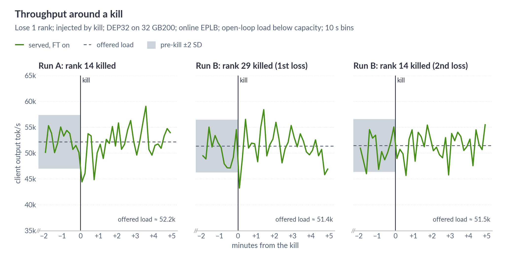

*Figure 10. Served tok/s in 10 s bins from 2 min before to 5 min after a rank kill under realistic traffic (run A: S2
8299473; run B: S3 8314070, G0). Dashed: offered load; band: ±2 SD of the pre-kill bins around it (±9.9%; 1 of the 36
pre-kill bins falls outside).*

*Notes: the y axis starts at 35k (axis break). The SD comes from the 12 pre-kill 10 s bins (2 min) of each panel,
pooled over the 3 panels. A 10 s bin can exceed the offered load while a backlog drains. The panels are 3 of the 8
stress-test losses: S2 job 1's first server (rank 14) and both losses on S3's G0 server. No selection rule was set;
all 8 losses have the same per-request client records. The other 5, including the node kill (CLAIMS 219), are not
plotted; their numbers are in the tables and below. The slide chart averages all 7 rank kills (CLAIMS 236).*

- The first 10 s bin after the kill is the lowest in 2 of 3 runs (44.4k, 43.2k; 49.0k in the third). Later bins
  scatter around the offered load: of the other 87 post-kill bins, 5 fall below the band (run A at +10 and +40 s; run B
  at +280 s after the first loss, +30 and +170 s after the second) and 3 rise above it.
- The dip is only a little larger than normal 10 s bin noise (the ±9.9% band).
- All 8 losses (CLAIMS 236): the first 10 s after a rank kill is -2.6% to -15.8% vs the offered load (mean -10.3% over 7
  rank kills); the node kill -30.4%. From +10 to +60 s the rank kills are -4.9% to +1.8%, then within 1.1% of the offered
  load to +5 min.

**A second loss 15 min later (S3, job 8314070, CLAIMS 218).** Same traffic; a second random rank killed 900 s after
the first recovery:

| Server | First loss: resume, failed, served after/before | Second loss: resume, failed, served after/before |
|---|---|---|
| G0 | rank 29: 1.02 s, 22 (lost rank's), 1.005x | rank 14: 0.99 s, 23 (lost rank's), 1.011x |
| G8 | rank 12: 0.87 s, 19 (lost rank's), 0.997x | rank 31: 1.03 s, 20 (lost rank's), 1.003x |

- Both servers pass: two recoveries each, 30 ranks serving at the end, no other request failed, no hang.
- The authority's recovering window was 0.67-0.86 s; /health missed one of the four (the 1 s cache, Limits).

### Accuracy

GSM8K (grade-school math) strict-match accuracy, 1319 questions, served by the 31 survivors after rank 5 was killed and
recovered (online EPLB, MTP acceptance not forced). This checks the recovered model's answers, not interrupted requests.

| Build | FT on, kill | FT off, no kill | Delta (+-2 SE; SE = standard error) |
|---|---|---|---|
| v5-final | 0.9477 | 0.9469 | +0.001 (+-0.017) |

- The delta is within 2 SE (CLAIMS 193). Of questions answered differently, 21 went right-to-wrong and 22
  wrong-to-right (strict match, ACCURACY-KILL-ON-8269102/accuracy_kill.txt): consistent with run-to-run
  nondeterminism.
- Earlier builds' GSM8K runs are in Appendix I.6.

### Memory

- GPU, after a loss: restored experts take up to 0.44 GB per survivor after a rank loss, 1.75 GB after a node loss and
  0.91 GB after two rank losses (444 / 1752 / 912 MB, no EPLB; kill_final.txt restored_mb, V5F-REC 8269102). This stays
  out of the KV cache until restart.
- GPU, healthy: unbacked spare slots map one shared scratch set of 15 VMM chunks per process (~30 MiB if the granularity is
  2 MiB).
- GPU, at recovery: the all-to-all remap maps 7.5 GB of fresh memory per GPU; the old memory frees when the failed
  processes end (Late Writes).
- Host: FT keeps expert copies in /dev/shm, reserved at startup. Offline or online EPLB: every node keeps every expert
  (~390 GB per node for R1). No EPLB: ring copies (~49 GB per node). FT off: none for no or offline EPLB; main's online
  EPLB keeps its own host copies. Minimum MemFree: FT 356-374 GB vs off 745-759 GB (offline32_analysis.md section 3).

## Known Costs & Limits

### Costs

- **Steady per-step cost** (trimmed mean; Healthy cost, per-step table; Appendix Figure A1): +0.35% to +0.87% at
  32/GPU (51-120 µs/step, pooled n=8), +0.39% to +0.56% at 128/GPU (99-150 µs/step, pooled n=8). Original n=4 at 32/GPU:
  133 / 83 / 69 µs (no EPLB / offline / online). Steps are ~14 ms at 32/GPU and ~26 ms at 128/GPU, so the percentage
  falls at 128/GPU without EPLB and offline; online's cost grows with the step (51 -> 99 µs, +0.35% -> +0.40%;
  Appendix H).

- **Where the steady cost comes from:**
  - Without EPLB, FT still routes through EPLB's slot tables with a fixed placement (the static load balancer). Its
    share on v5-final was not measured; the pre-fix (+54-82 µs) and v5-zero (~+5 µs) estimates of FT over the LB
    disagree (Appendix I.7).
  - Most of it shows in rank 0's GPU forward time (medium confidence: the CUDA-event forward delta tracks the host delta
    except online, device +41/+61 vs host +70/+96 µs; steady_cost_analysis.md section 1).
  - All-to-all kernels (dispatch + combine, 59 calls per step: 58 MoE layers + MTP). FT adds per call ~0.6-0.8 µs on one
    node (4 ranks, 8-32 tokens/rank; ~40 µs/step; CLAIMS 191). A kernel-only benchmark across 4-32 GPUs, at 32 GPUs and
    64 tokens/rank, gives +0.85-1.00 µs without EPLB statistics (online EPLB's per-expert token counts, which the
    all-to-all gathers for the balancer; three jobs: 8282103 +1.00, CLAIMS 200; 8289096 +0.85, CLAIMS 205; 8293196
    +0.88, CLAIMS 210; ~50-59 µs/step) and +3.0 µs with online EPLB's statistics (CLAIMS 200; x59 below). The
    statistics path grows ~4x from EP4 to EP32 (+0.71 -> +3.02 µs at 64 tokens/rank); the no-statistics delta grows
    less (+0.62 -> +1.00 µs). In serving, online's cost (51 / 99 µs at 32 / 128/GPU) is close to offline's (70 / 103
    µs), not ~119 µs above it, so overlap probably hides most of it (not measured).
  - Unattributed rest (inference): before the EP32 benchmark, ~36-50 µs/step of ~84 was unexplained
    (steady_cost_analysis.md section 4); if the EP32 no-statistics +59 µs/step is additive, ~10-25 µs remains for
    offline (pooled / original).
  - Single-run checks found no cost from hang detection, the failure watch, unbacked-slot memory or the spare slots (n=1 per
    arm per group, 2 groups, pre-fix build, diagnostic, CLAIMS 181, 182; unbacked-slot layout 4 set-runs, v5-zero build,
    CLAIMS 173).

- **All-to-all: work FT adds per call.**
  - No extra atomics, memory fences, syncwarps or healthy-path global stores. The completion flags are still 4 bytes;
    the per-rank flag-value slot grew from 4 to 8 bytes to hold a released-round marker (the last round released,
    which every send checks while healthy).
  - Code-read estimates per round trip at EP32, 64 tokens/rank (a2a_ft_work_coderead.md), superseded by the ablation
    below: per-peer mask check in the serial EPLB statistics loop (S; one queued memory round trip per peer, ~70
    ns/peer) ~2.0-2.4 µs, statistics only; released-round load after the system-scope memory fence (F) ~0.15-0.35;
    mask spill to local memory ~0.16 (measured); lane-parallel mask checks (L) ~0.1-0.2; extra clock compare per spin
    ~0.02-0.05; barrier with abort reduction ~0.01-0.02 µs. Sum without statistics ~0.45-0.8 µs vs measured +0.69 (no
    spill) / +0.85 µs; with statistics, + ~2.1 matches +3.0.
  - Mask spill refuted as the cause of the statistics-path growth (job 8289096, 32 GPUs, 64 tokens/rank, n=3, same
    nodes; CLAIMS 205): a variant keeping the mask in shared memory (branch `mask-spill`, stack 24 B vs 64 B) left the
    statistics cost unchanged (+3.21 vs +2.96 µs per round trip) and trimmed the no-statistics cost slightly (+0.69 vs
    +0.85 µs, ~10 µs/step).
  - **Measured item by item** (job 8293196, ablation build `d47a3bcf88`, 8 nodes, EP32, 64 tokens/rank, each switch
    removes one FT item; median of n=3 per item, spread <= 0.05 µs, outputs bit-identical to FT off; CLAIMS 210, diagnostic):

    | Item removed | Cut, with statistics (online EPLB) | Cut, without statistics |
    |---|---|---|
    | FT cost per round trip (control) | +3.00 µs | +0.88 µs |
    | S: per-peer mask check in the serial statistics loop | 2.13 µs (71%) | ~0 |
    | F: released-round load before the memory fence | 0.48 µs | 0.45 µs |
    | L: lane-parallel mask checks | 0.45 µs | 0.49 µs |
    | A: abort poll / SO: abort OR in the combine barrier | 0.10 / 0.03 µs | 0.05 / 0.03 µs |
    | All removed: what is left | +0.09 µs | +0.02 µs |

  - The FT all-to-all cost is fully attributed. With statistics it is mostly S; without, F and L about equally. F and L
    cost more than the code-read estimates; measured values stand.
  - Fix candidates, measured but not in the presented code: a one-load-per-32-peers ballot in the statistics loop (S1)
    cuts 1.62 of S's 2.13 µs; an 8-byte flag load (F8) cuts 0.18 / 0.14 µs. Neither has run in a serving pair.
  - In serving, kernel timing cannot isolate this cost: in an nsys run (NSYS-STEADY 8245564, pre-fix build, CLAIMS 212;
    online 32/GPU, n=1 case per arm) the all-to-all floor (minimum over ranks 0 and 5) is ~3.0 ms/step with FT on and
    off alike (-1.7 µs [-116, +101]), because most of it is waiting for the other ranks. The microbenchmark bound
    stands: removing all FT checks saves at most ~3.0 µs x 59 calls ≈ 177-178 µs/step if back to back (diagnostic).
  - Earlier EP4 smoke (smoke job 8292606, named in CLAIMS 210; n=1): L 0.40 µs, F 0.18 µs without statistics; EP4 has
    little statistics cost, so it could not test S.

- **One healthy FT run hung (1 of 36 FT-on runs, 0 of 31 FT-off; CLAIMS 204).** All 32 ranks stalled in main's
  attention-DP state allgather during a replication run, over FT's ob1/TCP transport. FT's hang detection did not see it
  (each rank was alive and waiting), and the job ended after 600 s: under the FT launcher `MPI_Abort` appears to end
  only its callers (inferred from behaviour; CLAIMS 204), so the other 23 ranks entered Shrink, which never returned
  until their own 300 s hang detector (repl_hang_8285727.md section C). These counts cannot tell whether it is FT-related
  (Fisher p ~ 1). Cause not isolated. No presented number comes from that run.

- **Offline at 32/GPU: -2.0% in the original runs, not replicated** (replication +0.65%; pooled n=8 -0.69% [-2.80,
  +1.42]; CLAIMS 206). Analysis of the logs (offline32_analysis.md, farstall_repl_offline.txt; medium confidence):
  - Far stalls (occasional slow decode steps not caused by rank 0's own prefill: a full decode step > 1.5x the median
    and > 5 iterations from any rank-0 context step). On v5-final (4 original + 4 replication pairs), FT had more far
    stalls in 5, fewer in 2, tied in 1 (two-sided sign p = 0.45); one pair had 46 vs 0 (6.8 s).
  - A follow-up with per-step logs from every rank (job 8282497, 4 cases per arm; CLAIMS 201) traced these stalls to
    other attention-DP ranks prefilling out of phase. They hit FT off as often as FT on (43 vs 33; 0-25 per case).
    Prefill on another rank covered 42 of 43 FT-off stalls and 26 of 33 FT stalls; 7 FT stalls are unexplained. That
    run logged every rank to node-local disk, unlike the finals' Lustre rank-0 log.
  - In the replication the extra was +1.3 s, ~0.1% of the window (CLAIMS 207). On v5-final there is no clear sign that
    FT makes these stalls more frequent; their cause is not attributed. The cross-build analysis is in Appendix I.

- **Kernel memory compaction** (stalls on host-copy pages; reduced to the FT-off level as far as measured). Fix 1: no
  mapping of peers' copies. Fix 2: a rank unmaps its own copies after writing them (Appendix E).
  - Startup stall on a used node (CLAIMS 187, 10-90 s window): FT 2.7 / 5.7 s vs FT off 3.2 s (n=1; 2.2 s on a fresh
    node). Before-fix numbers are in Appendix E.
  - Mid-run stall bursts (30-80 s compaction slowdowns): 0/8 FT and 0/9 FT-off healthy-32 windows on v5-final (CLAIMS
    194, 196, 197), vs 3 of 12 online FT windows on builds without fix 2 (Appendix E). One FT healthy-8 window (job
    8273195) had 3 slow 10 s buckets (3.1-4.6 s). At the old rate 0 of 8 would still occur ~10% of the time, so this is
    not proof of removal.
  - Online EPLB reads host copies every step, so main keeps a small exposure of its own.

### Limits

- **Frozen rank.** Fenced only with hang detection, 29.5-34.1 s after the freeze on v5-final (n=3 per mode; other
  builds in Appendix I.8).
  Two ranks frozen at once are not confirmed.
- **Main's MoE module tests.** test_moe_comm passes 41/41 on v5-final. test_moe_module hit one CUDA illegal memory
  access in a single-GPU dense NVFP4 GEMM test (TEST-INFRA 8293032), which poisoned the context for the tests after
  it. It did not reproduce in 16 reruns on v5-final's and main's code (9 isolated, 3 short windows, 4 full ordered
  runs; 8300459, 8301335), all on other nodes than the one that crashed (nvl72046-T15). Node vs code is not
  separated, and FT involvement is not shown either way.
- **/health can miss a recovery.** `/health` asks the authority and reuses the answer for 1 s
  (`serve/fault_tolerance_status.py`, max_age_s=1.0), and a recovery's recovering window is ~0.7-0.9 s. In the stress
  runs (S2 8299473 / 8318006, S3 8314070; CLAIMS 216, 218, 219), 3 of 8 recoveries showed healthy -> degraded with no
  recovering, and one showed a stale recovering ~0.5 s after the commit. Recovery itself passed in all 8.
  Fix candidate: a much shorter cache (~0.05 s), caching only failed queries (review/diag/health_recovering_gap.md).
- **Hang threshold.** Confirmed only after 30 s (see Recovery Flow; CLAIMS 77, 97, 103).
- **Host-collective stall.** If every rank stalls inside a host collective, FT blames no rank, so main's hang detector (300 s)
  ends the job (600 s seen once). Soak so far: 0 hangs (Healthy cost). Follow-up: three
  detector fixes (POST_FINAL_ANALYSIS_PLAN.md).
- **Second loss.** After Install, or a lost commit message, the job ends.
- **Not recoverable.** Rank 0 or its node; a node plus its ring-copy node; a loss the slots cannot cover.
- **Out of reach.** Host death, GPU loss and NVLink fabric faults end the job, as without FT (untested).
- **CFT.** CFT (the all-to-all's counted-write path, driver >= 615) is untested; every run used the all-to-all's
  fence path (driver 580).
- **Launch.** Only Open MPI built with ULFM, launched by `mpirun --with-ft ulfm` (through `trtllm-llmapi-launch`,
  ob1/TCP). Not other launchers, not disaggregated serving. FT tests do not run in CI yet.
- **Late-write tests.** Pass on v5-final (CLAIMS 221) but only on 2-4 GPUs in one NVLink domain; no at-scale test
  observes a late write being absorbed.
- **No rejoin** until restart.
- **KV cache.** Memory given to restored experts stays until restart.
- **Online EPLB on GPUs whose memory is a NUMA node** uses backed spare slots.
- **Validated.** v5-final: 52 of 52 recovery runs pass: 15/15 rows and GSM8K with a kill (CLAIMS 193); replication 8/8
  (CLAIMS 203); offline 2/2 (CLAIMS 202); THIN-CELLS 8/8 (CLAIMS 213); RECOV2 7/7, RECOV3 5/5 and RECOV4 7/7 (CLAIMS 227, 235, 238). Rows run only on the pre-fix build (fail-closed paths the fixes do not touch): rank 0 ends the job 4/4,
  deadline ends the job 4/4 (CLAIMS 177). The pre-fix build's full tally is in Appendix I. Not tested on v5-final: two
  frozen ranks at once, CFT, host death, NVLink fabric faults.

## Alternatives

- **A second CUDA graph set for the degraded layout.** Doubles graph memory and capture time.
- **Restore only into replica slots.** No new memory, but drops replicas and raises the peak expert load after a node
  loss. Used only when unbacked spare slots run out.
- **Backed spare slots.** No mapping at recovery, but keeps memory from the KV cache for good. Default only where GPU
  memory cannot be mapped for GDRCopy.
- **Fail over at the orchestrator (replica-level).** Move traffic to another replica and restart the failed one. It
  needs a spare replica (a whole DEP32 = 32 GPUs), the failed replica's in-flight requests still fail, and it is down
  for the restart (6-10 min on average, single runs 5.0-11.6 min, Figure A4). FT resumes in ~0.8-2.8 s and keeps serving on 31 of 32 GPUs after a
  rank loss (92.5-95.1% of its pre-loss throughput by mode, Figure 8; CLAIMS 239), with no spare replica.
- **Per-sender rows (Oct 20).** Not timing-independent for R1's mixed payload layouts, and fixing that cost layout
  or +7.5 GB per GPU; the per-sender-row path also cost ~0.16-0.22 ms per healthy step (Late Writes).
- **Reuse the all-to-all memory after a wait.** Needs a bound on a dead GPU's in-flight writes. The remap needs none.
- **Load-aware placement of restored experts.** Needs new placement APIs for a state that lasts only until the next
  EPLB update or restart.
- **Host copies in driver memory (option B).** Not adopted (Appendix E).

## Next Steps

- **Owner review** of the PR stack (below).
- **Models and features:** GLM-5.3 next; disaggregated serving (most production WideEP); other launchers.
- **Phase 2:** recovery back to N ranks while the survivors serve.
- **Healthy cost:** the statistics-loop ballot (S1) and the flag fixes (F, L) in a serving pair (CLAIMS 210); why FT starts
  closed-loop runs locked more often (TTFT, CLAIMS 223); the three host-collective detector fixes.
- **Recovery time:** shrink the remap (size the workspace to the real max batch; pre-map a spare).
- **Compaction:** option B if bursts reappear; test `vm.compaction_proactiveness=0`.
- **Configuration:** move FT settings into `LlmArgs`; a ULFM Open MPI stage in CI so the FT tests run.

## PRs

These go first, as their own PRs:

- Attention-DP burst-release rule (`prmain/08-adp-gate-quiet`): release a context hold once a burst of arrivals has
  ended. Not FT; affects scheduling and TTFT with `attention_dp_enable_balance`.
- mpi4py 3.1.5 -> 4.1.2 (`prmain/03-mpi4py-4.1.2`).

Then:

- **v5-pr** `a23efa7228`: the FT stack (spare slots, ring copies, tactic keying (GEMM tactic cache keyed by
  loaded slots, so spare slots do not change kernel choice), KV V2 rollback, attention-DP routing with absent ranks,
  executor recovery, `/health`, device expert-to-slot lookup, integration tests, docs).
- **v5-pr-fixes** (4 commits on v5-pr, tip `59eee8140a`): follow-up fixes found in review, e.g. validating the
  authority's fence command template at startup and dropping malformed recovery messages.

## Questions

Open questions, with the work each needs:

- FT off with a frozen rank "ends after 300 s" is main's default, not measured (1 FT-off stop case).
- How much more exposed WideEP is: scale [1]'s restarts per GPU to 32/64 GPUs (job-free).
- Host death and NVLink fabric faults: untested (needs a host power-off).
- Unbacked-slot scratch size in bytes: 15 VMM chunks by code; the GB200 granularity is not logged (startup log).
- Restored-expert memory as a share of each rank's KV pool (rank logs).
- Abandoned plan / loss before Install on v5-final (one re-plan row).
- Confirm the likely reasons for the 29.5-30.5 s fence and the 2.3-4.0 s fence-to-first-step (authority.log, kill_final
  phase lines).
- All-rank all-to-all stall and rank-0 SIGSTOP at DEP32 (one job).
- Number of discarded steps per recovery and their cost (code read plus rank-0 logs).
- Node-kill Plan phase split (shrink/agree vs unbacked-slot mapping; unbacked-slot mapping is the likely cause); no-EPLB staging
  bandwidth.
- Why the first import from the dead GPU's node stalls ~0.5 s with static routing (no EPLB, offline) but not with
  online EPLB (REMAP-TIMER 8308514, REMAP-PEER 8310851); whether waiting briefly before the remap avoids it.
- Why the first step after a second loss came 0.64-0.85 s after the resume in 8269102 (vs 0.06-0.16 s after the first
  loss; kill_final phases1/phases2, twokill-1); THIN-CELLS 8302191 (CLAIMS 213) showed 0.07 s (no EPLB) and 0.06 s
  (online), so it is intermittent (1 of 2 slow per mode).
- Why FT runs start locked more often in the synchronized-start benchmark (TTFT, CLAIMS 223); the post-recovery dips
  after a frozen rank and a prefill kill.
- Why offline EPLB is the fastest mode in both arms.
- Why the healthy-hang allgather completed on only some ranks (ob1/TCP suspected, CLAIMS 204).
- Post-loss throughput below proportional: a run with a graph size at the post-loss per-rank count (CUDA-graph padding).
- Offline against main; v5-final against main.
- Whether overlap hides the statistics cost in serving: not resolvable by nsys (CLAIMS 212); needs the ablation build
  in a serving throughput pair.
- Host memory's share of the earlier builds' offline gap (Appendix I): FT off with a 390 GB /dev/shm ballast.
- Graph-capture time and memory for the second-graph-set alternative; peak load for replica-only restore.

## Appendix A. Requirements

Startup refuses a missing requirement and names it.

| Area | Required |
|---|---|
| Layout | TP size = EP size = world size; no PP or CP; expert TP 1; no LM-head TP; default attention-DP router; MPI executor |
| MoE | NVLinkOneSided all-to-all's fence path; an EPLB load balancer |
| KV cache | V2; no transceiver, connector, SWA scratch reuse, KV pool rebalance, KV cache events, conversation manager, cross KV |
| Executor | A generation sampler; no guided decoding, beam search, PEFT or sleep; main's hang detector timeout above `shrink_timeout_s + 2 x recovery_timeout_s` |
| MPI | ULFM (`--with-ft ulfm`, shrink, revoke); `MPI_THREAD_MULTIPLE`; ob1; hcoll and UCC (Open MPI's accelerated collective libraries) off (the launcher defaults `coll ^hcoll,ucc`) |
| Coverage | The survivors of every failure domain hold every expert; `/dev/shm` fits the host copies |
| Authority | Reachable; same FT config; HMAC key in hex, >= 16 bytes |

Rejected per request: repetition, presence and frequency penalties; multimodal input with the overlap scheduler;
logits post-processors.

## Appendix B. Request Fate

| Request | Outcome |
|---|---|
| Survivor, in a discarded step | Replayed from its exact tokens |
| Interrupted again before any progress | Quarantined: retryable error |
| Lost rank, nothing returned yet | Re-run on a survivor |
| Lost rank, tokens already streamed | Retryable: HTTP 503, or an SSE error then `[DONE]` |
| Lost rank, cancel pending | Cancelled |
| Not yet received by every rank | Re-admitted |
| New, pinned to a lost DP rank | HTTP 400 |

## Appendix C. FT-off differences vs main

| Change | Effect |
|---|---|
| Attention-DP burst-release rule (not FT) | Scheduling and TTFT with `attention_dp_enable_balance`; its own PR |
| mpi4py 3.1.5 -> 4.1.2 (not FT) | Same in every measured arm |
| All-to-all flag-value slot 4 -> 8 bytes (completion flags stay 4 bytes) | Layout only |
| FT kernel branches | Compiled out when FT is off |
| Failed streams end with an SSE error and `[DONE]` (not FT) | Client-visible; its own PR |
| Recovery hook call sites | A few no-op calls per step |

## Appendix D. Code map

Code refs at v5-final `27442bd91d`, for reviewers.

| Topic | Code |
|---|---|
| Recovery hook (`PeerLossRecovery`) | `_torch/pyexecutor/peer_loss_recovery.py` (requirements 416-463; recovery 950-1111; remap 1379-1458; quarantine 1570-1607) |
| Authority, config, client | `executor/recovery/{authority,config,client}.py` |
| Unbacked spare slots | `cpp/tensorrt_llm/runtime/moeLoadBalancer/ghostSlotMemory.{h,cpp}` |
| Load balancer, placement, host copies | `_torch/moe/fused_moe/moe_load_balancer.py` (986-1032, 1197-1212, 1451-1544) |
| Execution state (live-rank mask, abort flag) | `_torch/moe/fused_moe/communication/execution_state.py`; `cpp/.../moeAlltoAllKernels.cu` (223-311) |
| Remap | `_torch/distributed/mnnvl_memory.py` (943-1021) |
| ULFM, failure watch, hcoll check | `_torch/distributed/communicator.py` (850-1091) |
| Hang detection | `_torch/pyexecutor/hang_evidence.py` (reporter), `executor/recovery/hang_monitor.py` (monitor) |
| Shutdown | `llmapi/mpi_session.py` (141-200) |

## Appendix E. Host copies and kernel memory compaction

**The issue.** Kernel memory compaction (kcompactd, proactive by default) moves movable pages to build huge pages. The
/dev/shm EPLB host copies are movable. While a page moves, any thread that touches it waits
(migration_entry_wait_on_locked, D state). FT made this worse in two ways: every rank mapped every local rank's copy
(prefault), and each rank kept its own copy mapped.

**When it hits.**

- Startup on a used node. A large free (page-cache drop, previous server's teardown) starts a 45-90 s compaction pass
  that moves ~100 GB per memory node. With the prefault, every rank's steps stall (CLAIMS 183).
- Mid-window, online EPLB. Online EPLB reads the host copies every step. Before the fixes, 3 of 12 online FT windows had
  a 30-80 s burst. FT off showed one partial burst in a diagnostic run (midburst2_readout.md; 0/10 FT-off cost
  windows; CLAIMS 192).

**The fixes (in the PRs).**

1. No peer prefault: a rank maps a peer's copy only when a restore reads it. Startup stall 21-46 s -> 6-11 s (n=3
   each; CLAIMS 184).
2. The owner drops its own mapping after writing its copy (MADV_DONTNEED; the shm pages stay). Startup stall 16.8 /
   15.0 s -> 2.7 / 5.7 s, FT off 2.2 s (fresh node) / 3.2 s (CLAIMS 187, its 10-90 s window; on it fix 1 alone reads
   15-17 s, not 6-11 s).

On the final code: 0 mid-window bursts in every healthy-32 window checked (cost runs 0/4 FT + 0/4 off; long online
windows 0/2 FT + 0/3 off; B-AB2, the option-B A/B below, 0/2 FT + 0/2 off; CLAIMS 194, 196, 197); one FT healthy-8
window had 3 short slow buckets (3.1-4.6 s vs a 1.1 s median per 10 s; CLAIMS 197). Restore and accuracy unchanged
(CLAIMS 193).

**What did not work.** Pinning (cudaHostRegister) cuts compaction stalls ~5x but does not remove them: kernel 6.8 still
isolates and unmaps pinned shmem pages before it gives up on them (CLAIMS 192). Pinning every copy starved nodes in an
earlier run (job 8121589; HANDOFF 10-21, no CLAIMS row).

**Option B: driver-allocated host memory (not adopted).**

- Host copies in cuMemCreate host-NUMA pinned memory, owned by the driver, which compaction should not move.
- 1-node probe: 15 s of slow copies vs 71 s (prefaulted /dev/shm) and 44 s (lazy /dev/shm), with residual waits (22 vs
  109 / 86 samples): inconclusive by the rule set before the probe. Slow-copy time tracks how many pages were migrated,
  and fewer were migrated during the driver-memory blocks; in its one block with heavy migration, slow copies (8.9 s)
  were within the /dev/shm range (CLAIMS 195).
- At full scale it must be reserved before weight loading. Startup was 128-170 s slower than v5-final on the same nodes
  (CLAIMS 196). In G0 the reservation pushed the loader off read-ahead; G1 kept read-ahead and still loaded 157 s
  slower. A loader fix is untested.
- Full-scale A/B (B-AB2: 2 groups of 8 nodes, one run per arm): no steady gain over the final code (output tok/s/GPU
  -1.1% to +0.3% at 32/GPU, -2.5% to -0.8% at 128/GPU), higher TTFT than FT off (+1.8% to +13.7%), 0 bursts in either.
  The next step if bursts reappear (CLAIMS 196).
- Not tested: `vm.compaction_proactiveness=0` (CLAIMS 183, 192 list it as a candidate).

## Appendix F. Healthy cost, original n=4 tables (CLAIMS 194)

| Mode | Load | Output tok/s/GPU | Median TPOT | p99 TPOT | Median TTFT |
|---|---|---|---|---|---|
| No EPLB | 32 | +0.50% [-1.40, +2.41] | -2.41% [-6.66, +1.84] | -1.99% [-6.27, +2.29] | +8.54% [-8.23, +25.30] |
| No EPLB | 128 | -1.15% [-3.30, +1.01] | -0.55% [-4.77, +3.66] | +0.75% [-1.03, +2.53] | +6.57% [-14.23, +27.36] |
| Offline EPLB | 32 | -2.03% [-3.56, -0.49] | +2.21% [-0.34, +4.76] | +3.55% [+2.56, +4.54] | +0.50% [-8.32, +9.32] |
| Offline EPLB | 128 | -0.35% [-4.13, +3.43] | -0.27% [-1.67, +1.13] | +0.00% [-3.04, +3.05] | +2.96% [-10.73, +16.66] |
| Online EPLB | 32 | -0.18% [-1.94, +1.57] | -0.29% [-4.26, +3.68] | -0.31% [-5.65, +5.02] | +6.70% [-21.90, +35.30] |
| Online EPLB | 128 | -0.05% [-1.67, +1.57] | -0.11% [-1.48, +1.27] | +0.41% [-1.14, +1.97] | -0.16% [-6.90, +6.58] |

Mean over n=4 pairs with a 95% CI (t), from review/v5f_tpot_ttft.txt.

Per-step cost, original n=4 (positive = FT slower):

| Mode | Load | Full mean | Trimmed mean |
|---|---|---|---|
| No EPLB | 32 | +0.18% [-2.08, +2.43] | +0.96% [+0.68, +1.25] |
| No EPLB | 128 | +0.93% [-1.48, +3.34] | +0.53% [+0.06, +1.01] |
| Offline EPLB | 32 | +1.73% [-1.00, +4.47] | +0.59% [+0.28, +0.89] |
| Offline EPLB | 128 | +0.60% [-1.90, +3.09] | +0.34% [-0.02, +0.69] |
| Online EPLB | 32 | +0.63% [-0.95, +2.22] | +0.48% [-0.35, +1.30] |
| Online EPLB | 128 | +0.52% [+0.12, +0.92] | +0.39% [+0.10, +0.68] |

## Appendix G. Late-write designs compared: per-sender rows (Oct 20) vs same-address remap (final)

Historical comparison: the Oct 20 numbers are from earlier builds, labelled per row.

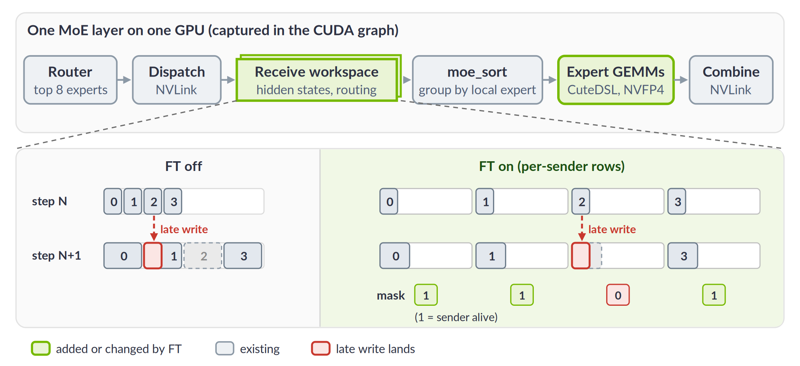

*Figure G1. The Oct 20 design (per-sender rows; compare Figure 4 for the final design), as intended with one row
width. With R1's two row widths the per-sender rows move too, so a late write can leave its sender's rows (below).*

*Names: receive buffer = the all-to-all workspace (NVLinkOneSided's `MnnvlMemory`); per-sender rows = the Oct 20 build's
layout, not in v5-final.*

| | Per-sender rows (Oct 20) | Same-address remap (final) |
|---|---|---|
| How a late write is contained | Each sender owns fixed rows in every receiver's buffer; a dead sender only hits its own rows | Survivors swap in fresh physical memory at the same addresses; the dead rank can only reach the old pages |
| Safe for R1 as deployed | No: rows move between the NVFP4 (~4 KB/token) and MTP (~14 KB/token) calls, so a late write can hit a live sender (mvp/DECISIONS.md, 10-21 19:05) | Yes: does not depend on the layout |
| Healthy cost, no EPLB, 32/GPU | +0.22 ms/step over FT off (v5-land, the old design's build, CLAIMS 171) | +0.12 ms/step (+0.87%, trimmed, pooled n=8, v5-final, CLAIMS 206); other modes in Healthy cost |
| Cost at recovery | None extra | 7.5 GB per GPU remapped in 0.41-0.97 s (Late Writes) |
| Online rank kill -> first step | 0.92-1.31 s (Oct 20 build, CLAIMS 121) | 0.76-1.00 s (v5-final, CLAIMS 193, 203, 227, 235) |
| Kernel changes | Bound per-sender receive path | Main's packed path plus the live-rank mask and abort flag |
| Fixing the old design for R1 | One row width for all layers (kernel and reader changes) or one workspace per width (+7.5 GB per GPU) | Not needed |
| Tests | 3 late-write unit cases (CLAIMS 118) | 2- and 4-GPU late-writer tests (pass on v5-final, 3 runs, CLAIMS 221) |

- The final design trades a ~0.4-1 s remap at each recovery for no layout constraint and less healthy-path work.
- End to end it is not slower, because the Oct 20 build also mapped unbacked-slot memory before fencing the failed ranks
  (0.95 s on the no-EPLB row, CLAIMS 119; stopped -> proposed 0.68 s on the online row, CLAIMS 121). `proposed` now
  arrives at 0.24-0.28 s instead of 0.69-0.89 s. Script-observed resume (kill -> the test script seeing rank 0's
  "resumed" log line, polled every 0.5 s): 1.20/1.21 s vs 0.93-1.54 s. Each case is n=1-3, on different builds and
  nodes.
- The proposed -> ready interval, ~all remap on v5-final (0.42-0.68 s over all online rows), was 0.00 s in the
  per-sender design (CLAIMS 121).
- Earlier late-write tests: unit tests passed 3 late-write cases (CLAIMS 118). At DEP32 (older wheel) the late-write
  cases were invalid by construction: fencing ended the victim before survivors resumed, so the write never landed
  after resume; the delay cases passed with exact tokens (CLAIMS 100).

## Appendix H. Figures

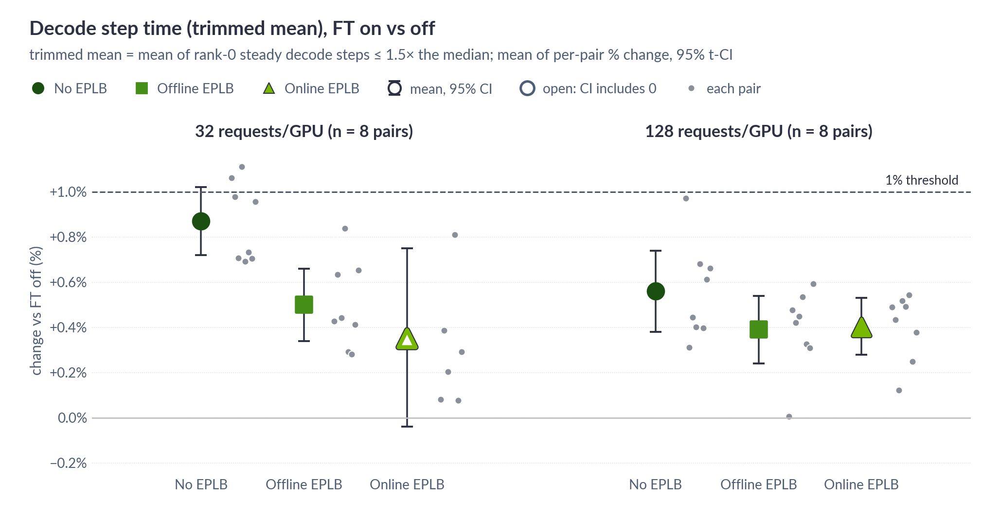

*Figure A1. FT's change in rank 0's decode step time (trimmed mean): mean of per-pair % changes with a 95% t-CI
(n - 1 df), pooled n=8 at both loads; dots = each pair, open marker = CI includes 0. The upper CI reaches 1% for
No EPLB at 32/GPU.*

*Notes: the 1% threshold was pre-registered for the trimmed-and-full-mean rule; this plot shows the trimmed mean only.*

- No EPLB pays the most (+0.87% / +0.56%; ~120-150 µs/step), partly the static load balancer it routes through.
- Offline and online are +0.35-0.50%. Only online at 32/GPU has a CI that includes 0.
- Without EPLB and offline the cost grows less than the step (14 -> 26 ms): 120 -> 150 and 70 -> 103 µs, so their
  percentage falls at 128/GPU. Online grows about as much as the step (51 -> 99 µs; +0.35% -> +0.40%).

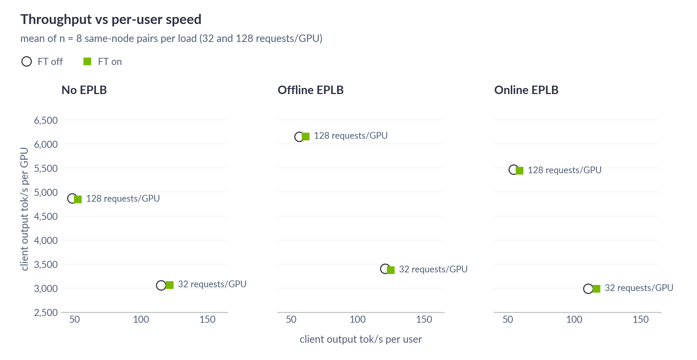

*Figure A2. Client output throughput per GPU vs per user, FT off and FT on (mean of n = 8 same-node pairs at 32 and
128 requests/GPU).*

- FT on and FT off sit on the same curve in every mode; per-user speed at 32/GPU is 117.0 -> 119.2 (no EPLB),
  122.7 -> 122.7 (offline), 112.7 -> 114.4 tok/s (online).
- Going from 32 to 128/GPU raises per-GPU throughput ~1.6-1.8x and cuts per-user speed ~2-2.3x, in both arms.

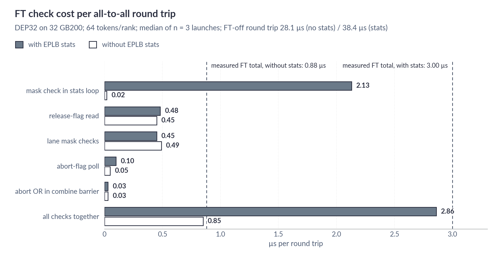

*Figure A3. µs saved per all-to-all round trip by removing each FT check, with and without EPLB statistics, EP32, 64
tokens/rank (ablation job 8293196, CLAIMS 210; diagnostic build). Bars are the median of 3 launches; launch-to-launch
ranges are <= 0.04 µs wide.*

*Names: mask = live-rank mask (`active_rank_mask`); release flag = released-round flag (`flag_val[kReleasedRoundIndex]`,
moeAlltoAllKernels.h); abort flag = `MoeA2AAbortState`; stats = online EPLB's per-expert token counts.*

*Notes: mask check in stats loop = per-peer check in the expert-statistics loop; release-flag read = read of the
released-round flag before the fence; lane mask checks = per-lane live-rank checks; abort-flag poll = abort poll in the
round-flag wait; abort OR = block-wide OR of whether each thread's wait ended on the abort flag. Each check was removed alone, so the savings overlap and
do not add up; "all checks together" removes them together in the ablation build. The measured FT total compares the FT
and no-FT kernels.*

- With EPLB statistics, the per-peer mask check in the statistics loop is 2.13 of the 3.00 µs.
- Without statistics, the release-flag read (0.45 µs) and the lane-parallel checks (0.49 µs) make up most of 0.88 µs.
- Single-check savings overlap slightly (the bars sum to 3.19 / 1.04 µs); removing all checks together saves 2.86 /
  0.85 µs of the 3.00 / 0.88 µs.

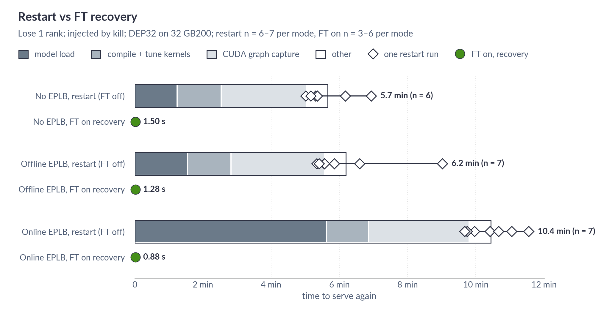

*Figure A4. Time to serve again after a rank kill: a restart without FT (phases) vs FT recovery, per EPLB mode
(pooled warm restarts, CLAIMS 224/228, model load CLAIMS 211). Restart bars are the mean of n=6-7 runs per mode (diamonds:
each run); FT on n=3-8.*

*Names: host-copy build = main's `HostMoeTensorSharer` (moe_load_balancer.py).*

*Notes: restart = FT off (3 FT-off builds; FT-off code = v5-final), kill -> first request answered, excluding the relaunch gap,
page and autotuner caches kept in the same allocation (a lower bound); FT on = kill -> first decode step.
"Other" = exit, process startup and time to first token. Online model load includes main's host-copy build (CLAIMS
211).*

- A restart takes 5.0-11.6 min: model load, kernel compile and tuning (~74-77 s mean, mostly attention-kernel JIT ~51 s;
  3 of 20 restarts spent ~60 s more here rebuilding flashinfer's sampling kernels, CLAIMS 228) and CUDA graph capture
  (~157-184 s mean).
- Online EPLB's model load is ~5-6 min on every launch (main's host-copy build, CLAIMS 211); the offline mean includes one
  277 s page-cache outlier, the no-EPLB mean one 165 s load (cause not checked).
- FT recovers in 0.88-1.50 s (means per mode) by keeping the weights, tactics and CUDA graphs it already has.

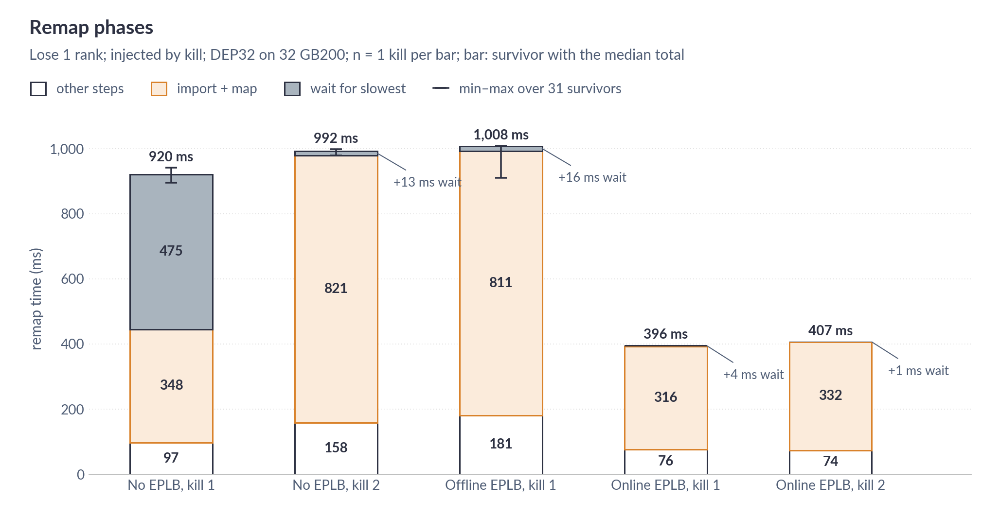

*Figure A5. Where the all-to-all remap's time goes in each of the 5 kills of the REMAP-TIMER diagnostic job (8308514,
CLAIMS 214): bar = the survivor with the median total of 31; whisker = min-max total over the 31 survivors. "Other
steps" = release, barrier, make room, create/export/gather and rest.*

*Names: remap = `_remap_workspaces` (peer_loss_recovery.py) -> `MnnvlMemory.release_backing` / `remap`
(mnnvl_memory.py); import + map = `cuMemImport`, map and set access of the other survivors' fresh memory.*

*Notes: the online-EPLB whiskers are too narrow to draw: kill 1 396.2-397.0 ms, kill 2 399.1-407.3 ms. The two no-EPLB
kills differ in shape: in kill 2 (and the offline kill) most survivors, the median one included, stall in one import;
in kill 1 only the victim's node-mates stall and the rest wait for them. Why the two kills differ is not known.*

- Import + map of the other survivors' fresh memory is most of the remap for the median survivor in 4 of 5 kills:
  316-332 ms online, 811-821 ms with static routing.
- In no-EPLB kill 1 the median survivor maps in 348 ms, then waits 475 ms for the slow ones, the victim's node-mates
  (slowest survivor's import + map: 822-833 ms with static routing, 319-332 ms online).
- Release, barrier, freeing cached memory and the handle exchange are small and similar across modes.

## Appendix I. Results from earlier builds (historical)

Not v5-final data. Each item names its build; the main text uses v5-final except a few labelled results with no
v5-final equivalent (Builds). Builds: pre-fix `58caa0fde6` (before
both host-copy fixes), fix-1 `d71f169e4b` (fix 1 only), v5-zero and older freezes (Evaluation & Benchmarks, Builds).

**I.1 No-EPLB remap speed across builds** (7 builds: v5-zero, freezes 5330b899f0, 7e8dfb37df, 1117f7e0e7, pre-fix,
fix-1, v5-final; critical path; review/diag/why_remap_noeplb.md, no CLAIMS row).

- Pooled over all 7 builds, no-EPLB rank-type kills took either 384-532 ms (15 runs) or 808-1007 ms (33 runs), nothing
  between in those 48 runs. All 15 fast runs are on the pre-fix build or older.
- Before the host-copy overlays (v5-zero through pre-fix) it was a per-run coin flip within one job: 15 fast / 21 slow
  (e.g. pre-fix 8211797: 385 and 872 ms). Since the overlays it was slow in every run (fix-1 8244019: 0 fast of 5;
  v5-final: 0 of 7).
- Online EPLB was never slow over the same builds: 41/41 rank-type kills (376-646 ms), 10/10 node kills.
- Against that cross-build split, THIN-CELLS' (v5-final) offline node kills (600 / 626 ms) and online two-loss 712 ms
  fall between the two speeds.

**I.2 Offline EPLB at 32/GPU across builds** (pre-fix finals, fix-1, v5-final; offline32_analysis.md,
farstall_repl_offline.txt; post hoc; the pre-fix and fix-1 FT-on arms predate the host-copy fixes).

- FT on in the v5-final original runs ran at the speed of earlier builds' FT on (3349 vs 3364 fix-1 and 3322 pre-fix
  tok/s/GPU, cell means); that batch's FT-off arms were fast (3419 vs 3369 fix-1 and 3355 pre-fix).
- Over 12 pairs across three builds (4 each) the cell averages about -1.0%, splitting into ~0.45% steady per-step cost
  and ~0.6% from far stalls; FT had more far stalls in 9 of 12 pairs.
- Over 16 pairs (those 12 plus the v5-final replication), FT had more rank-0 far stalls in 12, fewer in 3, tied in 1
  (two-sided sign p = 0.035); p = 0.17 with the 4 STALL-ATTR 8282497 pairs added (CLAIMS 207).
- The excess is carried by the pre-fix and fix-1 FT-on arms (pre-fix FT / off: 37/2, 29/7, 28/0, 11/0; fix-1: 29/9,
  7/16, 17/0, 7/0), i.e. the stalls the host-copy fixes target. v5-final alone is in Costs.
- Host memory does not explain the build-to-build spread (every FT-on arm holds ~390 GB of /dev/shm per node). Its
  share of the FT gap is untested.

**I.3 FT on vs main** (pre-fix build, n=4 pairs per cell, online and no EPLB; CLAIMS 180 jobs,
review/figures/finals/fig4_main_parity.csv).

- Trimmed step: +0.34% to +0.75% (cell means); single pairs up to +1.24% (online 32/GPU).
- Client output tok/s: single pairs -5.3% to +1.8%. The -5.3% pair is online 32/GPU. On that build the online-32 cell's
  FT-on vs FT-off client change was -3.50% [-8.49, +1.50] (n=4, CLAIMS 180); -5.3% lies inside that range. That build
  predates the host-copy compaction fixes (Appendix E); whether this pair had a stall burst was not checked. On
  v5-final the same cell is +0.05% [-0.81, +0.91] (pooled n=8, Healthy cost), and single pairs at 32/GPU range -3.8%
  to +2.8%, so a -5.3% pair would fall outside both.

**I.4 Recovery times on the pre-fix build** (CLAIMS 176-178; its times may not carry over to v5-final).

- Every row ran twice: script-observed resume 1.0-2.2 s for rank kills, 1.7-3.2 s for node kills.
- Its no-EPLB node kill read 3.2 s vs 2.7 s on fix-1 and v5-final (CLAIMS 185, 193). A v5-final repeat read 3.22 s by
  the script but 2.81 s by server timestamps.
- By server timestamps the pre-fix node kill took 2.94 / 2.95 s (job 8211797) vs 2.42-2.81 s on v5-final: ~0.3 s of the
  gap is the script's 0.5 s polling, ~0.1-0.5 s is server-side; cause not isolated (open: a phase-by-phase diff).

**I.5 Pre-fix build pass tally** (source: review/old_doc_versions/DESIGN_DOC_v5final_filled.md:219, not a CLAIMS row;
the per-row results are in CLAIMS 176-178, which report every planned kill row n=2 PASS; invalid runs excluded,
CLAIMS 177): rank kill 9/9, in prefill 5/5, in an EPLB update 2/2, node kill 4/4, two losses 4/4, frozen rank 4/4,
rank 0 ends the job 4/4, deadline ends the job 4/4, GSM8K with a kill 2/2.

**I.6 GSM8K on earlier builds** (same method as Accuracy; v5-final row repeated for reference).

| Build | FT on, kill | FT off, no kill | Delta (+-2 SE) |
|---|---|---|---|
| v5-final | 0.9477 | 0.9469 | +0.001 (+-0.017) |
| Pre-fix, run 1 | 0.9469 | 0.9416 | +0.005 (+-0.018) |
| Pre-fix, run 2 | 0.9431 | 0.9409 | +0.002 (+-0.018) |
| Fix-1 build | 0.9401 | 0.9484 | -0.008 (+-0.018) |

- Every delta is within 2 SE. Post hoc: over the 4 runs (3 builds) the mean delta is +0.000; treating them as
  independent, 2 SE is ~0.009.

**I.7 Static load balancer's share of the no-EPLB cost** (pre-fix and v5-zero; not measured on v5-final).

- LB-floor control arm (job 8208527; its FT arm is on the pre-fix build): the static load balancer alone, no FT,
  +29/+48 µs at 32/GPU and +99/+102 µs at 128/GPU, so FT (pre-fix build) over the LB is ~+54-82 µs at 32/GPU
  (diagnostic; trim_readout over STD(-G1)-8208527, steady_cost_analysis.md section 1; CLAIMS 180's pooled LB floor
  reads +0.37% / +0.49%, ~51 / ~131 µs).
- v5-zero measured FT over the LB at only ~+5 µs (CLAIMS 173). The two do not agree.

**I.8 Frozen-rank fence time across builds** (CLAIMS 176, 178, 185, 193, 213, 227).

- 29.5-34.1 s over 15 runs on three builds (pre-fix, fix-1, v5-final); v5-final alone is 29.5-34.1 s (n=3 per mode,
  Recovery Flow).

## References

1. Dynamo production fault-tolerance study, arXiv 2609.25451.
2. TENT (Mooncake team), LLM-serving fault data, arXiv 2604.00368, Table 1.
